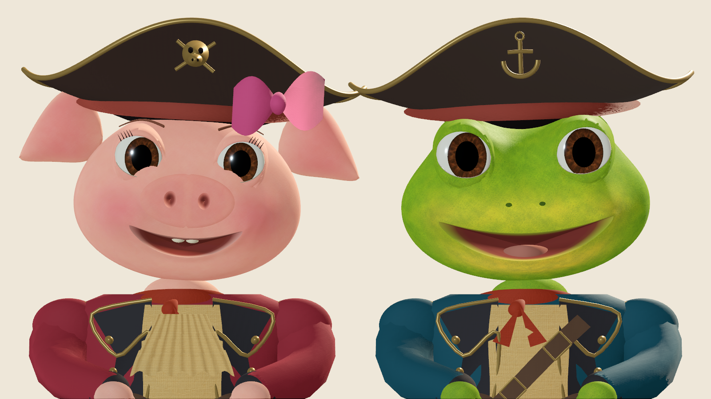

# Świnka i Żabol — oczy, skóra i mimika v5

Aktywne od 2026-11-17: sześć siatek `assets/characters/academy_v5/`. [Natywne obrazy, porównanie z oryginałami Akademii Oli, tekstury i pomiary](academy-v5/README.md). Zachowany [opis v4](CHARACTERS_BEFORE_ORGANIC_V5.md).



## Geometria i materiały

`tools/organic_face_geometry.gd` rozszerza własną topologię v4: dwie osobne anatomie, ciągłe powierzchnie czaszki i zamknięte wnętrze ust. Świnka ma pełniejsze policzki i ciepły rumieniec. Obie postacie mają zagłębienia przy kącikach ust oraz spokojniejszy uśmiech. Stroje, kapelusze, kokarda i dopasowanie do kierownicy zachowują konstrukcję własnych narzędzi v4/v3.

Oko składa się z pierścienia białka, zagłębionej wklęsłej tęczówki, osobnej źrenicy i przezroczystej rogówki. Wewnętrzny brzeg białka podąża za spojrzeniem, aby przy ruchu nie powstawała szczelina; zewnętrzny zostaje pod powieką. Rogówka odbija światła sceny, bez białych kul udających odblaski i bez symulacji refrakcji. Oba oczy współdzielą jedną dodatkową powierzchnię. Powieki są cieńsze i mniej wypukłe; dolną krawędź oka zaznacza cienka wilgotna linia.

Trzy nowe materiały PNG: brązowa tęczówka, skóra Żabola i skóra Świnki. Wbudowany image_gen, wyłącznie opisy tekstowe, natywne 1254×1254 px, pliki skopiowane bez edycji. [Dokładne prompty i ścieżki](academy-v5/TEXTURE_PROMPTS.json). Skóra ma trójpłaszczyznowe mapowanie, drobny bump, zróżnicowaną szorstkość, słabszy połysk i delikatne światło od tyłu. To przybliżenie transmisji, nie pełne rozpraszanie podpowierzchniowe.

| Profil | Żabol: wierzchołki | Świnka: wierzchołki | Powierzchnie |
|---|---:|---:|---:|
| High | 46 716 | 58 884 | 3 |
| Balanced | 27 730 | 35 104 | 3 |
| Performance | 16 586 | 20 850 | 3 |

`tools/organic_character_builder.gd` zapisuje warianty oraz indeksowe LOD offline. Gra ładuje gotowe zasoby. Dwie powierzchnie nieprzezroczyste zachowują scalone palety; trzecia to wspólna rogówka. Poprzednie siatki pozostają zachowane.

## Mimika i szkielet na GPU

Compute wyznacza pozy sześciu kości i parametry mimiki w istniejącym atlasie 32×8 RGBA32F. `shaders/driver_deformation.gdshaderinc` zawiera wspólną deformację powiek, oczu i skóry, używaną przez materiały nieprzezroczyste oraz rogówkę. Shader wierzchołków wykonuje skórkowanie. Głowa, oczy i żuchwa zachowują sztywny wpływ głowy; szyja i chusta mają wagi mieszane.

`shaders/academy_face.gdshaderinc` interpoluje zapisane cele zamknięcia powiek i ich normalnych. Cele Y/Z pozostają w UV.y i UV2.y, a XY normalnej w UV.x i alfa koloru; shader odtwarza Z. Rzęsy i dolna wilgotna linia poruszają się razem z powieką. Radość porusza żuchwą i kącikami ust oraz lekko podnosi dolną powiekę. Zęby pozostają przy górnej szczęce. Spojrzenie przesuwa tęczówki pod rogówką. Brwi, uszy i przechył głowy zachowują drobną animację.

Parametry mimiki zajmują dwa texele na aktora w wierszu 6 istniejącego atlasu. Wszystkie kamery korzystają z tego samego wyniku. Pakiet CPU pozostaje 96 B sterowania oraz 16 B parametrów kroku; CPU nie aktualizuje co klatkę powiek ani póz twarzy. Produkcyjna pauza zatrzymuje zegar aktora. Nie ma aktywnego produkcyjnego Skeleton3D ani odczytu atlasu przez CPU. `ir_face_state` służy do stałych stanów w narzędziach i testach. Nie jest to pełny rig mowy ani system wszystkich emocji.

Mieszkańcy zachowują poprzednie modele, animacje GPU i pochodzenie opisane w [raporcie v3](portraits-v3/README.md).

## Kontrola i odtworzenie

`tools/review_organic_faces.gd` zapisuje siedemnaście ujęć rzeźby i mimiki. `tools/review_character_game.gd` zapisuje pięć ujęć rzeczywistej gry. Osobny test sprawdza zamknięcie białek i źrenic, ruch uśmiechu, spojrzenie i widoczny wkład rogówki w każdym profilu. Obrazy są kopiowane bez retuszu.

Test materiałów pilnuje rozdzielenia rogówki, zachowania trzech tekstur i braku geometrycznych białych odblasków. GPU motion weryfikuje compute i zapisuje rzeczywiste pozy z hashem shadera. GPU skin porównuje je z pomocniczym szkieletem CPU przy wyłączonej dodatkowej mimice. GPU life sprawdza mruganie oraz produkcyjną pauzę i wznowienie. Testy zwalniają pomocnicze viewporty i konsumentów atlasu przed zamknięciem renderera. [Końcowe wyniki, pomiary oraz SHA-256](academy-v5/README.md).

```powershell
godot --headless --editor --single-threaded-scene --path . --import --quit
godot --headless --path . --script tools/organic_character_builder.gd
godot --headless --path . --script tests/test_art.gd
godot --headless --path . --script tests/test_portrait_assets.gd
godot --headless --path . --script tests/test_organic_assets.gd
godot --headless --path . --script tests/test_session.gd
godot --path . --script tools/review_organic_faces.gd
godot --path . --script tools/review_character_game.gd
godot --path . --script tests/test_academy_faces.gd
godot --path . --script tests/test_gpu_motion.gd
godot --path . --script tests/test_gpu_skin.gd
godot --path . --script tests/test_gpu_life.gd
godot --path . --script tools/benchmark_art.gd -- --high --circuit
godot --path . --script tools/benchmark_art.gd
godot --path . --script tools/benchmark_art.gd -- --four --performance
python tools/archive_organic_review.py
```

Projekty postaci zachowują pochodzenie z Akademii Oli. Siatki powstają lokalnie, bez wysyłania portretów do usług 3D i bez zewnętrznych modeli. Podobieństwo oraz jakość artystyczna pozostają do oceny użytkownika; testy nie potwierdzają zgodności z ilustracją.
