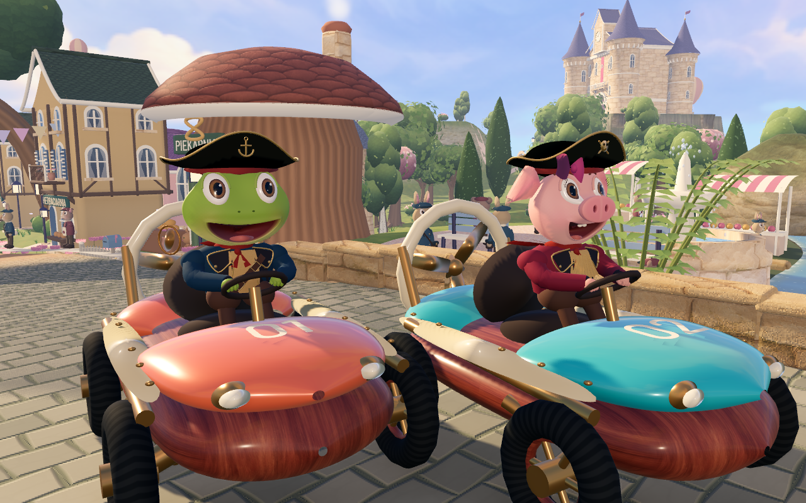
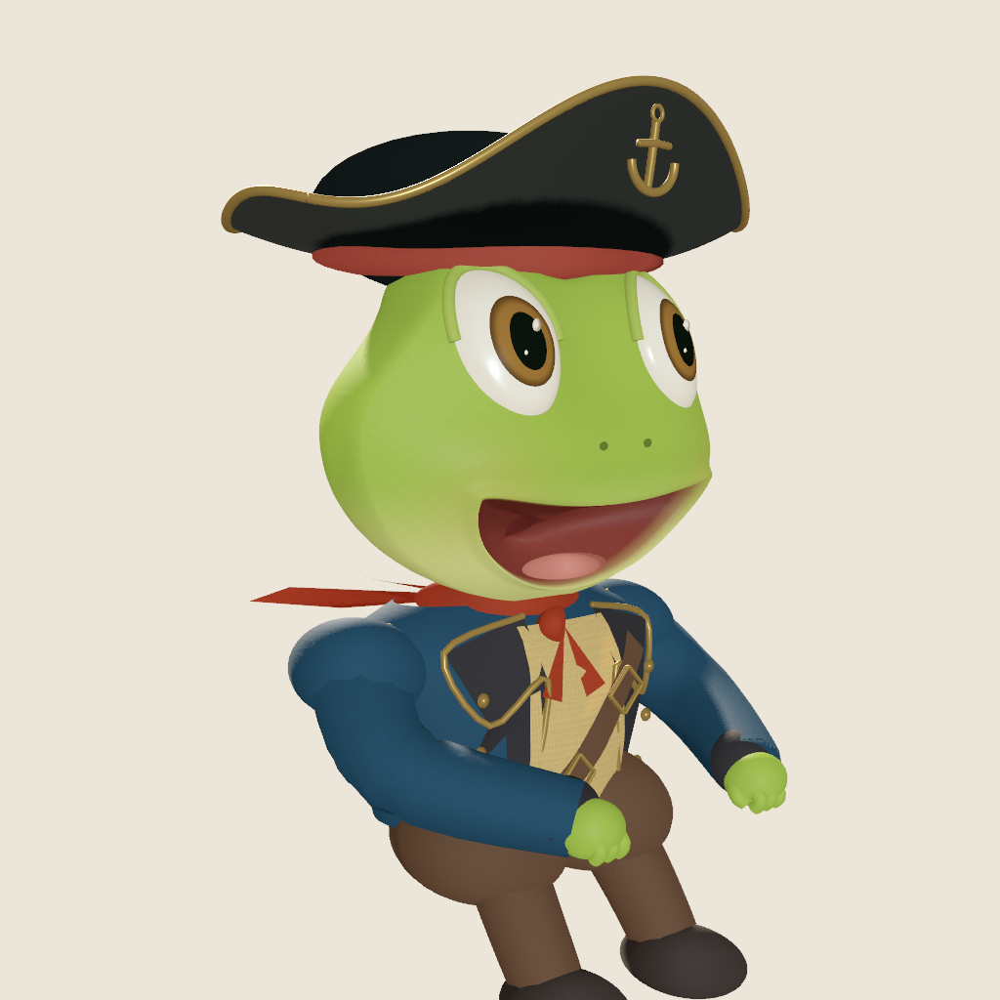
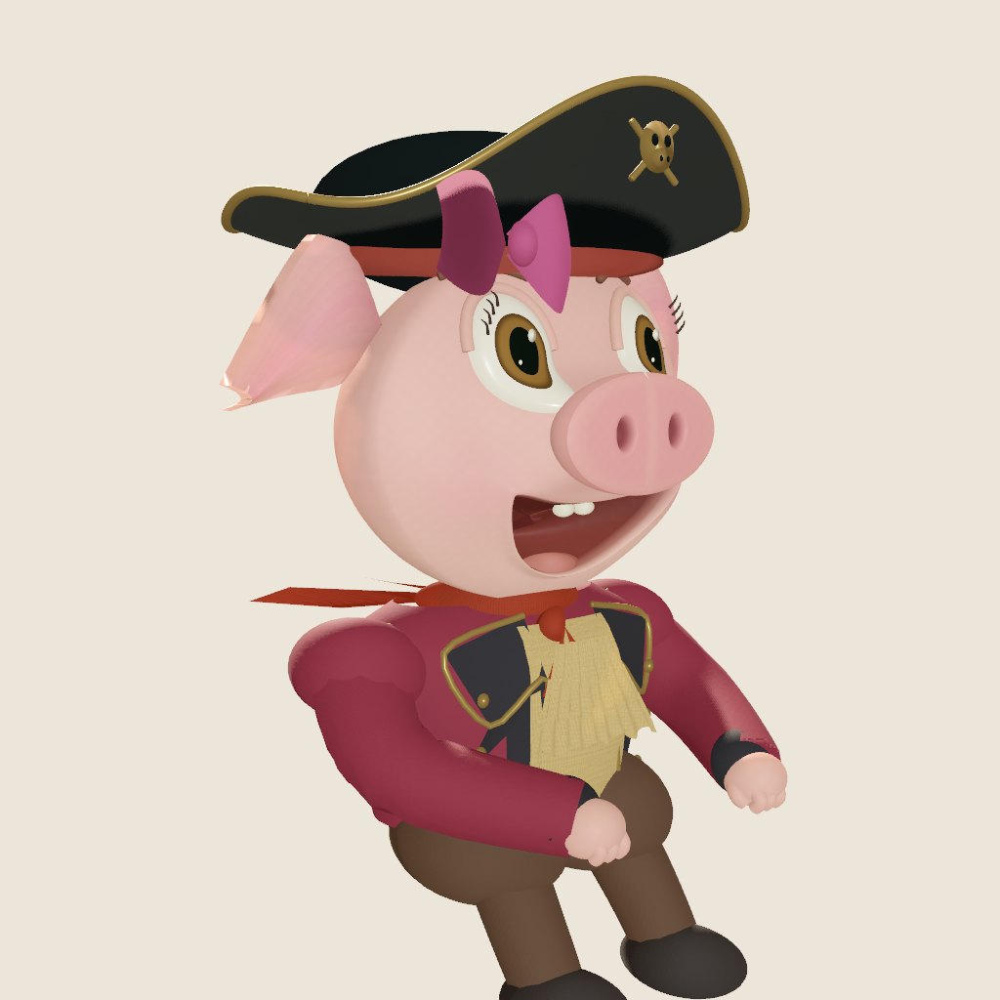

# Kierowcy i mieszkańcy — nowe portrety 3D

2026-11-17: gra ładuje sześć nowych siatek `assets/characters/portrait_v3/`. Żabol i Świnka mają przebudowane twarze i stroje; królik i mysz nowe modele mieszkańców. [Natywne obrazy, testy i pomiary](portraits-v3/README.md). [Poprzedni opis](CHARACTERS_BEFORE_PORTRAITS.md) dokumentuje zastąpione siatki `storybook_v2`.



## Głowy i stroje

`tools/portrait_geometry.gd` buduje jawną topologię: pierścienie wokół uśmiechu przechodzą w policzki i zewnętrzny obrys głowy, a osobne pierścienie zamykają wnętrze ust i tył czaszki. Kształt jest ciągłą powierzchnią z analitycznymi wyniosłościami oczodołów, policzków i żuchwy. Nie wykorzystuje wycinania CSG ani marching tetrahedra. Usuwa to poszarpane krawędzie ust poprzedniego modelu.

Białka, brązowe tęczówki i źrenice dopasowują głębokość do powierzchni twarzy. Górne powieki zakrywają brzeg oka, a drobne refleksy podkreślają wzrok. Żabol ma szeroki zielony pysk i kremową dolną część żuchwy. Świnka osobny krótki, owalny ryjek: dwie połówki profilowanej powierzchni otaczają rzeczywiste kieszenie nozdrzy. Uszy mają zamkniętą grubość, a kokarda dwa profilowane płaty.

`tools/portrait_character_builder.gd` tworzy też dopasowane korpusy ubrań, rękawy, klapy, lamówki, guziki, mankiety i palce obejmujące kierownicę. Koszula podąża za przekrojem klatki piersiowej. Żabol ma pas z otwartymi złotymi klamrami, Świnka kremowy żabot. Obie postacie mają czarne filcowe kapelusze ze złotą krawędzią; znaki to kotwica i czaszka świnki. Żagiel lekkiego pojazdu przesunięto i zwężono, żeby odsłonić głowę.

Nowe modele powstały lokalnie według [referencji Akademii Oli](character-lookdev-v2/README.md). Wspólne funkcje brył i palety odziedziczono z wcześniejszego narzędzia, ale aktywny builder tworzy nowe głowy i stroje. Nie importowano zewnętrznych modeli i nie wysyłano referencji do usługi 3D. W tym przyroście nie dodano bitmap; faktura tęczówek, skóry, filcu i tkanin jest wyliczana w shaderze. Projekty kierowców zachowują pochodzenie z Akademii Oli. Nie jest to deklaracja identyczności z ilustracjami ani akceptacji wyglądu przez użytkownika.





## Geometria i animacja

| Profil | Żabol: wierzchołki | Świnka: wierzchołki | Powierzchnie |
|---|---:|---:|---:|
| High | 51 282 | 63 537 | 2 |
| Balanced | 30 480 | 38 363 | 2 |
| Performance | 17 328 | 22 392 | 2 |

Każdy wariant ma indeksowe LOD. Rig zachowuje sześć kości: tułów, głowę, dwie ręce i dwie części chusty. Żuchwa, policzki i oczy mają sztywny wpływ kości głowy; mieszane wpływy pozostają przy szyi i chuście. To usuwa odkształcenie dolnej twarzy względem głowy podczas skrętu.

Compute shader oblicza pozy, a shader wierzchołków deformuje modele. Gra nie ma aktywnego Skeleton3D ani odczytu póz do CPU. Mruganie spłaszcza oko i powiekę wokół właściwej wysokości każdego gatunku, korzystając ze wspólnego zatrzymywanego zegara GPU. Materiały oczu mają osobną tęczówkę i połysk, filc jest matowy. Dodatkowe powieki nie odwracają się podczas zamykania oka.

## Mieszkańcy

`tools/portrait_resident_builder.gd` korzysta ze wspólnej topologii twarzy, z osobnymi proporcjami królika i myszy. Mają miękkie pyski, nosy, powieki, wąsy i uśmiech. Królik ma długie uszy i torbę listonosza; mysz okrągłe uszy i fartuch. Dodano dopasowane ubrania, palce, mankiety i szwy butów. Sześć ważonych grup zachowuje wcześniejszy chód i role animowane przez GPU. Nowe oczy także mrugają w shaderze.

| Model | Trójkąty | Powierzchnie | Indeksowe LOD |
|---|---:|---:|---:|
| Królik | 16 208 | 1 | 7 |
| Mysz | 16 100 | 1 | 7 |

Gęstość twarzy i krzywych mieszkańców jest niższa niż u kierowców, odpowiednio do ich mniejszego rozmiaru w kamerze jazdy. Końcowy przyrost zmniejszył ich geometrię o około 30% względem pierwszych portretów v3, zachowując usta, oczy i akcesoria.

Koty, kaczki i mewy zachowują dotychczasowe modele. Rozmieszczenie 56 mieszkańców i zwierząt oraz liczba widocznych instancji w profilach jakości pozostają bez zmian. Pełna odbudowa 57 zasobów otoczenia używa teraz także nowego buildera mieszkańców.

## Kontrola i odtworzenie

`tools/review_portraits.gd` zapisuje przód, trzy czwarte, profil i twarz dwóch kierowców oraz dwie kamery królika i myszy. `tools/review_character_game.gd` pokazuje rzeczywiste kokpity, widoczność podczas jazdy i mieszkańców przy herbaciarni. Są to natywne obrazy 3D, zachowane bez retuszu.

`tests/test_portrait_assets.gd` sprawdza części twarzy, wagi żuchwy, kieszenie nozdrzy, budżety profili i przestrzeń za żaglem. GPU skin porównuje sześć renderów ze ścieżką referencyjną CPU przy wyłączonym dodatkowym mruganiu. GPU life oddzielnie sprawdza widoczny ruch, mruganie, pauzę i wznowienie. [Wyniki i SHA-256](portraits-v3/README.md).

```powershell
godot --headless --editor --single-threaded-scene --path . --import --quit
godot --headless --path . --script tools/portrait_character_builder.gd
godot --headless --path . --script tools/build_portrait_residents.gd
godot --headless --path . --script tests/test_portrait_assets.gd
godot --path . --script tools/review_portraits.gd
godot --path . --script tools/review_character_game.gd
godot --path . --script tests/test_gpu_skin.gd
godot --path . --script tests/test_gpu_life.gd
```

Gra ładuje gotowe zasoby; nie modeluje ich od nowa przy uruchomieniu. Nie dodano animacji mowy ani sekwencji zwycięstwa. Mimika nadal obejmuje stały uśmiech i mruganie; podobieństwo oraz jakość artystyczna pozostają do oceny użytkownika.
