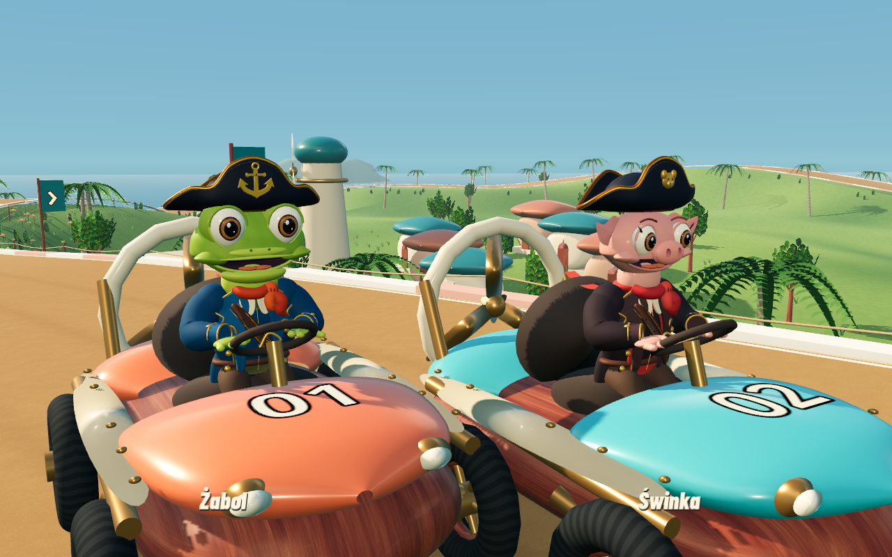

# Kierowcy Akademii Oli

**Status wizualny: odrzucone przez użytkownika, 2026-11-16.** Opisane poniżej siatki są działającym prototypem technicznym, ale nie zachowują wystarczającego podobieństwa do postaci Akademii. Testy geometrii i sesji nie są akceptacją wyglądu. Kolejna wersja ma bazować na głównych portretach Akademii, z osobnymi modelami Świnki i Żabola. Materiały do przebudowy: [character-lookdev-v2/README.md](character-lookdev-v2/README.md). W tej korekcie nie zastąpiono jeszcze modeli w grze.

Na prośbę użytkownika wcześniejszego pilota zastąpiono Żabolem i Świnką. W menu `CHARACTER` wybiera się kierowcę niezależnie od rodzaju pojazdu. W lokalnym wyścigu wybrana postać jest wspólna dla graczy; AI i demonstracja korzystają z obu postaci. Wybór nie zmienia parametrów jazdy.

## Pochodzenie

Źródłem jest lokalny projekt `AkademiaOli/public/games/chess`. Jego `THIRD_PARTY.md` opisuje Żabola jako własną, pełną geometrię 3D wykonaną według istniejącej ilustracji Akademii, z zachowaniem własności jej postaci i artworku.

- `assets/characters/zabol-seated-v1.glb`: kopia źródłowego modelu z `assets/pirate/models/`, bez zmian.
- `docs/character-sources/zabol-{model,hat,outfit}.js`: zachowane źródła geometrii tego modelu, bez zmian. Narzędzia źródłowe korzystają z Three.js; gra ładuje gotową geometrię przez Godot.
- `docs/character-references/{zabol,swinka}-seated-v1.png`: istniejące ilustracje tożsamości, zachowane bez zmian. Pozostają materiałem referencyjnym, a modele w grze są rzeczywistymi bryłami 3D.
- `docs/character-sources/CHARACTER_ART_PROMPTS.md` i `AKADEMIA_OLI_NOTICES.md`: zachowane opisy pochodzenia ilustracji i modelu.

Żabol jest adaptacją istniejącego modelu. Świnka wykorzystuje jego bazową geometrię korpusu, kapelusza i głowy; ma osobno zbudowane, wklęsłe uszy, ryjek z otworami i wnętrzem nozdrzy, brwi, rzęsy i emblemat kapelusza. Zmieniono proporcje oczu i twarzy oraz kolory skóry i stroju według referencji Świnki. Modele mają spokojniejszy wyraz twarzy dostosowany do jazdy. Pochodzenie nie jest przedstawiane jako całkowicie nowy projekt postaci ani formalny proces clean room.

## Adaptacja do gry

Builder usuwa krzesło z modelu źródłowego, zmienia skalę i kierunek, grupuje geometrię w siedem powierzchni materiałowych i nadaje wagi sześciu kościom. Skórkowane modele współdzielą dane siatki między pojazdami. Głowa, ręce przy kierownicy i chusta poruszają się; pozy sześciu kości i deformację oblicza GPU. Compute shader zapisuje macierze do współdzielonej tekstury 32×8 RGBA32F. Materiał postaci odczytuje te macierze oraz oryginalne indeksy i wagi. W grze nie ma aktywnego Skeleton3D ani pętli ustawiającej pozy na CPU. Gotowe `.res` zawierają indeksowe poziomy LOD wygenerowane przez Godot. Dodatkowo Balanced i Performance mają fizycznie mniejsze bufory wierzchołków, aby zmniejszyć również koszt skinningu. High zachowuje pełną geometrię przygotowanej adaptacji. Zmiana postaci i powrót z demonstracji zachowują wybór użytkownika.

| Profil | Żabol — wierzchołki | Świnka — wierzchołki |
|---|---:|---:|
| High | 149 810 | 169 213 |
| Balanced | 33 484 | 30 998 |
| Performance | 12 531 | 12 854 |

Oryginalne warianty zachowano bez zmian, z siedmioma powierzchniami i tym samym rigiem. Gra ładuje teraz ich kopie z `assets/characters/render_optimized/`, połączone w dwie powierzchnie: nieprzezroczystą i dwustronną. `tools/build_render_drivers.gd` sprawdza każdy wierzchołek, liczbę trójkątów oraz sumy wpływów poszczególnych kości. Maksymalna zmiana pozycji wynosi zero; liczby wierzchołków w tabeli pozostają aktualne. Manifest kopii zawiera hashe źródeł i wyniki kontroli. To optymalizacja renderowania odrzuconych prototypów, a nie poprawa lub akceptacja podobieństwa.

Liczba LOD w manifeście jest sumą poziomów poszczególnych powierzchni, a nie liczbą odrębnych profili jakości. Próby rendererów zapisują użyte bufory polami `driver_detail` i `driver_vertices`.

Podgląd menu ma ciepłe światło wypełniające ułatwiające obejrzenie twarzy pod kapeluszami. Światło jest wyłączane przy rozpoczęciu wyścigu. Poniższy wspólny podgląd używa tego samego świata i oświetlenia menu; ustawia dwa pojazdy obok siebie na potrzeby kontroli modeli.



## Odbudowa i kontrola

Gotowe siatki są w repozytorium; zwykłe uruchomienie gry nie wymaga odbudowy. Do regeneracji z użyciem oficjalnego edytora Godot 4.7.2:

```powershell
godot --headless --editor --single-threaded-scene --path . --import --quit
godot --headless --path . --script res://tools/build_academy_drivers.gd
godot --headless --path . --script res://tests/test_art.gd
godot --headless --path . --fixed-fps 60 --script res://tests/test_session.gd
godot --path . --script res://tools/review_characters.gd
godot --path . --script res://tools/review_menu.gd
godot --path . --script res://tests/test_gpu_motion.gd
godot --path . --script res://tests/test_gpu_skin.gd
```

`test_art.gd` sprawdza wszystkie sześć siatek: wiązania kości, sumy wag z tolerancją kwantyzacji UNORM16, skończone pozycje i jednostkowe normalne, mieszane wagi, brak aktywnego szkieletu CPU i odrębność zasobów. Natywny test test_gpu_motion.gd porównuje macierze GPU z zachowaną pozą referencyjną i kontroluje pauzę. Test test_gpu_skin.gd porównuje rzeczywiste obrazy obu ścieżek dla wszystkich sześciu siatek, również po transformacji do kokpitu. Test sesji przeszedł 40 sprawdzeń, w tym niezależność postaci od pojazdu, obecność obu postaci w demonstracji i powrót do wybranego kierowcy w menu. Pełny wyścig sześciu AI po trzy legalne okrążenia także przeszedł. Nie ma jeszcze pełnego zestawu mimiki, animacji ust ani sekwencji zwycięstwa.
