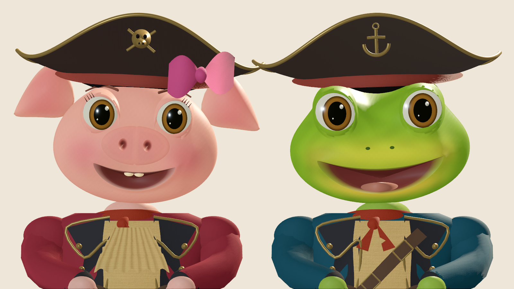

# Świnka i Żabol — rzeźba i mimika v4

Aktywne od 2026-11-17: sześć siatek `assets/characters/academy_v4/`. [Porównanie z oryginałami Akademii Oli, natywne obrazy i pomiary](academy-v4/README.md). Zachowany [opis poprzedniej wersji v3](CHARACTERS_BEFORE_ACADEMY_V4.md).



## Kształt i proporcje

`tools/academy_face_geometry.gd` tworzy dwie osobne anatomie według zachowanych oryginalnych portretów. Świnka ma krótszą głowę, pełniejsze policzki, bardziej wypukłe czoło, mniejszy ryjek, zagłębione nozdrza i łagodniejszy uśmiech. Żabol ma zwartą głowę z miękkimi wyniosłościami oczu, pełniejszą żuchwą oraz żółtą dolną częścią pyska. Białka są niższe w pionie, a brązowe tęczówki i źrenice większe względem białka. Powieki są ciągłymi miękkimi powierzchniami.

Przód i tył czaszki spotykają się na tym samym obrysie. Polarnej odległości nie wyznacza kąt parametrycznej elipsy: narzędzie buduje tablicę promienia obrysu dla rzeczywistych kierunków. Zapobiega to otwartym szwom. Normalne wynikają z pochodnych powierzchni, a usta mają zamknięte dno. Modele nie powstają przez wycinanie CSG ani marching tetrahedra.

`tools/academy_character_builder.gd` zachowuje konstrukcję dopasowanego stroju z v3, poszerza ramiona względem głowy i utrzymuje dłonie przy kierownicy. Świnka ma nowe miękkie uszy o zakrzywionym przekroju, kokardę po lewej stronie postaci i głębszą czerwień stroju. Żabol ma niebieskozielony płaszcz, pas z klamrami i czerwony halsztuk. Czarne kapelusze zachowują złote brzegi i znaki z portretów.

| Profil | Żabol: wierzchołki | Świnka: wierzchołki | Powierzchnie |
|---|---:|---:|---:|
| High | 45 758 | 57 680 | 2 |
| Balanced | 26 980 | 34 152 | 2 |
| Performance | 15 684 | 19 790 | 2 |

Każdy wariant ma indeksowe LOD. Poprzednie siatki v3 i starsze źródła pozostają zachowane; gra ładuje wyłącznie nowe warianty kierowców.

## Ruch twarzy

Sześć kości kierowcy zachowuje wcześniejszy rig. Compute shader tworzy pozy w atlasie, a shader wierzchołków wykonuje skórkowanie. Głowa, oczy i żuchwa mają sztywny wpływ głowy; szyja i chusta zachowują mieszane wagi. Nie ma aktywnego Skeleton3D ani odczytu póz GPU w grze.

`shaders/academy_face.gdshaderinc` dodaje interpolowane cele zamknięcia powiek, ruch tęczówek i źrenic oraz łagodną zmianę kącików ust i żuchwy. Rzęsy Świnki podążają za powieką. Brwi i uszy mają niewielki ruch, a głowa asymetryczny przechył i ruch w bezczynności. Parametry mimiki oblicza compute shader raz na kierowcę i zapisuje w dwóch wolnych texelach wiersza 6 istniejącego atlasu 32×8. Wszystkie kamery odczytują ten sam wynik. Zegar aktora zatrzymuje produkcyjna pauza; podglądy bez przypisanego aktora używają globalnego zegara GPU. CPU nie aktualizuje mimiki co klatkę.

Cele powiek mają stałe X. Zmiany Y i Z mieszczą się w UV.y oraz UV2.y. UV.x i alfa koloru przechowują XY normalnej zamknięcia; shader odtwarza jej ujemną składową Z i interpoluje z normalną otwarcia. Te rodziny materiałów mają własną szorstkość i nie interpretują UV2.y jako szorstkości. Alfa koloru nie steruje ich przezroczystością. Nie dodano nowych buforów ani dodatkowych powierzchni renderowania.

Materiały mają cieplejsze białka, brązowe tęczówki, delikatne zróżnicowanie pigmentu i łagodniejszy połysk skóry. Nie dodano bitmap. `ir_face_state` służy do stałych ujęć i testów: natywna gra korzysta z automatycznej mimiki. Nie jest to pełny rig mowy ani system wszystkich emocji.

## Mieszkańcy

Królik i mysz zachowują nowe modele v3: ciągłe pyski, powieki, wąsy, stroje i akcesoria. Koty, kaczki i mewy pozostają bez zmian. Źródła i opis mieszkańców są w [raporcie v3](portraits-v3/README.md); obecny przyrost dotyczy Świnki i Żabola.

## Kontrola i odtworzenie

`tools/review_academy_faces.gd` zapisuje siedemnaście natywnych ujęć: cztery widoki rzeźby i cztery stany mimiki każdej postaci oraz wspólny portret obu modeli. `tools/review_character_game.gd` pokazuje rzeczywiste kokpity i widoczność z kamery jazdy. Obrazy zachowano bez retuszu.

`tests/test_academy_faces.gd` sprawdza obie postacie w trzech profilach jakości: zamknięcie białek i źrenic, zmianę uśmiechu i spojrzenia. Test geometrii sprawdza zachowane części twarzy, sztywność żuchwy, nozdrza, budżety siatek i odsłonięcie kierowcy przez żagiel. GPU motion zapisuje zweryfikowane rzeczywiste pozy GPU do pliku testowego z hashem shadera. GPU skin wczytuje je jako RGBA32F i porównuje obrazy z referencyjną pozą CPU przy wyłączonej dodatkowej mimice. Dzięki temu pomocniczy Skeleton3D nie współdzieli cyklu życia z obrazem storage compute. GPU life oddzielnie sprawdza mruganie, pauzę i wznowienie. [Końcowe wyniki i SHA-256](academy-v4/README.md).

```powershell
godot --headless --editor --single-threaded-scene --path . --import --quit
godot --headless --path . --script tools/academy_character_builder.gd
godot --headless --path . --script tests/test_art.gd
godot --headless --path . --script tests/test_portrait_assets.gd
godot --path . --script tools/review_academy_faces.gd
godot --path . --script tools/review_character_game.gd
godot --path . --script tests/test_academy_faces.gd
godot --path . --script tests/test_gpu_motion.gd
godot --path . --script tests/test_gpu_skin.gd
godot --path . --script tests/test_gpu_life.gd
```

Geometria i LOD powstają lokalnie offline; gra ładuje gotowe zasoby. Referencji nie wysyłano do usług 3D i nie pobierano zewnętrznych modeli. Projekty postaci zachowują pochodzenie z Akademii Oli. Nowe siatki są stylizowaną interpretacją portretów; podobieństwo i jakość artystyczna pozostają do oceny użytkownika.
