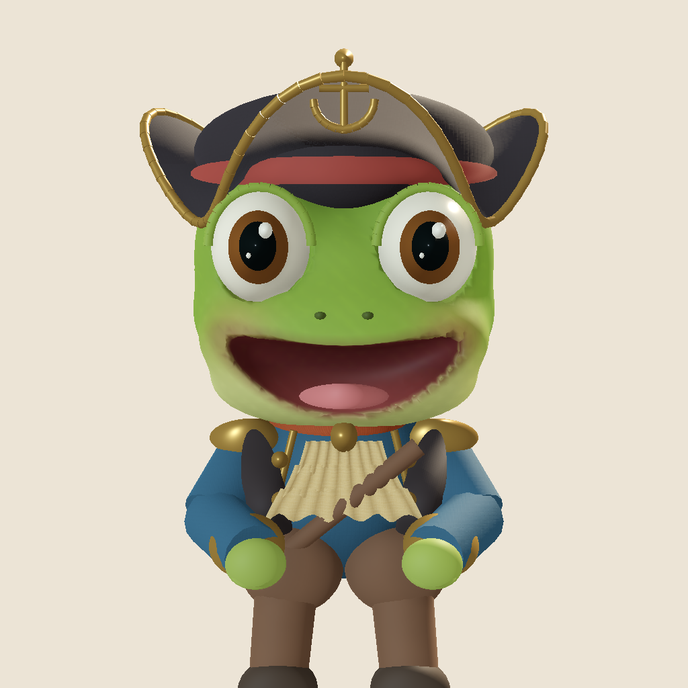
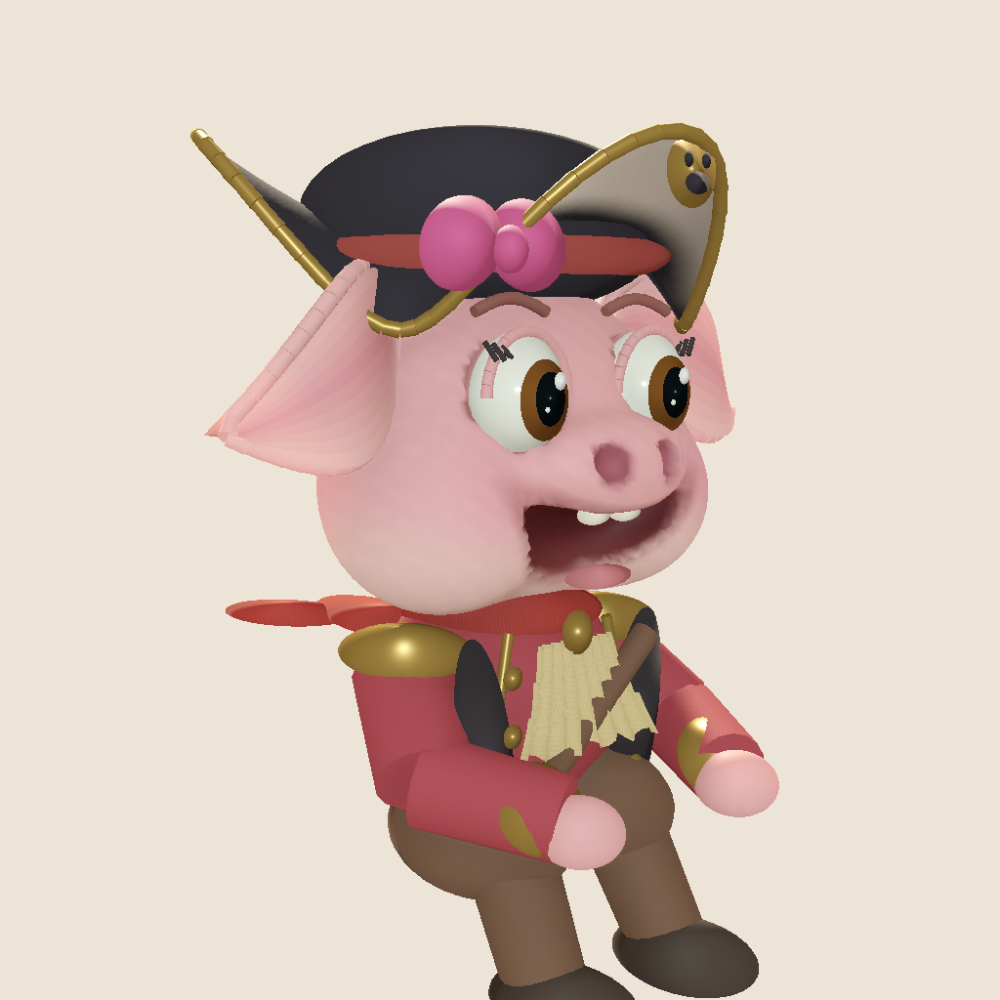

# Kierowcy Akademii Oli — nowe siatki 3D

2026-11-16 wdrożono sześć nowych siatek `assets/characters/storybook_v2/`. Starsze odrzucone modele i ich źródła zachowano; [poprzedni opis](CHARACTERS_BEFORE_LIVING.md) dokumentuje tamten etap. Nowe rendery służą ocenie podobieństwa. Poprawne testy nie oznaczają akceptacji wyglądu przez użytkownika.

## Modelowanie

`tools/storybook_driver_builder.gd` buduje dwie osobne głowy jako ciągłe powierzchnie niejawne. Elipsoidy łączy wygładzone minimum, a wnętrza ust, oczodoły i nozdrza są wycięciami objętości. Marching tetrahedra zapisuje geometrię i normalne do zwykłej siatki. Orientacja trójkąta wynika z liniowego interpolantu tetraedru; próbkowanie nieliniowej funkcji przy ostrym brzegu ust powodowało wcześniej błędne odwrócenia małych ścian.

Żabol ma szeroki zintegrowany pysk, żuchwę, wyniosłości oczu i zielono-kremowy pigment. Świnka ma własne proporcje twarzy, krótki ryjek z wklęsłymi nozdrzami, fałdowane uszy, rzęsy i kokardę. Oczy mają brązowe tęczówki, źrenice, refleksy i górne powieki. Kapelusze mają profilowane ronda, złote brzegi oraz kotwicę lub emblemat świnki. Stroje mają kołnierze, fałdy kremowego żabotu, mankiety, guziki, epolety i chustę.

To własna lokalna geometria według [zachowanych portretów i referencji](character-lookdev-v2/README.md). Świnka nie jest przemalowaną siatką Żabola. Projekty postaci i artwork zachowują pochodzenie z Akademii Oli. W tym przyroście nie wysyłano referencji do zewnętrznej usługi generowania modeli i nie dodano nowych bitmap. Nie jest to deklaracja identyczności z ilustracjami.





## Animacja i koszt

| Profil | Żabol: wierzchołki | Świnka: wierzchołki | Powierzchnie |
|---|---:|---:|---:|
| High | 59 979 | 69 314 | 2 |
| Balanced | 35 037 | 44 045 | 2 |
| Performance | 21 169 | 29 635 | 2 |

Każda wersja ma dodatkowe indeksowe LOD. Rig zachowuje sześć kości: tułów, głowę, dwie ręce i dwie części chusty. Mieszane wpływy są przy szyi i chuście. Pozy oblicza compute shader, a deformację shader wierzchołków. W grze nie ma aktywnego Skeleton3D ani odczytu póz GPU do CPU. Mruganie jest dodatkową deformacją oka i powieki, korzystającą ze wspólnego zatrzymywanego zegara GPU.

Widoki z przodu, z trzech czwartych i z profilu zapisuje `tools/review_storybook_drivers.gd`. Test grafiki sprawdza sześć wariantów, wagi i normalne. Test GPU skin porównuje sześć renderów z referencyjną ścieżką CPU przy wyłączonym dodatkowym mruganiu. Test GPU life oddzielnie sprawdza widoczną zmianę oczu, pauzę i wznowienie. [Wyniki](GRAPHICS_VALIDATION.md).

## Odtworzenie

Gotowe zasoby są w repozytorium; normalne uruchomienie nie wykonuje rzeźbienia ani ekstrakcji powierzchni.

```powershell
godot --headless --editor --single-threaded-scene --path . --import --quit
godot --headless --path . --script tools/storybook_driver_builder.gd
godot --headless --path . --script tests/test_art.gd
godot --path . --script tools/review_storybook_drivers.gd
godot --path . --script tests/test_gpu_skin.gd
godot --path . --script tests/test_gpu_life.gd
```

Nie ma jeszcze animacji ust ani sekwencji zwycięstwa. Głowy, gesty przy kierownicy, chusty i mruganie działają. Podobieństwo i dalsze opracowanie rzeźby pozostają otwarte na ocenę użytkownika.
