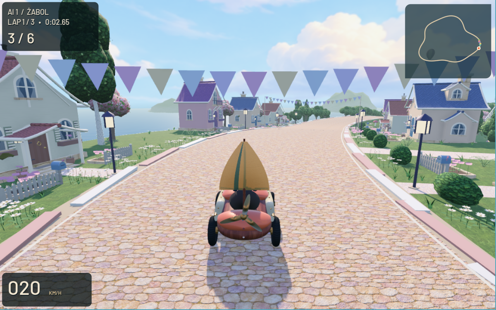
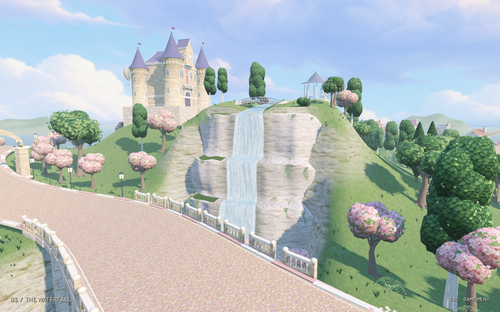

# Grafika i animacja GPU — walidacja 2026-11-16

GPU oblicza teraz pozy wszystkich kierowców, deformację ważonych siatek, obrót i skręt kół, śmigła, przechył nadwozia oraz rotor wiatraka. Ruch roślin, wody, motyli, chorągwi, łodzi i balonów korzysta ze wspólnego zegara GPU. Mgiełka, fontanny i kurz pozostają symulacjami GPUParticles3D.

## Podział pracy

| Zadanie | Wykonanie |
|---|---|
| Obraz 3D, materiały, normalne, oświetlenie i cienie | GPU |
| Pozy 36 kości sześciu kierowców i ich hierarchia | Compute shader GPU |
| Deformacja pozycji i normalnych według oryginalnych wag | Shader wierzchołków GPU |
| Koła, śmigła, przechył i dopasowanie nadwozia do nachylenia | Compute shader oraz shader wierzchołków GPU |
| Rośliny, woda, wiatrak i inne animowane dekoracje | GPU |
| Cząsteczki | GPU |
| Sterowanie, fizyka, AI, kolizje, bramki i wyniki | CPU |
| Kamery, układ interfejsu, zarządzanie sceną i wysyłanie poleceń renderowania | CPU |
| Wczytywanie oraz początkowe przygotowanie geometrii i rozmieszczenia świata | CPU |
| Narzędzia tworzące zapisane modele i ich LOD | CPU, poza renderowaniem klatek gry |

**Nie jest to gra działająca w 100% bez CPU.** Modele i tekstury są wczytywanymi zasobami, teren i rozmieszczenie powstają przy budowie świata, a logika gry pozostaje po stronie CPU. Usunięto ciągłe obliczanie póz i transformacji dekoracyjnej animacji na CPU. Nie ma pętli aktualizującej kości Skeleton3D, koła, śmigła ani wiatraki.

## Bufor animacji

scripts/gpu_motion.gd wysyła sześć rekordów: skręt, prędkość, nachylenie drogi i numer generacji pojazdów. To 96 bajtów danych oraz 16 bajtów parametrów kroku. scripts/gpu_motion_device.gd zarządza zasobami na wątku renderowania. shaders/gpu_motion.glsl wykonuje siedem wywołań: po jednym na pojazd i jedno dla zegara świata oraz wiatraka.

Tekstura **32×8 RGBA32F zawiera 4096 bajtów danych texeli**. Zawiera macierze sześciu kości na kierowcę, stan obrotów, macierze nadwozia, kół i śmigła, zegar oraz macierz wiatraka. Powstaje raz na klatkę i jest współdzielona przez wszystkie kamery. Gra nie odczytuje jej wyników do CPU. Odczyt w testach jest jawny, blokujący i nie wchodzi do pomiarów płynności.

Siatki zachowują wszystkie źródłowe pozycje, indeksy i wagi. Materiały palette_driver odczytują te wagi oraz macierze GPU bez aktywnego Skeleton3D. Statyczne przekształcenia części pojazdu są przekazywane przy tworzeniu modelu; shader uwzględnia je przy animacji. Numer pojazdu ma teraz postać TextMesh i przechyla się razem z nadwoziem. Konserwatywne granice widoczności obejmują ruch shaderów.

Pauza przekazuje zerowy krok. Bufor póz, obroty i zegar GPU pozostają bitowo niezmienione, a po wznowieniu ruszają dalej. Nowy wyścig otrzymuje nową generację i zeruje stan pojazdów. Usunięto też tworzenie nieużywanych tekstur szumu normalnych na CPU; aktywne materiały wyliczają normalne w shaderach.

Interfejs wyścigu nie ma aktywnej kamery 3D; obraz świata rysują tylko widoki graczy. Test i pomiary kontrolują `root_camera_active: false`.

## Renderer i uruchomienie

Zweryfikowano **Forward+ / Vulkan, Windows, Intel Iris Xe, Godot 4.7.2**. Compute wymaga RenderingDevice. Dotychczasowy OpenGL Compatibility nie obsługuje tej ścieżki; Run-light.cmd uruchamia teraz Forward+ w profilu Performance. Projekt zgłasza błąd i kończy działanie, gdy nie można uruchomić animacji GPU, zamiast pokazywać uszkodzoną geometrię. Mobile jest dopuszczony przez kod jako renderer RenderingDevice, ale nie był testowany na urządzeniu mobilnym.

Run.cmd uruchamia menu. Run-tour.cmd pokazuje zapętlony objazd wyspy, Esc przywraca menu. Ekran przygotowania renderuje warianty materiałów przed jazdą. W pierwszym pomiarze po zmianie shaderów trwało to 26,4 s, a kolejne przygotowania przy istniejącej pamięci podręcznej około 1,3 s. To czas samego przygotowania, bez całego importu i startu.

Źródła API: [compute shaders](https://docs.godotengine.org/en/stable/tutorials/shaders/compute_shaders.html), [Texture2DRD](https://docs.godotengine.org/en/stable/classes/class_texture2drd.html), [wejścia shaderów przestrzennych](https://docs.godotengine.org/en/stable/tutorials/shaders/shader_reference/spatial_shader.html).

## Płynność

Okno 1280×800, VSync i limit FPS wyłączone. Procesy uruchamiano kolejno. Przygotowanie grafiki, pięć sekund rozgrzewki i odczyt obrazu nie wchodzą do pomiaru. Zwykła próba obejmuje około 12 sekund jazdy; dłuższa — około 40 sekund zbierania klatek, 1599 próbek i jedno ukończone okrążenie.

| Profil Forward+ | Widoki | FPS | Średnia klatka | P99 | Najdłuższa klatka |
|---|---:|---:|---:|---:|---:|
| Balanced | 1 | 67,99 | 14,71 ms | 17,36 ms | 17,75 ms |
| High, pełne okrążenie | 1 | 40,39 | 24,76 ms | 30,04 ms | 32,54 ms |
| Balanced | 4 | 39,54 | 25,29 ms | 29,68 ms | 30,26 ms |
| Performance | 4 | 53,17 | 18,81 ms | 25,77 ms | 29,39 ms |

We wszystkich czterech próbach: **zero klatek ponad 100 ms**, zero kompilacji pipeline'ów podczas mierzonej jazdy, `gpu_pose_generation: true` i obie kontrole rozmieszczenia instancji zakończone poprawnie. Surowe JSON mają prefiks `gpu_` w [benchmarks/](benchmarks/).

Przed tym etapem wyniki wynosiły odpowiednio 47,13; 25,29; 24,65 i 35,53 FPS. Ustawienia okna, skale i profile jakości pozostają takie same; zmieniła się ścieżka animacji i organizacja renderowania. [Poprzedni raport i pomiary](GRAPHICS_VALIDATION_BEFORE_GPU.md) zachowano. Wyniki dotyczą tego komputera i tej sceny; nie gwarantują stałych 60 FPS ani wydajności innych kart.

High ma MSAA 4×, Balanced 2×, Performance bez MSAA. Pojedynczy widok ma 1438×898 pikseli logicznych i skalę 0,8889, czyli około 1278×798 pikseli 3D w fizycznym oknie 1280×800. Cztery widoki mają po 718×448 pikseli logicznych, z jednostkowymi skalami 0,6667 w Balanced i 0,5778 w Performance. Atlasy cieni: 2048 px w High/Balanced i 1024 px w Performance.

## Sprawdzenia

- **GPU motion: PASS, 125 sprawdzeń.** Wszystkie kości sześciu kierowców przy skręcie, prędkości dodatniej i wstecznej, macierze kół i śmigła, zerowy krok, prawdziwa pauza oraz wznowienie z czterema kamerami. Największa norma różnicy transformacji względem dotychczasowej pozy: **0,000036950**; tolerancja 0,0001 uwzględnia zaokrąglenia funkcji GPU.
- **GPU skin: PASS, sześć siatek.** Natywne obrazy obu postaci w trzech profilach porównano z zachowaną ścieżką Skeleton3D, również ze skalą i przesunięciem kokpitu. Największy średni błąd obrazu po normalizacji kanałów: **0,0000315**. Obrazy `gpu_skin_*` i `gpu_skin_reference_*` są zapisane w repozytorium. Odniesienie CPU jest ładowane wyłącznie przez test.
- **Reguły 133 PASS, sesja 40 PASS, otoczenie 195 PASS, grafika PASS.** Wagi, geometria, mipmapy i alfa, teren, bramki, kontakty, obrysy ścieżek, przesłony oraz 40 siatek scenerii.
- **Pełny wyścig AI PASS:** sześć pojazdów ukończyło po trzy legalne okrążenia; ostatni czas 108,15 s przy kroku 1/60 s.
- **Natywne menu i objazd PASS:** obie postacie, wybór, fokus, małe okno, brak kontrolerów, pauza, wszystkie osiem ujęć i powrót Esc.
- **Run-light.cmd PASS:** import i uruchomienie headless z nowym profilem Performance. Natywny Forward+ Performance sprawdzono osobnym pomiarem czterech widoków.
- Końcowe procesy testowe zwolniły zasoby i zamknęły się samodzielnie.

Polecenia dla oficjalnego Godot 4.7.2:

```powershell
godot --headless --editor --single-threaded-scene --path . --import --quit
godot --path . --script tests/test_gpu_motion.gd
godot --path . --script tests/test_gpu_skin.gd
godot --path . --script tools/benchmark_art.gd -- --high --circuit
godot --path . --script tools/benchmark_art.gd -- --four --performance
```

## Obrazy i granice etapu

To rzeczywiste PNG z silnika. Sześć odcinków i 40 modeli otoczenia zachowują geometrię nocnej przebudowy. [Zasoby i pochodzenie](fairytale-assets/README.md), [aktualne obrazy](screenshots/).





Podobieństwo kierowców do Akademii Oli nadal pozostaje odrzucone. Przeniesienie animacji nie przebudowuje ich wyglądu. Pozostała zawartość gry, integracja Steam i docelowe wymagania sprzętowe pozostają osobnymi pracami.
