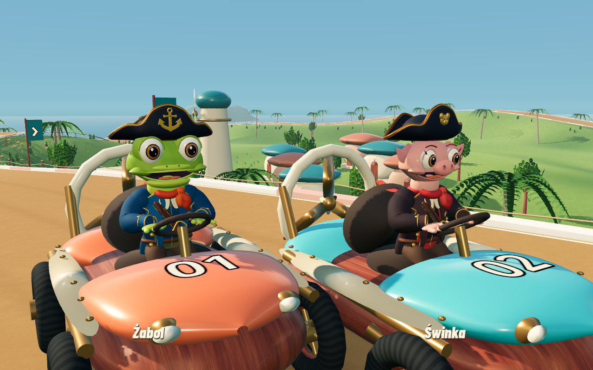
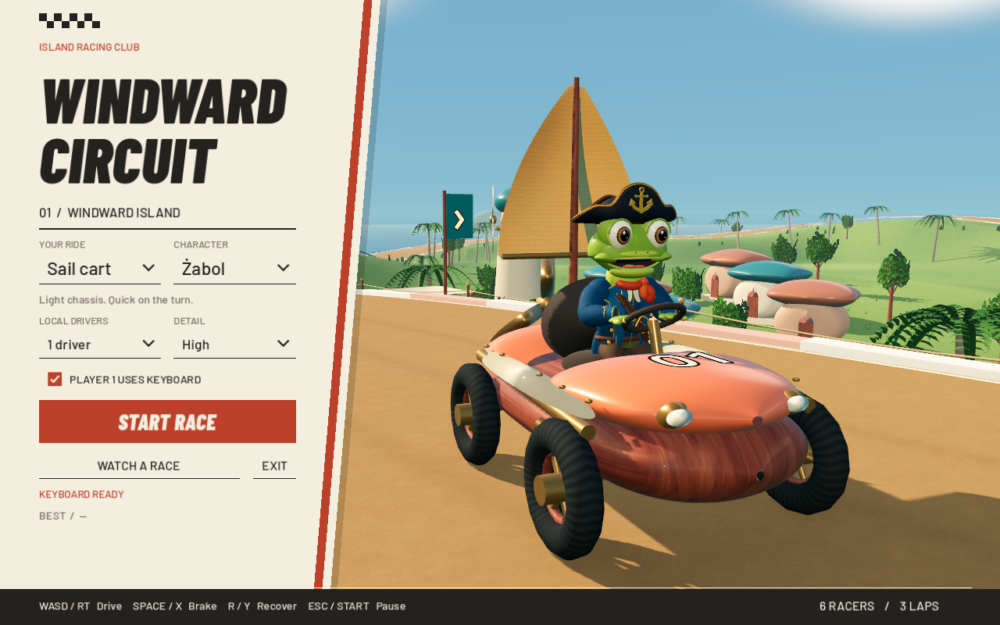
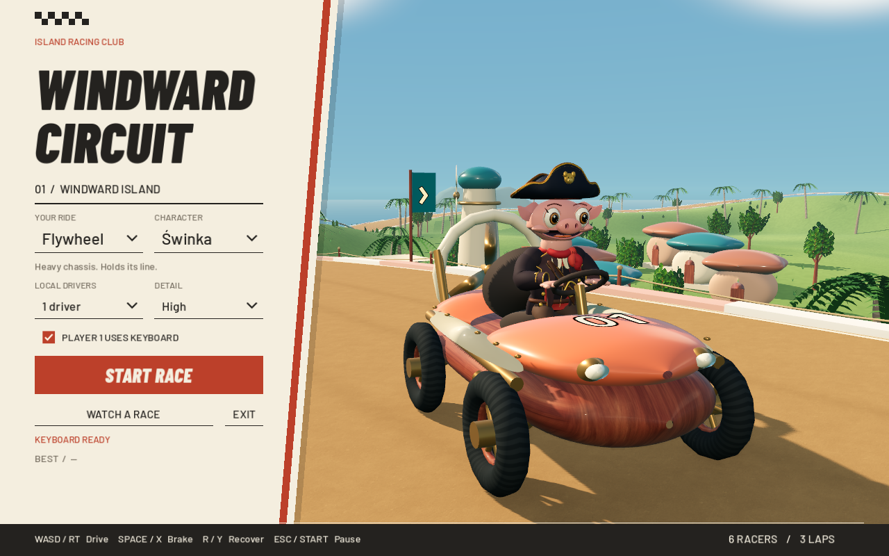
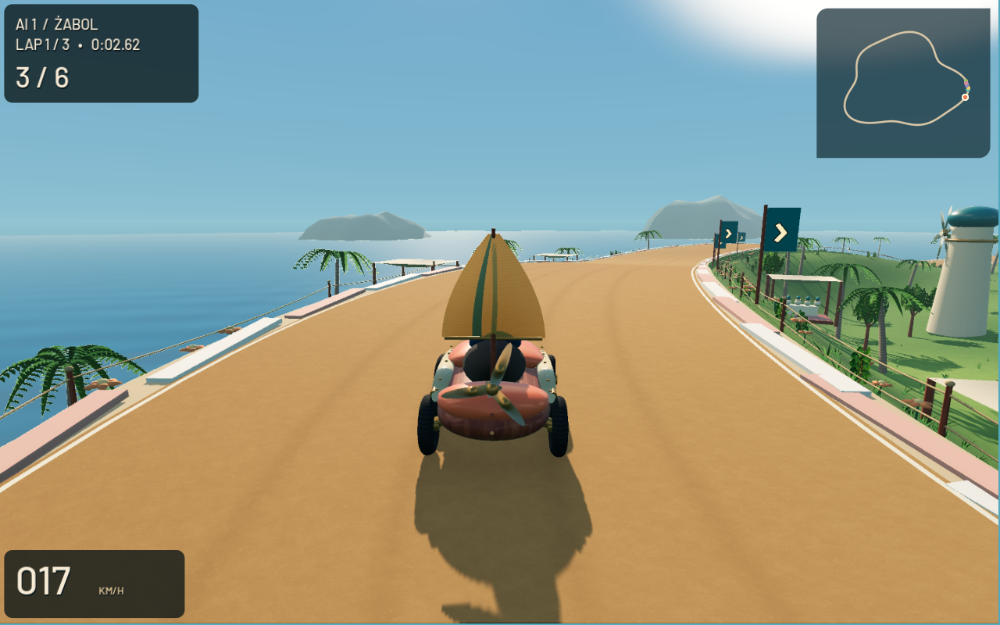
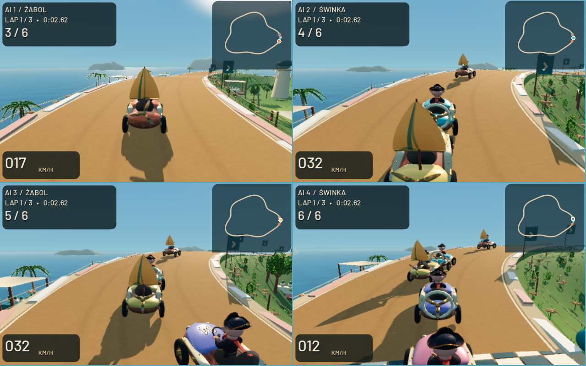

# Oprawa 3D i kierowcy Akademii Oli — 2026-11-16

**Uwaga dotycząca wyglądu postaci:** użytkownik odrzucił podobieństwo obu modeli. Poniższe wyniki potwierdzają działanie geometrii, sesji i rendererów; nie potwierdzają wierności postaci. Zrzuty przedstawiają odrzucony prototyp. Nowe referencje znajdują się w [character-lookdev-v2/](character-lookdev-v2/).

Cel: bogatsze materiały, miękkie światło i wyraziste modele w działającej niezależnej grze. Aktualna wersja obejmuje również Żabola i Świnkę zamiast wcześniejszego pilota. Pełne M2 nadal wymaga areny i kolejnych trybów gry.

## Aktualny zakres

Karoserie korzystają z ciągłych przekrojów Catmulla-Roma, poprawnych normalnych, szkliwionej ceramiki i drewna mapowanego trójpłaszczyznowo. Opony mają bieżnik; obręcze, nity, reflektory i numery uzupełniają model. Irradiancja nieba, ACES, ciepłe słońce i High z SSAO oraz miękkimi cieniami PCSS kształtują oświetlenie. Woda odczytuje głębokość sceny, ma przejrzyste płycizny i pianę przy brzegu. Shader obsługuje Vulkan i OpenGL.

Pierzaste palmy, drzewa liściaste, krzewy, pawilony, płotki z linami, domki i ruchomy wiatrak wzbogacają sektor startowy. Rośliny trafiają na interpolowaną wysokość rzeczywistych trójkątów terenu. MultiMesh używa lokalnego środka, a krawężniki mają poprawne osie i pozycje po obu stronach drogi. Małe trawy nie rzucają cieni. Dekoracyjne liście i palmy rzucają cienie, ale mają uproszczone odbieranie cieni i wyłączony refleks powierzchniowy.

Żabol wykorzystuje model z lokalnej Akademii Oli. Świnka jest adaptacją jego bazowej geometrii według istniejącej ilustracji, z własnymi uszami, ryjkiem, proporcjami twarzy, detalami oczu, emblematem i kolorami stroju. Każdy kierowca ma siedem powierzchni i sześć kości. CPU wylicza pozę, GPU deformuje ważoną siatkę; kurz używa `GPUParticles3D`. Wszystkie trzy profile mają indeksowe LOD. Balanced i Performance dodatkowo zmniejszają bufory wierzchołków poddawanych skinningowi. Szczegóły i źródła: [CHARACTERS.md](CHARACTERS.md).

Menu ma kremową, skośną kompozycję, grafitowe liternictwo Barlow i czerwony start. Postać oraz pojazd wybiera się niezależnie. Powrót z demonstracji przywraca wybraną postać w podglądzie. Menu ma ciepłe światło wypełniające twarze pod kapeluszami; przy starcie wyścigu światło jest wyłączane. Kamera główna nie renderuje świata ponownie, gdy wyścig korzysta z kamer graczy.

Kontakty pojazdów są rozwiązywane w poziomie, bez unoszenia ich na cudzy dach. AI wypchnięte poza bramkę wraca do ostatniego legalnego punktu. Odzyskiwanie pozycji nie przyznaje postępu wyścigu.

## Zasoby

Trzy albedo otoczenia i gałązka liści pochodzą z wbudowanego `image_gen`, bez referencji obrazowych; wszystkie cztery PNG mają natywne **1254×1254 px**. Liście zachowują alfa i mipmapy. Plików nie powiększano sztucznie i nie opisujemy ich jako gotowe 2K/4K. Prompty: [TEXTURE_PROMPTS.json](TEXTURE_PROMPTS.json) i [FOLIAGE_PROMPT.json](FOLIAGE_PROMPT.json). Hashe: [ASSET_MANIFEST.json](ASSET_MANIFEST.json).

Nowe siatki kierowców powstają w builderze geometrii, z zachowanych zasobów Akademii Oli i nowych części 3D. W tym kroku nie generowano nowych ilustracji postaci. Kopie referencji, źródła i hashe są w [CHARACTER_ASSET_MANIFEST.json](CHARACTER_ASSET_MANIFEST.json). Fonty i ikony menu opisuje [UI_ASSET_MANIFEST.json](UI_ASSET_MANIFEST.json).

## Kontrola

- Reguły: **PASS, 133 sprawdzenia**.
- Sesja: **PASS, 40 sprawdzeń**. Obejmuje wybór Świnki, zachowanie pojazdu przy zmianie postaci, Świnkę w wózku żaglowym, obie postacie w demonstracji i przywracanie wyboru po powrocie. Sprawdzono też kamery, pauzę, restart, rozłączenie urządzenia i wyniki.
- Grafika: **PASS dla sześciu siatek**, czyli dwóch postaci w trzech profilach. Sprawdzono wiązania kości, normalizację wag z tolerancją UNORM16, mieszane wagi, skończone pozycje, jednostkowe normalne i zmianę pozy. Nadal przechodzą kontrole alfa liści, terenu, instancji, krawężników, płaskich kontaktów i odzyskiwania bramek AI.
- Pełny wyścig przy kroku fizyki 1/60 s: **PASS**, sześć AI ukończyło po trzy legalne okrążenia; ostatni czas **108,15 s** symulacji.
- Import i launcher: **PASS** dla `Run.cmd --headless --quit-after 4`. Import używa `--single-threaded-scene`; wcześniej sprawdzono także odbudowę cache obu fontów.
- Natywne podglądy: obejrzano obie postacie w kokpitach, menu, listę, fokus, komunikat o brakujących kontrolerach, pauzę i okno 1024×768 z zachowaniem proporcji gry.
- Forward+ oraz Compatibility: poprawne rendery i `instance_layout_valid: true`. Pole `driver_detail` oraz sześć wartości `driver_vertices` potwierdzają odpowiedni profil modeli w realnym rendererze.

Renderer Dummy z testów headless nie zachowuje buforów MultiMesh. Kontrola rzeczywistego rozmieszczenia krawężników odbywa się w oknie, przez odczyt transformacji z RenderingServer.

## Zrzuty z silnika

Obrazy przedstawiają rzeczywiste rendery projektu. Wspólny podgląd ustawia dwa pojazdy obok siebie w świecie gry, z oświetleniem menu. Zrzuty wyścigu korzystają z normalnej fizyki i AI.

## Płynność

| Renderer / profil | Widoki | Średnie FPS | Średnia klatka | P99 klatki |
|---|---:|---:|---:|---:|
| Forward+ / High | 1 | 34,9 | 28,69 ms | 54,71 ms |
| Forward+ / Balanced | 4 | 28,3 | 35,32 ms | 46,27 ms |
| Compatibility / Performance | 4 | 23,3 | 42,88 ms | 76,54 ms |

Stanowisko: Windows, Intel Iris Xe, Godot 4.7.2, okno 1280×800. High renderuje wewnętrzny widok 1438×898, skala 1,0 i MSAA 2×. Cztery widoki mają po 718×448, ze skalą 0,75 w Balanced lub 0,65 w Performance. Menu ma osobną kamerę i MSAA 4× w High. Rozmiary logiczne pochodzą z Godot; próba nie reprezentuje natywnego 1080p.

High używa modeli 149 810 / 169 213 wierzchołków. Balanced używa 33 484 / 30 998, a Performance 12 531 / 12 854. Mniejsze bufory są wybierane przy zmianie jakości oraz tworzeniu nowego podglądu lub wyścigu. Pełny detal pozostaje dostępny w High.

Powyższy końcowy przebieg wykonano kolejno w jednej kolejce, bez równoległych procesów weryfikacyjnych gry. VSync i limit FPS były wyłączone. Pominięto pierwsze dwie klatki, pięć sekund rozgrzewki oraz odczyt i zapis obrazu. Każda próbka obejmuje około 12 sekund po rozgrzewce. To krótki pomiar, bez gwarancji płynności na całej trasie i innym sprzęcie. High jest cięższy od poprzedniego, prostszego pilota; projekt nadal wymaga optymalizacji i nie osiąga tu stałych 60 FPS.

`gpu_ms_by_viewport` opisuje osobne widoki; ich suma nie jest zmierzonym czasem całej klatki. `frame_ms_mean` i `frame_ms_p99` dotyczą odstępów między renderowanymi klatkami. Surowe wyniki znajdują się w [benchmarks/](benchmarks/), polecenia w README. Dalszej pracy wymagają pozostałe sektory trasy, pełna mimika i animacje postaci oraz zawartość z całej specyfikacji.
