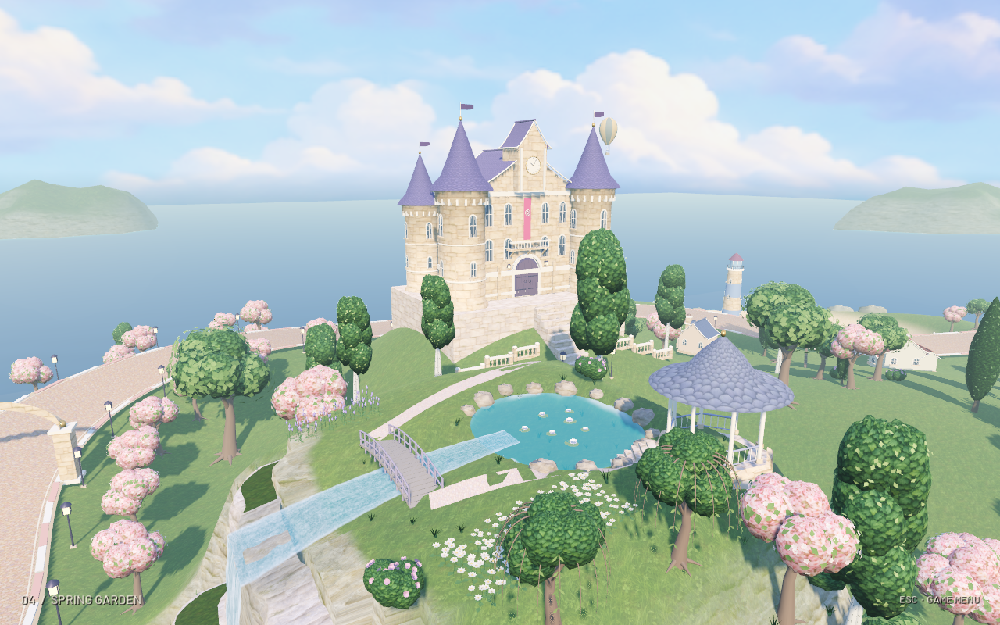
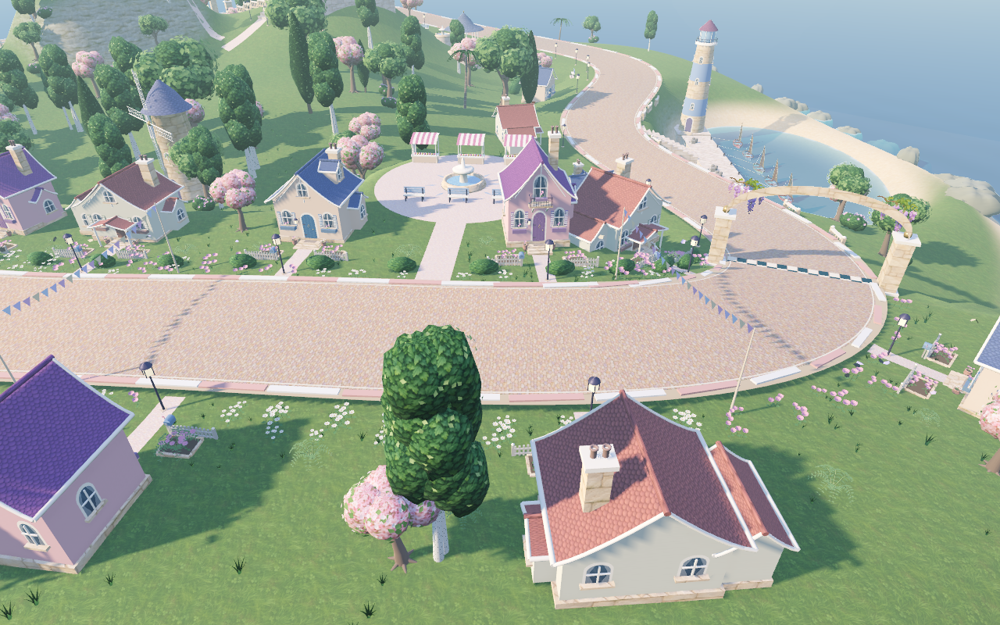
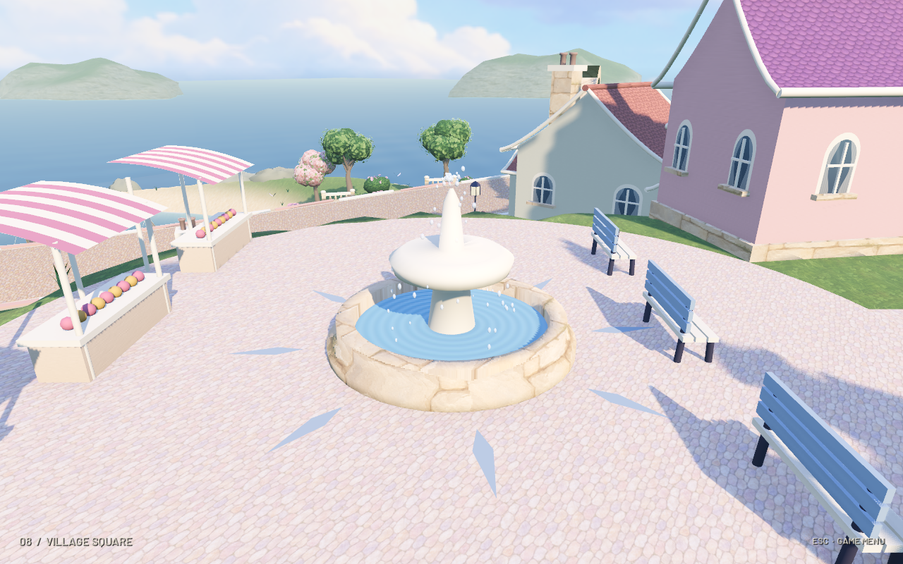
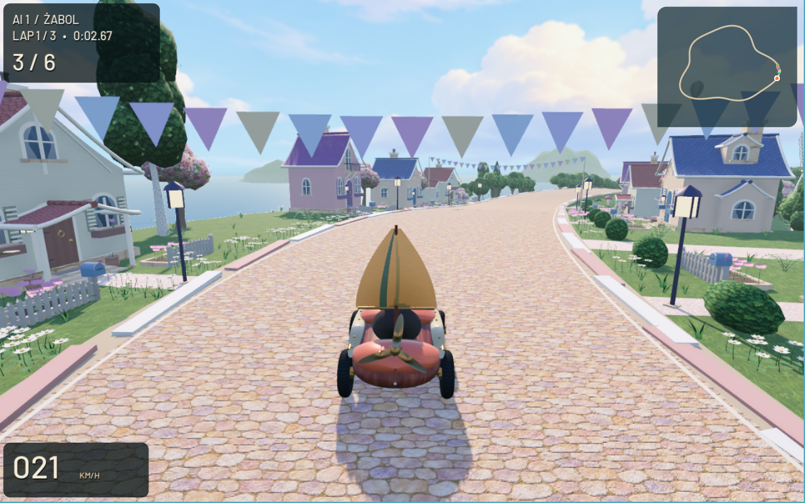

# Bajkowa wyspa — końcowy przegląd nocny, 2026-11-16

Całe okrążenie ma sześć rozpoznawalnych odcinków: wioskę, gaj, most przy wodospadzie, zamkowe wzgórze, ogrody i port. Nocna przebudowa objęła **40 modeli i wariantów**, sześć nowych tekstur, materiały, rzeźbę terenu, rozmieszczenie dekoracji oraz oświetlenie. Detale i pochodzenie: [fairytale-assets/](fairytale-assets/README.md).

W świecie są 154 drzewa pięciu gatunków oraz 1310 kęp róż, lawendy i stokrotek o różnej budowie przestrzennej. Dochodzą paprocie, krzewy, bluszcz, ogródki i mała architektura. Wyrównany rynek łączy fontannę, ławki i stragany. Kaskada ma źródło, strumień, trzy skalne progi, pianę i mgiełkę. Port otrzymał otwarte łodzie z deskami, ławkami i olinowaniem oraz beczki, skrzynie i zwoje lin.

**Modele kierowców nadal pozostają odrzuconymi prototypami.** Ten etap nie potwierdza ich podobieństwa do Akademii Oli. Kopie siatek do renderowania zachowują geometrię i wpływy kości; zmniejszono wyłącznie liczbę powierzchni. [Stan postaci](CHARACTERS.md).

## Rzeczywiste obrazy

Poniższe PNG pochodzą bezpośrednio z renderera gry, bez retuszu. Pierwsze trzy przedstawiają kamery krajobrazowe, ostatni — dynamiczną jazdę AI. Nie są ilustracjami generatora obrazów.

Komplet obejmuje sześć widoków z wysokości kamery jazdy, osiem ujęć krajobrazowych `world_*.png`, osiem ujęć objazdu `night_tour_*.png` i trzy zbliżenia domków w [screenshots/](screenshots/). Run-tour.cmd uruchamia płynny, zapętlony objazd ośmiu miejsc; Esc wraca do zwykłego menu.

Poprzedni stan wraz z niezmienionymi obrazami porównawczymi zachowano w [raporcie przed nocnym etapem](GRAPHICS_VALIDATION_BEFORE_NIGHT.md).

## Sprawdzenia

- Reguły: **PASS, 133 sprawdzenia**.
- Sesja: **PASS, 40 sprawdzeń** wyboru, kamer, pauzy, restartu, odłączenia urządzenia i wyników.
- Grafika: **PASS** dla sześciu siatek kierowców, wag, normalnych, alfa, mipmap, interpolacji trójkątów terenu, krawężników, kontaktów i odzyskiwania bramek AI. Siatki indeksowane i bez indeksów są łączone bez utraty ścian.
- Otoczenie: **PASS, 195 sprawdzeń** 40 zasobów, indeksów i normalnych, materiałów łodzi, obróconych obrysów budynków, prześwitów ścieżek, ciągłości strumienia oraz konserwatywnej siatki przesłaniającej teren. Ostatnia regresja kontroluje prześwit skały pod poruszającą się wodą na górnym progu kaskady.
- Pełny wyścig sześciu AI: **PASS**, każdy ukończył trzy legalne okrążenia przy kroku 1/60 s. Ostatni czas: **108,15 s symulacji**. Krzywa drogi, kolizja nawierzchni, bramki i reguły pozostały dotychczasowe.
- Builder: **PASS**, 40 skompresowanych siatek, około 3,7 MiB łącznie. Większe modele mają zapisane LOD. ImporterMesh służy do odbudowy zasobów, nie do zwykłego uruchomienia.
- Audyt obrazów: **PASS**, sześć plików, natywne wymiary, SHA-256 i mipmapy zgodne z manifestem. Pięć albedo ma 1254×1254 px, panorama 1774×887 px; nie są opisywane jako 2K/4K.
- Launcher: **PASS**, Run.cmd z importem i `--headless --quit-after 4 -- --island-tour`.
- Natywny przegląd: **PASS**, sześć odcinków i osiem ujęć krajobrazowych. Osobno sprawdzono trzy warianty domków, menu i ośmioczęściowy objazd wraz z powrotem do menu po przygotowaniu shaderów.
- Forward+ i Compatibility: **PASS**, bez zgłoszonych błędów shaderów w końcowej serii. Wszystkie pomiary mają `instance_layout_valid: true` i `world_instance_layout_valid: true`.

Renderer Dummy nie przechowuje buforów instancji. Ich rozmieszczenie sprawdza natywny renderer: odczytuje rzeczywiste banki MultiMesh i potwierdza, że zmiana jakości nie przesuwa obiektów.

## Płynność dynamicznej jazdy

Windows, Intel Iris Xe, Godot 4.7.2, okno 1280×800. Procesy wykonywano kolejno, z wyłączonym VSync i limitem FPS. Przygotowanie grafiki i pięć sekund rozgrzewki poprzedzają pomiar. Zwykła próba obejmuje około 12 sekund zbierania klatek; odczyt obrazu i zapis PNG są wyłączone ze statystyki.

| Renderer / profil | Widoki | Średnie FPS | Średnia klatka | P99 | Najdłuższa klatka |
|---|---:|---:|---:|---:|---:|
| Forward+ / High | 1 | 26,91 | 37,16 ms | 47,87 ms | 49,11 ms |
| Forward+ / Balanced | 1 | 47,13 | 21,22 ms | 26,56 ms | 27,72 ms |
| Forward+ / Balanced | 4 | 24,65 | 40,57 ms | 49,63 ms | 51,13 ms |
| Forward+ / Performance | 4 | 35,53 | 28,15 ms | 35,31 ms | 39,17 ms |
| Compatibility / Performance | 4 | 24,52 | 40,79 ms | 60,23 ms | 67,49 ms |
| Forward+ / High, pełne okrążenie | 1 | 25,29 | 39,53 ms | 50,56 ms | 52,73 ms |

W każdej z tych prób: **zero klatek ponad 100 ms i zero kompilacji nowych pipeline'ów podczas mierzonej jazdy**. Nie oznacza to gwarancji braku przycięć na innych kartach lub sterownikach. Surowe pliki mają prefiks `night_` w [benchmarks/](benchmarks/).

Dłuższa próba trwała 45 sekund, z około 40 sekundami pomiaru, 999 klatkami i jednym ukończonym okrążeniem. Każdy odcinek otrzymał rzeczywiste próbki:

| Odcinek, High | Średnie FPS | P99 |
|---|---:|---:|
| Wioska | 25,13 | 46,48 ms |
| Gaj | 23,27 | 49,74 ms |
| Wodospad | 26,36 | 51,82 ms |
| Zamek | 24,31 | 50,82 ms |
| Ogrody | 25,27 | 43,65 ms |
| Port | 26,38 | 45,38 ms |

High używa obecnie MSAA **4×**, Balanced 2×, Performance bez MSAA. Pojedynczy widok ma logiczne 1438×898 i skalę 0,8889, czyli około 1278×798 pikseli renderowania 3D w oknie 1280×800. Cztery widoki mają po 718×448 logicznych pikseli i skale 0,6667 w Balanced oraz 0,5778 w Performance. To odpowiednio 75% i 65% fizycznej rozdzielczości panelu. Atlasy cieni: 2048 px w High/Balanced, 1024 px w Performance.

Poprzedni High osiągał 23,14 FPS, pojedynczy Balanced 25,75 FPS, cztery Balanced 14,51 FPS. **Ustawienia nie są identyczne**: wcześniej pojedynczy widok renderował ponad fizyczną rozdzielczość okna, High miał MSAA 2× i atlas cieni 4096 px. Poprawa obejmuje zarówno organizację geometrii i materiałów, jak i korektę tych ustawień. Nie jest to porównanie samych shaderów przy niezmienionej liczbie pikseli.

Na Iris Xe nadal **nie ma stałych 60 FPS**. Do jednego gracza warto wybrać Balanced, do czterech Performance z Forward+. Compatibility pozostaje wariantem dla starszych sterowników, a nie szybszym rendererem na tym komputerze. Testów 1080p i innych kart jeszcze nie wykonano.

## Kompilacja przy uruchomieniu

Próba bez przygotowania ujawniła pojedynczą klatkę **3270,11 ms** w Balanced. Zachowano ją w [night_cold_single_forward_plus_balanced.json](benchmarks/night_cold_single_forward_plus_balanced.json), zamiast usuwać ten wynik.

Ekran „Preparing Windward Island…” renderuje osiem widoków, trzy profile, pojazdy i emitery cząsteczek przed menu lub objazdem. Koszt przygotowania w końcowej serii Forward+ wynosił około 1,8–2,1 s przy istniejącej pamięci podręcznej; Compatibility potrzebował 48,5 s podczas pierwszego sprawdzenia nowych wariantów. To czasy samego przygotowania, nie całego startu i importu projektu. Pierwszy start po pobraniu albo aktualizacji sterownika może być dłuższy.

Po przygotowaniu usuwane są pomocnicze widoki, wraca wybrany profil i normalna obsługa wejścia. Końcowe procesy testowe zamknęły się samodzielnie. Natywny test objazdu kontroluje również ten stan i powrót klawiszem Esc.

## Organizacja renderowania i granice

Materiały modeli są pakowane do współdzielonych palet. Siatki kierowców mają dwie powierzchnie zamiast siedmiu. MultiMesh dzieli dekoracje na komórki 48 m i odcinki, a konserwatywne przesłony terenu i budynków pozwalają pomijać dalszą geometrię. Małe kępy mają gęstość 100/75/50% zależnie od profilu; High zachowuje pełną kompozycję.

Woda, liście, motyle, chorągwie, łodzie i balony poruszają się w shaderach. Kurz, mgiełka wodospadu oraz krople fontann to GPUParticles3D. Rotor wiatraka i pozy kości nadal liczy CPU, deformację skórkowanych siatek wykonuje GPU. Efekty dekoracyjne nie zastępują fizyki pojazdów.

To etap otoczenia rozwijanej gry. Pozostałe trasy, tryby, sieć, dźwięki, docelowe postacie i wymagania sprzętowe pozostają osobnymi pracami.
