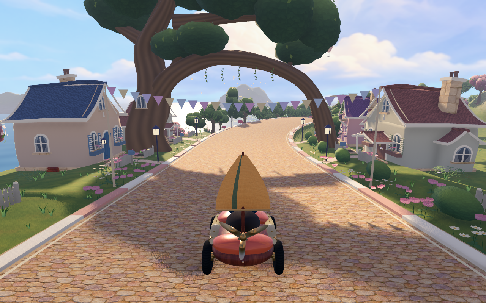
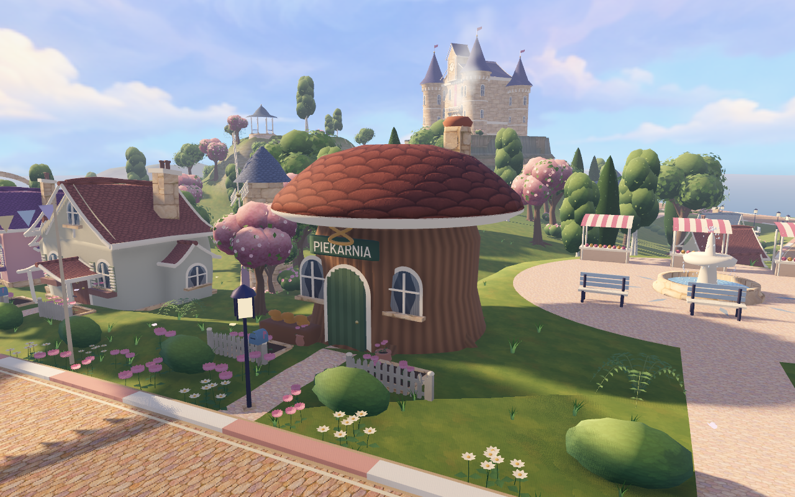
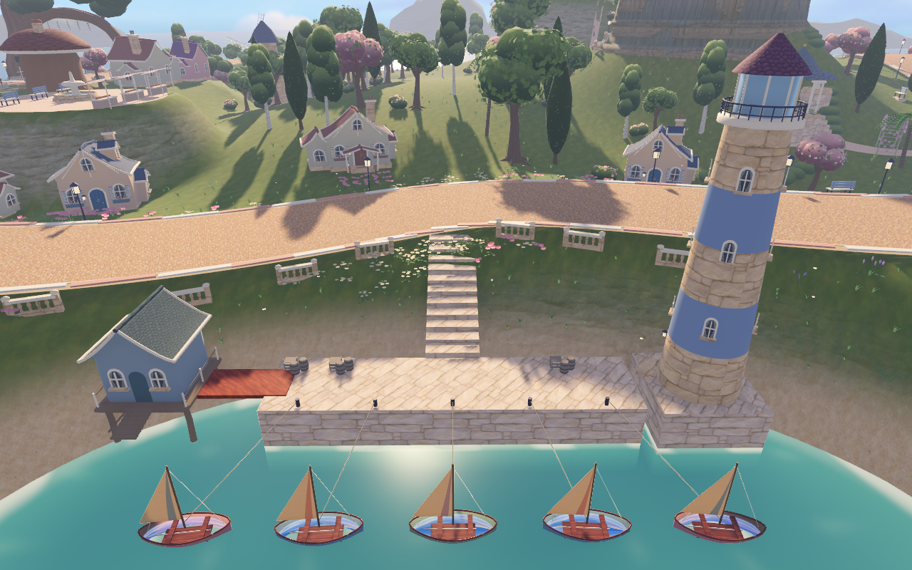

# Bajkowa wyspa — walidacja 2026-11-16

Wdrożono nowy kierunek na odcinku wioski oraz wspólne materiały i oświetlenie całej wyspy. Piekarnia w pniu, przejazd pod starym drzewem, skalne tarasy zamku i dom rybaka są rzeczywistymi modelami w grze. [Zakres i pochodzenie](enchanted-island/README.md). Poprzedni raport GPU i jego wyniki zachowano w [GRAPHICS_VALIDATION_BEFORE_ENCHANTED.md](GRAPHICS_VALIDATION_BEFORE_ENCHANTED.md).

## Obraz i ustawienia

Własne generatory zapisują teraz 44 modele otoczenia z LOD. Domki mają zaokrąglone ściany i asymetryczne dachy, a drzewa większe, spokojniej malowane korony. Nowa łąka meadow_painted_v3 jest natywnym RGB 1254×1254 px z wbudowanego image_gen, bez powiększania. [Prompt](enchanted-island/PROMPTS.json) i [manifest SHA-256](enchanted-island/ASSET_MANIFEST.json) dokumentują dokładny plik.

Słońce pada niżej z boku, ma ciepłą barwę; wypełnienie cieni jest lawendowe. High używa SSAO, SSIL i miękkich cieni z filtrem Soft High. Balanced ma Soft Low i bezpośrednie cienie kierunkowe, Performance filtr Hard. SSIL działa wyłącznie w High; jakość High, połowa rozdzielczości, cztery przebiegi rozmycia. Zachowano ACES i trzy profile gęstości roślin. Kamera jazdy ma teraz FOV 58°, patrzy dalej i nieco wyżej.

Ocean nie odbiera map cieni, które w porównaniu diagnostycznym powodowały kratkę. Płycizny mają kolory zależne od głębokości i wysoką nieprzezroczystość. Pięć miękkich przyciemnień pod łodziami jest analitycznych; pozostałe obiekty nie mają pełnych cieni na wodzie. Obliczenia kontaktów są ograniczone do przystani, kaustyka do płycizn. Dodano dym, płatki i subtelną tęczę. Motyle są mniejsze, zaokrąglone i mają jaśniejsze spody.

Wszystkie poniższe obrazy pochodzą z Godot, bez generowania lub retuszu zrzutów.







## Płynność

Godot 4.7.2, Windows, Forward+ / Vulkan, Intel Iris Xe, natywne okno 1280×800 przesunięte poza widoczny pulpit na czas automatycznych prób. VSync i limit FPS wyłączone; procesy renderujące uruchamiano kolejno. Pomiar wyklucza przygotowanie grafiki, pierwsze klatki, pięć sekund rozgrzewki i odczyt PNG. Zwykła próba zbiera około 12 sekund klatek; High obejmuje około 40 sekund pomiaru, 1198 próbek i jedno pełne okrążenie.

| Profil | Widoki | FPS | Średnia klatka | P99 | Maksimum |
|---|---:|---:|---:|---:|---:|
| High, pełne okrążenie | 1 | 30,27 | 33,04 ms | 39,75 ms | 44,91 ms |
| Balanced | 1 | 67,44 | 14,83 ms | 20,12 ms | 22,14 ms |
| Balanced | 4 | 35,72 | 28,00 ms | 35,22 ms | 38,36 ms |
| Performance | 4 | 52,11 | 19,19 ms | 24,56 ms | 27,24 ms |

We wszystkich próbach: zero klatek ponad 100 ms, poprawne rozmieszczenie instancji, aktywna animacja GPU i brak dodatkowej kamery świata za interfejsem. Surowe JSON mają prefiks `enchanted_` w [benchmarks/](benchmarks/); odpowiadające im obrazy są w screenshots/.

Przed zmianą stylu było odpowiednio 40,39; 67,99; 39,54 i 53,17 FPS. Obecny High jest wyraźnie droższy, m.in. przez SSIL i dokładniejsze miękkie cienie. Zmieniły się także kamera i geometria, więc nie jest to izolowany pomiar jednej techniki. Balanced zachowuje zbliżoną płynność jednego widoku. Nie zweryfikowano jeszcze 1080p ani innych kart.

Po zmianie shaderów przygotowanie przed próbą High trwało 15,35 s; kolejne starty przy zapisanej pamięci podręcznej 1,49–1,62 s. To czas samego przygotowania, bez całego importu i startu. Przygotowanie nie wyeliminowało wszystkich późniejszych kompilacji: High zarejestrował 15 Draw / 19 Specialization, Balanced 12 / 12, Performance 9 / 10. Nie należy przedstawiać tych prób jako pozbawionych kompilacji w czasie jazdy.

High ma MSAA 4×, Balanced 2×, Performance bez MSAA. Jeden widok ma 1438×898 pikseli logicznych i skalę 0,8889, czyli około 1278×798 pikseli 3D. Cztery widoki mają po 718×448 pikseli logicznych ze skalą 0,6667 w Balanced i 0,5778 w Performance. Atlasy cieni mają 2048 px w High/Balanced i 1024 px w Performance.

## Sprawdzenia

- Reguły: 133 PASS. Grafika: PASS, wagi, mipmapy i alfa, geometria, teren, krawężniki i kontakty pojazdów.
- Otoczenie: 216 PASS, 44 siatki. Dodatkowo prześwit pod drzewem, górna powierzchnia tarasu skały i brak kołysania domu rybaka materiałem łodzi.
- Sesja: 40 PASS. Pełny wyścig: sześć AI ukończyło po trzy legalne okrążenia, ostatni czas symulacji 108,15 s przy kroku 1/60 s.
- GPU motion: 125 PASS, największy błąd transformacji względem odniesienia CPU 0,000036950. Pauza, wznowienie i cztery kamery są zachowane.
- GPU skin: sześć siatek PASS, największy znormalizowany średni błąd obrazu 0,0000315. Końcowe zwalnianie głównego świata w tym teście przekazano zamykaniu SceneTree; ponowiony test zakończył proces samodzielnie z kodem 0.
- Metadane nowej tekstury i identyczność kopii z oryginałem generatora: PASS. Audyt sześciu wcześniejszych tekstur: PASS.
- Natywny przegląd: dziewięć ujęć jazdy i cztery zbliżenia, sześć odcinków świata i osiem ujęć scenerii, jedenaście ujęć objazdu oraz powrót Esc. Menu: wybór, fokus, małe okno, brak kontrolerów i pauza.

## Podział GPU / CPU

| Zadanie | Wykonanie |
|---|---|
| Renderowanie, materiały, normalne, światło, cienie i SSIL | GPU |
| Obliczanie 36 póz kości, deformacja siatek, koła, śmigła, przechył i wiatrak | Compute i shadery wierzchołków GPU |
| Wiatr, woda, motyle, chorągwie, łodzie i balony | Shadery GPU |
| Kurz, mgiełka, fontanny, dym i płatki | GPUParticles3D |
| Fizyczna jazda, AI, kolizje, bramki i wyniki | CPU |
| Kamery, UI, wczytywanie, przygotowanie terenu i rozmieszczenie przy starcie | CPU |
| Autorska odbudowa zapisanych modeli i LOD | CPU poza pętlą renderowania gry |

Zachowano współdzielony atlas 32×8 RGBA32F i brak odczytu animacji GPU do CPU w grze. Nowe efekty nie mają skryptowych aktualizacji na każdą klatkę. Nie oznacza to działania całej gry bez CPU ani tworzenia modeli i tekstur w czasie rzeczywistym przez GPU.

Źródła API: [Environment i SSIL](https://docs.godotengine.org/en/stable/classes/class_environment.html), [RenderingServer i filtrowanie cieni](https://docs.godotengine.org/en/stable/classes/class_renderingserver.html). Opis poprzedniej implementacji atlasu i testów: [raport GPU](GRAPHICS_VALIDATION_BEFORE_ENCHANTED.md).

## Uruchomienie i odtworzenie

Run-tour.cmd pokazuje nowy objazd od piekarni i drzewa; Esc przywraca menu. Run.cmd uruchamia zwykłą grę, Run-light.cmd profil Performance. Wymagany jest RenderingDevice; zweryfikowano Forward+, a nie OpenGL Compatibility.

```powershell
godot --headless --editor --single-threaded-scene --path . --import --quit
godot --headless --path . --script tools/build_fairy_assets.gd
godot --headless --path . --script tests/test_environment.gd
godot --path . --script tools/review_enchanted.gd
godot --path . --script tools/review_tour.gd
godot --path . --script tools/benchmark_art.gd -- --high --circuit
godot --path . --script tools/benchmark_art.gd -- --four --performance
```

Modele Żabola i Świnki nadal pozostają odrzuconymi prototypami i nie zostały przebudowane. Ta wersja dokumentuje wdrożony kierunek środowiska; nie jest deklaracją idealnej grafiki, stałych 60 FPS ani gotowości do wydania na Steam.
