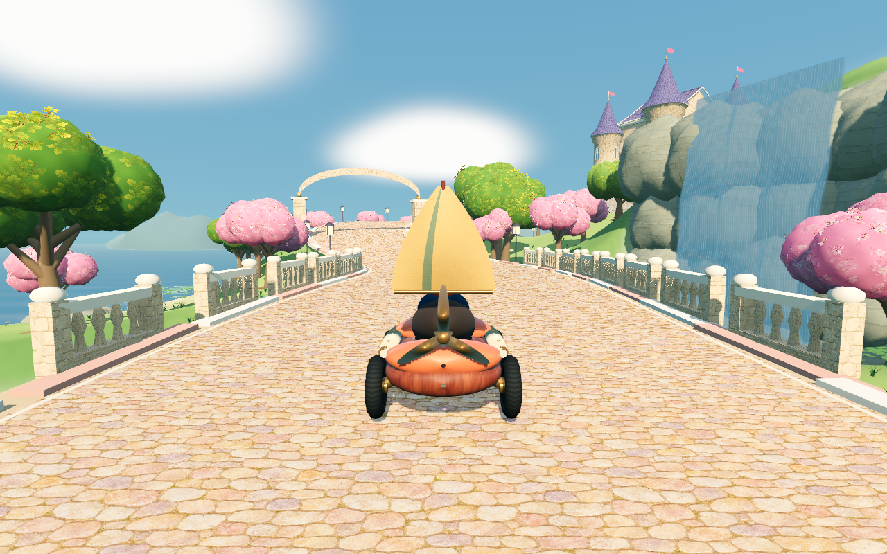
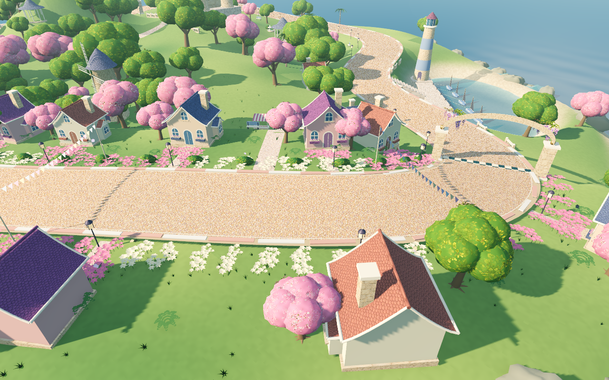
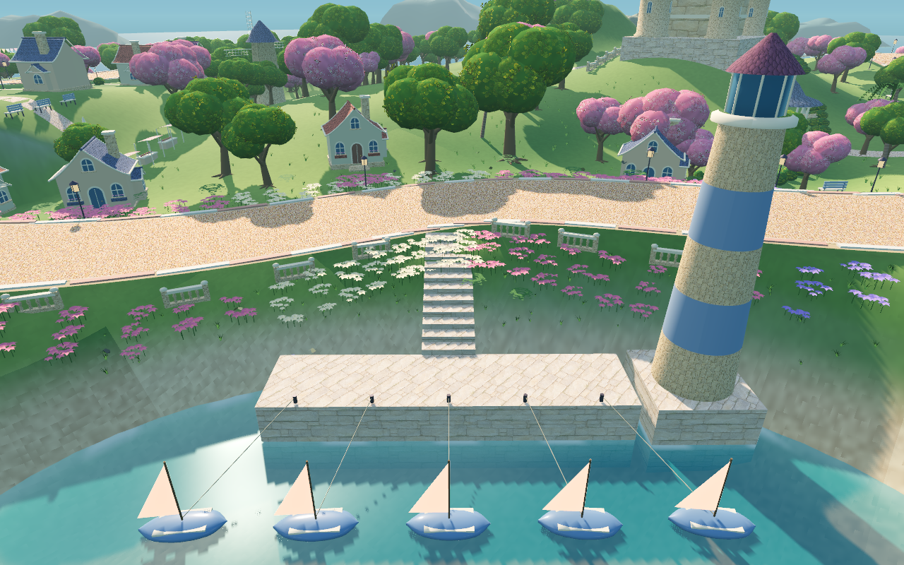

# Bajkowa wyspa — walidacja 2026-11-16

Całe okrążenie ma sześć odcinków: wioskę, gaj, most przy wodospadzie, zamkowe wzgórze, ogrody i port. Dodano 27 siatek i wariantów, sześć nowych tekstur, 183 drzewa liściaste i 1712 kęp kwiatów. Szczegóły, prompty i hashe: [fairytale-assets/](fairytale-assets/README.md).

**Postacie pozostają odrzuconymi prototypami.** Przebudowa otoczenia nie potwierdza podobieństwa kierowców do Akademii Oli. Ich nowe referencje są w [character-lookdev-v2/](character-lookdev-v2/README.md).

## Co sprawdzono

- Reguły: **PASS, 133 sprawdzenia**.
- Sesja: **PASS, 40 sprawdzeń** wyboru, kamer, pauzy, restartu, odłączenia urządzenia i wyników.
- Grafika: **PASS** dla sześciu siatek kierowców, wag, normalnych, alfa, interpolacji terenu, krawężników, kontaktów i odzyskiwania bramek AI. Nowy test regresji potwierdza, że łączenie indeksowanych prymitywów z niestandardowymi ścianami bez indeksów zachowuje całą geometrię.
- Wyścig przy kroku 1/60 s: **PASS**, sześć AI ukończyło po trzy legalne okrążenia; ostatni czas **108,15 s** symulacji. Przebudowa nie zmieniła krzywej drogi, kolizji nawierzchni ani bramek.
- Launcher: **PASS**, `Run.cmd --headless --quit-after 4` wraz z importem projektu.
- Builder: **PASS**, komplet 27 skompresowanych modeli, około 1 MB łącznie. Większe siatki mają zapisane LOD; drobne karty liści nie wymagają dalszego upraszczania. ImporterMesh jest używany wyłącznie podczas odbudowy zasobów.
- Obejrzano natywne widoki sześciu odcinków i czterech krajobrazów. Poprawiono znikające sklepienia, otwarte szczyty dachów, fundament zamku, wysokość wioski, zatokę portową i rozstaw łodzi.
- Forward+ i Compatibility działają bez zgłoszonych błędów shaderów. Wszystkie końcowe pomiary mają `instance_layout_valid: true` oraz `world_instance_layout_valid: true`. Druga kontrola odczytuje rzeczywiste bufory MultiMesh i potwierdza, że zmiana gęstości nie przesuwa instancji.

Renderer Dummy nie przechowuje buforów instancji. Ich rozmieszczenie jest zatem sprawdzane przez natywny renderer, poza pomiarem czasu klatek.

## Obrazy z silnika

Pierwszy obraz to statyczny widok z kamery za pojazdem. Kolejne dwa korzystają ze specjalnie ustawionej kamery krajobrazowej. Nie są generowanymi ilustracjami ani retuszem.

Pozostałe obrazy `world_*.png` są w [screenshots/](screenshots/). Pomiary zapisują osobno dynamiczne wyścigi sterowane przez AI.

## Płynność

| Renderer / profil | Widoki | Średnie FPS | Średnia klatka | P99 klatki |
|---|---:|---:|---:|---:|
| Forward+ / High | 1 | 23,1 | 43,22 ms | 52,88 ms |
| Forward+ / Balanced | 1 | 25,8 | 38,83 ms | 47,94 ms |
| Forward+ / Balanced | 4 | 14,5 | 68,92 ms | 82,06 ms |
| Compatibility / Performance | 4 | 15,5 | 64,37 ms | 97,92 ms |

Windows, Intel Iris Xe, Godot 4.7.2, okno 1280×800. Pojedyncze widoki mają logiczne 1438×898, skalę 1,0 i MSAA 2×. Cztery widoki mają po 718×448, skalę 0,75 w Balanced lub 0,65 w Performance; odpowiednio MSAA 2× lub wyłączone. To nie jest próba natywnego 1080p.

Powyższe pomiary wykonano kolejno, bez nakładania procesów gry. VSync i limit FPS były wyłączone. Pominięto dwie początkowe klatki, pięć sekund rozgrzewki i odczyt obrazu. Każdy pomiar obejmuje około 12 sekund jazdy. Wyniki opisują krótki odcinek, a nie całe okrążenie. Ostatnia korekta rozstawu łodzi i pomostu została sprawdzona wizualnie po tej serii.

Bogatsza scena jest cięższa od poprzedniej. **Płynność wymaga dalszej optymalizacji, szczególnie przy czterech widokach; na tym sprzęcie nie ma stałych 60 FPS.** Wcześniejsze, wyższe wyniki dotyczyły prostszego otoczenia i nie są wynikami tej wersji. Zachowano je w [poprzednim raporcie](GRAPHICS_VALIDATION_BEFORE_FAIRYTALE.md).

Drobne kolory modeli są scalane w materiały z kolorem wierzchołków. Kępa kwiatów ma jedną powierzchnię i 504 trójkąty pełnego detalu. High używa wszystkich instancji. Balanced ogranicza drobną roślinność do 75% i skraca zasięg detali, Performance do 50% i wyłącza dodatkowe karty gałązek. Większe modele mają LOD. Nieprzezroczyste korony zachowują tekstury i geometrię we wszystkich profilach. Mgła wodospadu i kurz są cząsteczkami GPU; motyle i wiatr poruszają się w shaderach.

`gpu_ms_by_viewport` opisuje osobne widoki i nie jest czasem całej klatki. `frame_ms_mean` i `frame_ms_p99` opisują odstępy między renderowanymi klatkami. Surowe wyniki tej serii mają prefiks `fairytale_` w [benchmarks/](benchmarks/).
