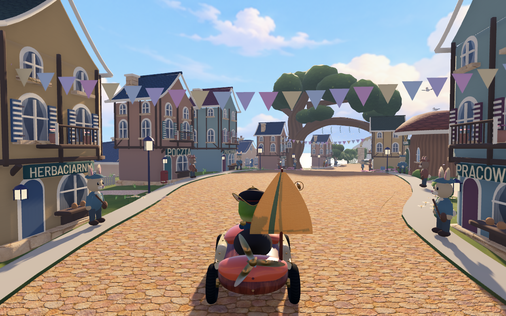
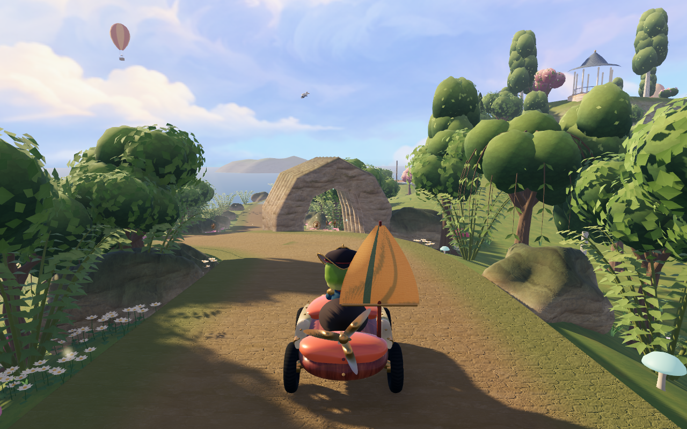
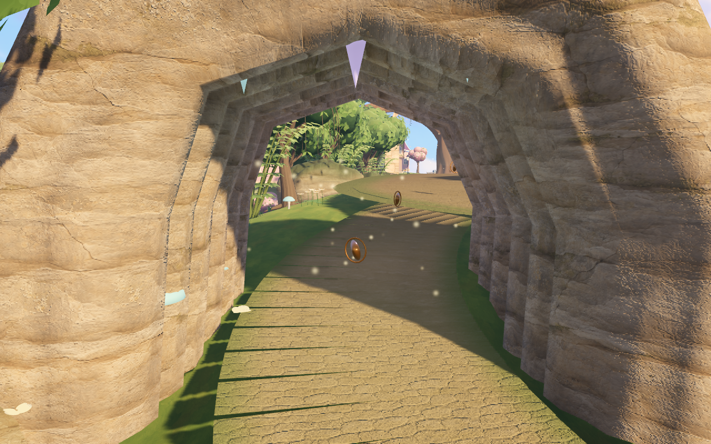

# Żywa bajkowa wyspa — walidacja 2026-11-16

Wdrożono przebudowę drogi, bliską zabudowę, mieszkańców i nowe elementy rozgrywki. Gra wczytuje 57 modeli otoczenia i mieszkańców oraz sześć nowych wariantów kierowców. [Poprzedni raport](GRAPHICS_VALIDATION_BEFORE_LIVING.md) zachowuje wyniki wcześniejszej wersji. [Pochodzenie](PROVENANCE.md), [hashe bieżących zasobów i zrzutów](living-island/ASSET_MANIFEST.json).

## Droga i okolica

Szerokość jezdni zmienia się między uliczkami, rynkiem i lasem. Nawierzchnie obejmują ciepły bruk, ziemię z mchem, drewniane deski, wapień przy zamku i chłodniejszy bruk portowy. Wioska ma chodniki, dziesięć nowych kamienic, drugą linię domków i alejki. Poczta, pracownia i herbaciarnia mają nadwieszone piętra, boczne okna, balkony, szyldy, kwiaty i latarnie. W lesie doszły wielkie paprocie, omszałe skały i świecące grzyby. Nad obniżeniem terenu biegnie most z linami, podwieszeniami i wysokimi drewnianymi podporami; w porcie stoi żuraw i przybrzeżne skały.

Skrót ma 27,950 m wobec 30,178 m równoległego fragmentu głównej drogi. Łączy się między bramkami 4 i 5 i nie omija obowiązkowych punktów. Grotę otacza rzeczywista geometria skalna, a przy sklepieniu wiszą kryształy. Usunięto nakładający się stary portal, skały i grzyby z przejazdu. Test geometrii sprawdza obie drogi przy ich własnych wysokościach; nad przejazdem pozostaje prześwit 3,1 m.

W świecie jest 56 postaci i zwierząt: 31 królików i myszy na chodnikach, rynku i przy trasie, cztery koty, siedem kaczek i czternaście mew. Chód, gesty, głowy, ogony, skrzydła, pływanie i patrole są animowane w shaderze. Nie ma skryptu zmieniającego ich pozy ani macierze na każdą klatkę. Niższe profile zachowują podzbiór tych samych miejsc.







## Rozgrywka i dźwięk

41 odnawiających się nasion wiatru daje ładunki dopalacza. Trzy ładunki wystarczają na jedno użycie; maksymalny zapas to dziewięć. Shift lub przycisk B aktywuje dopalacz. Legalne odkrycie groty przyznaje trzy dodatkowe ładunki raz na wyścig. HUD pokazuje zapas, odkrycie i skrót na minimapie. Bród zmniejsza przyczepność i wytwarza rozbryzgi, a rampa wybija szybki pojazd. Świetliki, smuga dopalacza, liście za pojazdem i rozbryzgi korzystają z GPUParticles3D.

Pięć oryginalnych syntetycznych pętli otoczenia jest odtwarzanych przez sześć źródeł przestrzennych o ograniczonym zasięgu. Podzielony ekran ma jednego słuchacza. M wycisza dźwięk. PCM: mono, 44 100 Hz, 16 bitów, osiem sekund; brak przesterowania, szczyty 0,183–0,418, średnia składowa stała poniżej 0,0001. [Surowa kontrola audio](living-island/audio_validation.json). Nie użyto zewnętrznych nagrań ani sampli.

## Kierowcy

Wczytywane są nowe siatki z osobną rzeźbą głowy każdej postaci, powiekami, ryjkiem albo żabim pyskiem, strojem i emblematem. Świnka ma fałdowane uszy i kokardę. Starszych odrzuconych modeli nie usunięto z zachowanych źródeł. Rendery pokazują rzeczywistą geometrię z przodu, z trzech czwartych i z profilu. GPU oblicza sześć póz kości, deformację oraz dodatkowe mruganie. [Opis i obrazy](CHARACTERS.md). Podobieństwo pozostaje do oceny użytkownika.

## Pomiary natywnego renderera

Windows, Godot 4.7.2, Vulkan / Forward+, Intel Iris Xe, okno 1280×800, bez VSync i limitu FPS. Próby wykonano kolejno bez drugiej uruchomionej gry. High mierzy około 40 sekund po rozgrzewce i obejmuje całe okrążenie; pozostałe około 12 sekund. Zapis zrzutu i jego odczyt z GPU są wyłączone z mierzonego czasu. Surowe JSON są w docs/benchmarks z prefiksem living_.

| Próba | Średnie FPS | p99, ms | Maksimum, ms | Klatki >100 ms |
|---|---:|---:|---:|---:|
| High, 1 widok, pełne okrążenie | 24.30 | 50.73 | 53.41 | 0 |
| Balanced, 1 widok | 43.35 | 28.76 | 31.96 | 0 |
| Balanced, 4 widoki | 23.20 | 54.73 | 55.58 | 0 |
| Performance, 4 widoki | 30.33 | 41.91 | 45.27 | 0 |

Rozbudowa zwiększyła koszt renderowania na tej zintegrowanej karcie. W poprzednim przyroście odpowiednie średnie wynosiły 30,27 / 67,44 / 35,72 / 52,11 FPS. Nie osiągnięto stałych 60 FPS. High zachowuje SSAO, SSIL, MSAA 4× i miękkie cienie; Balanced MSAA 2×, Performance bez MSAA. Cztery widoki mają niższą skalę 3D, zgodnie z ustawieniami profili.

Przygotowanie renderuje 16 miejsc w trzech profilach oraz nowe warianty cząsteczek. Pierwsza próba po zmianach wymagała 37,36 s samego przygotowania. Końcowe powtórzenia z pamięcią podręczną: 2.93 s, 3.53 s, 2.87 s, 2.88 s. Kompilacje podczas pomiarów nadal występowały: high / 1 wid.: 21 Draw, 25 Specialization, balanced / 1 wid.: 19 Draw, 19 Specialization, balanced / 4 wid.: 19 Draw, 19 Specialization, performance / 4 wid.: 12 Draw, 16 Specialization. Nie należy przedstawiać tych prób jako wolnych od kompilacji w trakcie jazdy.

Pełna próba High zaobserwowała zbieranie przedmiotów, dopalacz, skok, rozbryzgi i liście. Każda próba potwierdziła inicjalizację animacji GPU, brak dodatkowej kamery pod interfejsem i zgodność rzeczywistych banków instancji otoczenia oraz mieszkańców.

## Kontrole

- Reguły: 133 PASS. Otoczenie: 271 PASS, 57 modeli. Grafika: PASS, wszystkie sześć nowych siatek kierowców, wagi, normalne, alfa, teren i kontakty.
- Żywa trasa: 23 PASS. Zmienna szerokość, krótszy i połączony skrót, prześwit groty, patrole poza jezdnią, wagi mieszkańców, przedmioty, budżet dopalacza, jednorazowy sekret i reset.
- Sesja: 40 PASS. Pełny wyścig: sześć AI ukończyło po trzy legalne okrążenia; ostatni czas symulacji 110,33 s, krok 1/60 s.
- GPU motion: 125 PASS, największy błąd kości 0,000036950. GPU skin: sześć siatek PASS, największy średni znormalizowany błąd obrazu 0,0004515 przy progu 0,003.
- GPU life: 11 PASS. Widoczny ruch pięciu gatunków, mruganie, zatrzymanie i wznowienie obrazu, rzeczywiste położenie grzybów poza skrótem, inicjalizacja pętli audio i jeden słuchacz. Pozycje instancji sprawdzono natywnie; renderer headless nie przechowuje tych buforów.
- Przegląd: 17 natywnych widoków trasy i detali, sześć ujęć kierowców. Objazd: 14 miejsc, przygotowanie grafiki i powrót Esc do działającego menu.

## Podział obliczeń

| Zadanie | Miejsce wykonania |
|---|---|
| Renderowanie, materiały, normalne, światło i cienie | GPU |
| Pozy kierowców, deformacja, mruganie, koła, śmigła i przechył | Compute i shadery wierzchołków GPU |
| Stawy mieszkańców, patrole, ogony, skrzydła, woda, wiatr i przedmioty | Shadery GPU |
| Kurz, fontanny, mgiełka, dym, płatki, świetliki i nowe efekty pojazdów | GPUParticles3D |
| Fizyka, AI, kolizje, bramki, przyznawanie przedmiotów i wyniki | CPU |
| UI, kamery, dźwięk, wczytywanie i początkowe rozmieszczenie | CPU |
| Rzeźbienie zapisanych modeli, przygotowanie geometrii i LOD | Narzędzia offline na CPU |

Zachowano atlas 32×8 RGBA32F i brak odczytu animacji do CPU w normalnej grze. Renderowanie na GPU nie oznacza działania całej gry bez CPU ani generowania modeli 3D w czasie rzeczywistym przez GPU. Ten przyrost dodaje geometrię i materiały shaderowe, a nie nowe bitmapowe tekstury.

API: [MultiMesh](https://docs.godotengine.org/en/stable/tutorials/performance/using_multimesh.html), [ImporterMesh i LOD](https://docs.godotengine.org/en/stable/classes/class_importermesh.html), [AudioStreamWAV](https://docs.godotengine.org/en/stable/classes/class_audiostreamwav.html).

## Odtworzenie

```powershell
godot --headless --editor --single-threaded-scene --path . --import --quit
godot --headless --path . --script tools/build_fairy_assets.gd
godot --headless --path . --script tools/storybook_driver_builder.gd
python tools/build_soundscape.py
godot --headless --path . --script tests/test_living.gd
godot --path . --script tests/test_gpu_life.gd
godot --path . --script tools/review_living.gd
godot --path . --script tools/review_tour.gd
godot --path . --script tools/benchmark_art.gd -- --high --circuit
godot --path . --script tools/benchmark_art.gd
godot --path . --script tools/benchmark_art.gd -- --four
godot --path . --script tools/benchmark_art.gd -- --four --performance
```

Run-tour.cmd pokazuje aktualną wyspę, Run.cmd uruchamia grę, Run-light.cmd wybiera Performance. Wymagany jest RenderingDevice; zweryfikowano Forward+. Lokalny commit nie oznacza publikacji na GitHub ani Steam.
