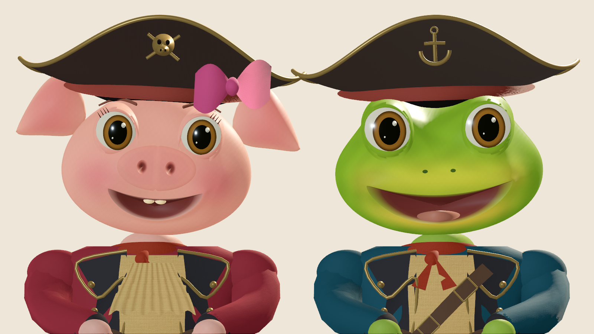
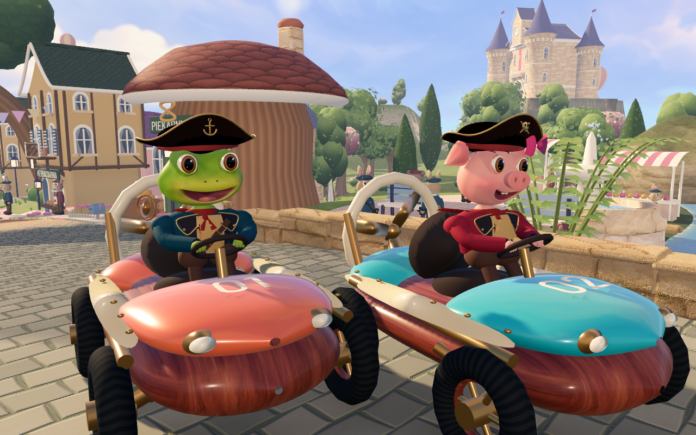

# Świnka i Żabol — podobieństwo i mimika, v4

Nowe modele wdrożono 2026-11-17 po ponownym porównaniu z oryginalnymi portretami Akademii Oli. Poniżej są natywne rendery trójwymiarowych modeli gry, zachowane bez retuszu. Nie są obrazami koncepcyjnymi ani teksturami naklejonymi na twarz.



| Postać | Oryginał Akademii Oli | Poprzednia wersja v3 | Nowy model v4 |
|---|---|---|---|
| Świnka | [Portret](../character-lookdev-v2/canonical-swinka.webp) | [Siatka v3](../portraits-v3/screenshots/swinka_threequarter.png) | [Zbliżenie](screenshots/swinka_face.png), [trzy czwarte](screenshots/swinka_threequarter.png), [profil](screenshots/swinka_profile.png) |
| Żabol | [Portret](../character-lookdev-v2/canonical-zabol.webp) | [Siatka v3](../portraits-v3/screenshots/zabol_threequarter.png) | [Zbliżenie](screenshots/zabol_face.png), [trzy czwarte](screenshots/zabol_threequarter.png), [profil](screenshots/zabol_profile.png) |

## Zmiany kształtu

Świnka ma krótszą głowę z szerszymi dolnymi policzkami, bardziej wypukłe czoło, mniejszy owalny ryjek i zagłębione nozdrza. Szerokość ryjka zmniejszono z 0,45 do 0,356 jednostki modelu, a ust z 0,51 do 0,426. Uśmiech ma mniejsze otwarcie. Uszy są miękkimi objętościami o zakrzywionym przekroju; kokarda znajduje się po lewej stronie postaci, zgodnie z portretem. Zmieniono kolor skóry, rumieńce i głębszy czerwony odcień stroju.

Żabol ma bardziej zwartą głowę, pełniejszą żuchwę, wypukłe okolice oczu i szerszą powierzchnię pyska nad ustami. Dolna część pyska ma silniejsze żółte zabarwienie, a zielona skóra drobną nierównomierność pigmentu. Oczy obu postaci są niższe w pionie, z większym udziałem brązowej tęczówki i źrenicy. Powieki tworzą miękkie powierzchnie, zamiast wystających rurek. Ramiona są nieco szersze względem głowy; dłonie zachowują położenie na kierownicy.

Przód i tył głowy korzystają ze wspólnego obrysu polarnego. Normalne są obliczane z pochodnych powierzchni, a wnętrze ust ma zamknięte dno. Usunięto prześwity na łączeniu czaszki i w głębi ust. [Szczegóły modeli i odbudowa](../CHARACTERS.md).

## Mimika na GPU

- Górna i dolna powieka mają zapisane osobne pozycje otwarcia i zamknięcia, a także normalne zamknięcia. Shader interpoluje je bez spłaszczania całej gałki ocznej.
- Rzęsy Świnki podążają za górną powieką. Zamknięte oko ma subtelną linię styku powiek.
- Tęczówki i źrenice wykonują niewielkie, płynnie wygaszane zmiany kierunku patrzenia; przy skręcie spojrzenie reaguje na sterowanie z atlasu GPU.
- Uśmiech lekko zmienia kąciki ust, dolną wargę i żuchwę. Brwi oraz uszy mają niewielki ruch. Głowa ma łagodny, różny dla postaci przechył oraz spokojny ruch w bezczynności.

Compute shader oblicza parametry powiek, uśmiechu, spojrzenia i ruchu głowy raz na kierowcę. Przechowuje je w dwóch wolnych texelach na aktora w wierszu 6 istniejącego atlasu 32×8. Shadery wierzchołków odczytują ten sam wynik dla każdej kamery. Nie dodano bufora ani dodatkowych danych wysyłanych przez CPU co klatkę. Zegar aktora zatrzymuje produkcyjna pauza. Podglądy bez przypisanego aktora korzystają z globalnego zegara GPU.

W grze nie ma pętli CPU animującej twarz, aktywnego Skeleton3D ani odczytu atlasu do CPU. Parametr `ir_face_state` służy do odtwarzalnych ujęć i testów; zwykła gra zostawia go w trybie automatycznym. Nie dodano animacji mowy ani pełnego systemu emocji.

| Postać | Spokojny wyraz | Silniejszy uśmiech | Zamknięte oczy | Spojrzenie |
|---|---|---|---|---|
| Świnka | [Obraz](screenshots/swinka_calm.png) | [Obraz](screenshots/swinka_joy.png) | [Obraz](screenshots/swinka_blink.png) | [Obraz](screenshots/swinka_gaze.png) |
| Żabol | [Obraz](screenshots/zabol_calm.png) | [Obraz](screenshots/zabol_joy.png) | [Obraz](screenshots/zabol_blink.png) | [Obraz](screenshots/zabol_gaze.png) |



## Kontrola

Nowy test obrazu obejmuje obie postacie w trzech profilach jakości. W otworze oka osobno liczy białko i ciemną źrenicę. Uwzględnia przechylenie głowy i pomija refleksy na otaczającej skórze. Po zamknięciu obu powiek wykryto zero pikseli białka i źrenicy w każdym z sześciu przypadków. Osobno potwierdzono widoczną zmianę uśmiechu i kierunku spojrzenia: 24 asercje PASS.

Test geometrii: 16 PASS. Test grafiki PASS. Obsługa sesji i podglądów: 40 PASS. GPU skin porównuje sześć siatek z referencyjnym Skeleton3D przy wyłączonej dodatkowej mimice. Korzysta z trzech rzeczywistych zestawów póz odczytanych z GPU przez poprawnie zakończony test GPU motion; sprawdza SHA-256 bieżącego compute shadera i przesyła te same liczby do próbkowanej tekstury RGBA32F. Rozdziela to własność obrazu storage compute od pomocniczego Skeleton3D, których wspólne zamykanie potrafiło zawieszać Iris Xe. Odczyty i plik pośredni istnieją wyłącznie w narzędziach testowych. GPU life sprawdza widoczne mruganie oraz dokładne zatrzymanie i wznowienie wspólnego zegara w produkcyjnej pauzie.

[Końcowe logi](TEST_LOGS.json), [SHA-256 źródeł, referencji, siatek i obrazów](ASSET_MANIFEST.json). Testy sprawdzają działanie geometrii i animacji; nie potwierdzają artystycznego podobieństwa ani akceptacji wyglądu przez użytkownika. Nowe modele pozostają stylizowaną interpretacją portretów, a nie ich identyczną rekonstrukcją.

GPU motion: 143 asercje PASS, obejmujące także obecność i zakres parametrów mimiki wszystkich sześciu kierowców oraz zamrożenie całego atlasu podczas pauzy. GPU skin: sześć porównań PASS. GPU life: 11 asercji PASS.

## Płynność

Godot 4.7.2, Windows, Vulkan / Forward+, Intel Iris Xe, okno 1280×800, bez VSync i limitu FPS. Trzy próby wykonano kolejno, bez drugiej instancji gry. Przygotowanie grafiki, pierwsze dwie klatki, pięć sekund rozgrzewki oraz zapis obrazu są poza pomiarem. High obejmuje około 40 s jazdy i pełne okrążenie, pozostałe około 12 s; nie są bezpośrednio porównywalnymi przebiegami. Liczniki kompilacji w czasie jazdy zachowano w JSON.

<!-- MEASUREMENTS -->
| Próba | Średnie FPS | p99, ms | Maksimum, ms |
|---|---:|---:|---:|
| High, 1 widok, pełne okrążenie | 25.75 | 47.80 | 50.10 |
| Balanced, 1 widok, krótka próba | 54.61 | 24.01 | 26.32 |
| Performance, 4 widoki | 39.48 | 35.49 | 42.02 |
<!-- /MEASUREMENTS -->

Surowe wyniki znajdują się w `docs/benchmarks/academy_*.json`. Dotyczą tej Iris Xe i tych ustawień, a nie docelowej wydajności 1080p czy stałych 60 FPS. [Poprzedni etap](../portraits-v3/README.md) pozostaje zachowany.

## Odtworzenie

```powershell
godot --headless --editor --single-threaded-scene --path . --import --quit
godot --headless --path . --script tools/academy_character_builder.gd
godot --headless --path . --script tests/test_art.gd
godot --headless --path . --script tests/test_portrait_assets.gd
godot --path . --script tools/review_academy_faces.gd
godot --path . --script tools/review_character_game.gd
godot --path . --script tests/test_academy_faces.gd
godot --path . --script tests/test_gpu_motion.gd
godot --path . --script tests/test_gpu_skin.gd
godot --path . --script tests/test_gpu_life.gd
```

Nowe aktywne modele to `assets/characters/academy_v4/`. Geometria powstaje lokalnie offline; gra ładuje gotowe zasoby. Nie wysyłano artworku do usług 3D ani nie pobrano cudzych modeli. Projekty kierowców zachowują pochodzenie z Akademii Oli. [Pochodzenie całego projektu](../PROVENANCE.md).
