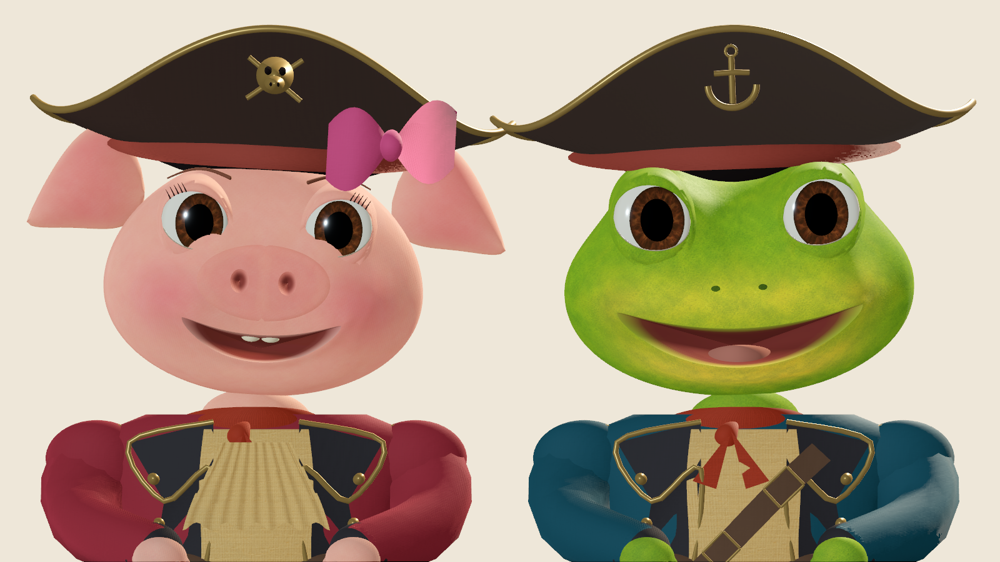
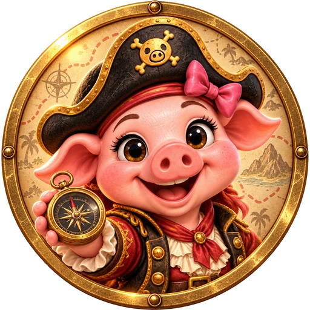
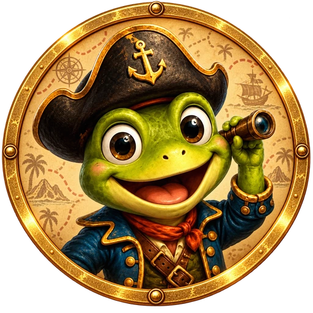
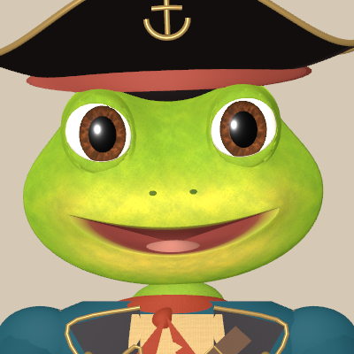
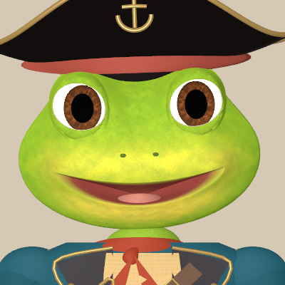
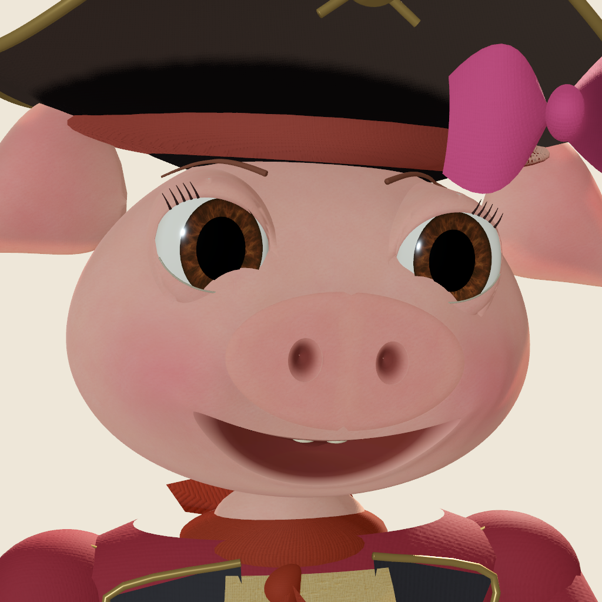
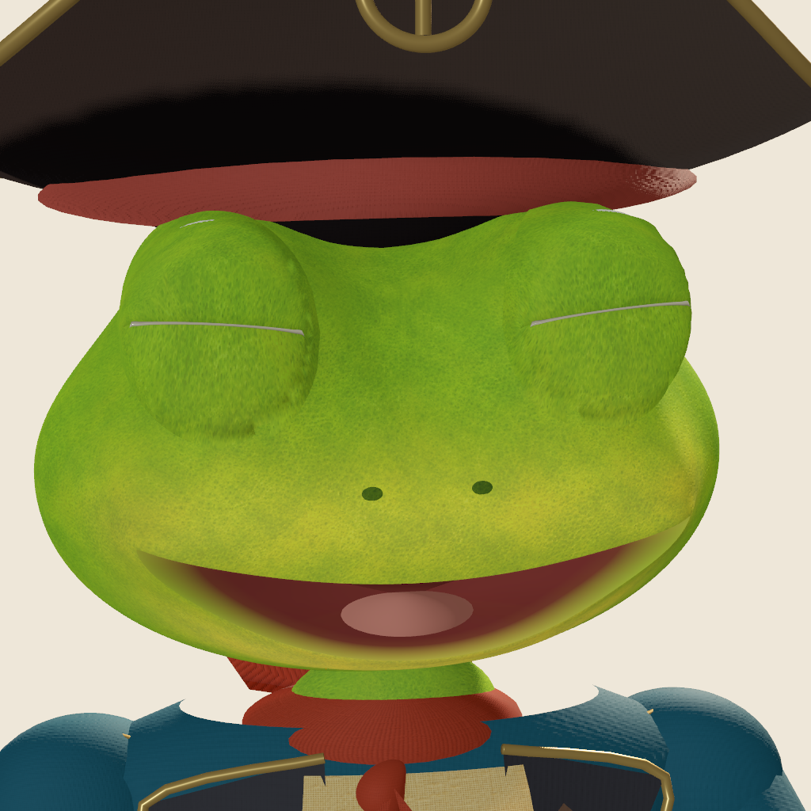
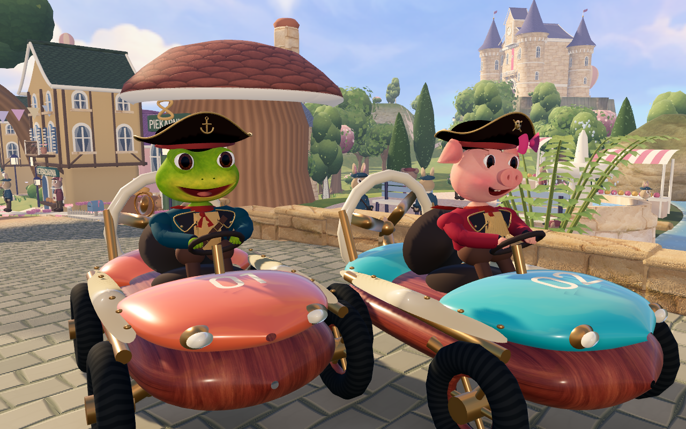

# Świnka i Żabol — oczy, skóra i wyraz twarzy v5

2026-11-17. W grze aktywne są siatki `assets/characters/academy_v5/`. Przyrost zastępuje jednolite materiały twarzy, płaskie tęczówki i geometryczne białe odblaski warstwowym okiem oraz skórą z drobnym pigmentem. Podstawą pozostają oryginalne portrety Akademii Oli. Podobieństwo wymaga oceny użytkownika; wyniki techniczne go nie potwierdzają.

| Referencja Świnki | Referencja Żabola |
|---|---|
|  |  |

## Oczy

Białko jest pierścieniem z otworem, pod którym leży zagłębiona, lekko wklęsła tęczówka i osobna źrenica. Brązowa tęczówka otrzymała nową teksturę z nieregularnymi włóknami. Jej kolor jest łagodzony w materiale, żeby uniknąć jaskrawej pomarańczowej obwódki. Oko jest mniej wysunięte przed twarz, a powieki cieńsze. Zniknęły białe kule udające odbicia. Osobna wypukła rogówka odbija rzeczywiste światła; refleks zależy od kamery, normalnej powierzchni i oświetlenia.

Rogówka używa `blend_premul_alpha` z małą alfą, niską szorstkością i `PREMUL_ALPHA_FACTOR`. To przezroczysta warstwa odbicia, bez symulacji refrakcji. Odpowiada to [modelowi materiału opisanemu w dokumentacji Godot](https://docs.godotengine.org/en/stable/tutorials/shaders/shader_reference/spatial_shader.html). Jest jedna dodatkowa powierzchnia na kierowcę, wspólna dla obu oczu. Nie dodano drugiego renderowania sceny ani odczytu ekranu.

| Rogówka włączona, testowe światło z przodu | To samo światło, odbicie wyłączone |
|---|---|
|  |  |

W stałym teście światło patrzy na stronę −Z modelu. Obrócenie światła o 180° usuwało refleks z widocznej części oka, co wykryło porównanie obrazów. Końcowy test przy niezmiennej kamerze i świetle mierzy wyłącznie wkład rogówki: ponad 1 100 zmienionych pikseli w każdym profilu, próg 100. W słabszym lub bocznym oświetleniu refleks jest odpowiednio słabszy.

## Skóra i mimika

Żabol ma delikatne pory, drobne plamki i nieregularne przejścia zieleni z żółtym. Świnka ma drobne pory, cieplejszy pigment i rumieniec policzków. Trójpłaszczyznowe mapowanie w przestrzeni modelu utrzymuje szczegóły przy poruszającej się głowie; normalizacja względem średniego koloru bitmapy zachowuje zaprojektowaną paletę. Szorstkość zmienia się wraz z detalem, połysk skóry został osłabiony, a warstwa lakieru wyłączona. Mały bump jest obliczany w shaderze. `BACKLIGHT` daje tanie przybliżenie światła przechodzącego przez skórę, zgodnie z [dokumentacją Godot](https://docs.godotengine.org/en/stable/tutorials/shaders/shader_reference/spatial_shader.html); nie jest to pełne rozpraszanie podpowierzchniowe.

Policzki Świnki są pełniejsze, kąciki ust mają łagodne zagłębienia, a spoczynkowy uśmiech jest mniej rozwarty. Przy radości porusza się żuchwa, policzki, kąciki i powieki. Dolna wilgotna krawędź oka i rzęsy podążają za mrugnięciem. Zęby zachowują pozycję górnej szczęki, a jama ustna ma mniejszy połysk, aby nie odbijała jasnego pasa jak plastik.

| Świnka — uśmiech | Żabol — zamknięte powieki |
|---|---|
|  |  |

Compute nadal wyznacza parametry mimiki i sześciu kości w istniejącym atlasie RGBA32F 32×8. Shader wierzchołków wykonuje deformację twarzy i skórkowanie; rogówka korzysta z tego samego wspólnego kodu deformacji. Spojrzenie przesuwa tęczówki i źrenice pod nieruchomą względem oka rogówką. Wewnętrzny brzeg białka podąża za tęczówką, a zewnętrzny zostaje pod powieką; eliminuje to szczeliny przy zmianie kierunku patrzenia. CPU nie przesyła co klatkę celów powiek ani póz twarzy. Pakiet sterowania pozostaje 96 B oraz 16 B parametrów kroku. Produkcyjna pauza zatrzymuje zegar aktora. Nie jest to system mowy ani pełny zestaw emocji.

## Tekstury i geometria

Trzy nowe PNG powstały wbudowanym **image_gen**, wyłącznie z opisów tekstowych. Zapisano je bez skalowania i edycji, w natywnym rozmiarze **1254×1254 px**. Dokładne prompty, tryb narzędzia oraz ścieżki wynikowe i źródłowe: [TEXTURE_PROMPTS.json](TEXTURE_PROMPTS.json). Archiwizator porównuje SHA-256 kopii z oryginalnymi wynikami, jeśli są dostępne lokalnie.

- [Tęczówka](../../assets/textures/academy_iris_v5.png)
- [Skóra Żabola](../../assets/textures/academy_frog_skin_v5.png)
- [Skóra Świnki](../../assets/textures/academy_pig_skin_v5.png)

| Profil | Żabol: wierzchołki | Świnka: wierzchołki | Powierzchnie na model |
|---|---:|---:|---:|
| High | 46 716 | 58 884 | 3 |
| Balanced | 27 730 | 35 104 | 3 |
| Performance | 16 586 | 20 850 | 3 |

Źródła: `tools/organic_face_geometry.gd`, `tools/organic_character_builder.gd`; wspólna konstrukcja głów i strojów pochodzi z własnych narzędzi v4/v3. Każdy wariant zachowuje indeksowe LOD. Modele są wytwarzane offline i ładowane jako gotowe zasoby; renderowanie i zmienna mimika działają na GPU. Projekty postaci zachowują pochodzenie z Akademii Oli. Nie wysyłano portretów do zewnętrznej usługi 3D.

## W rzeczywistej grze

[Świnka w kokpicie](screenshots/cockpit_swinka.png), [Żabol w kokpicie](screenshots/cockpit_zabol.png), [widok jazdy](screenshots/drive_visibility.png). Portrety studyjne używają tego samego układu świateł co v4; osobny test rogówki ma mocniejsze światło skierowane na twarz. Wszystkie 38 obrazów to niezmienione pliki PNG zapisane przez Godot, bez retuszu i generowania obrazów postaci zamiast renderów.

## Kontrole i koszt

Końcowe logi: [TEST_LOGS.json](TEST_LOGS.json). Zestaw obejmuje kontrolę grafiki, 16 kontroli geometrii i kokpitu, 24 kontroli materiałów i rozdzielenia rogówki, 40 kontroli sesji, 30 porównań oczu i mimiki, 143 kontrole compute, sześć porównań skórkowania z CPU oraz 11 kontroli życia świata, mrugania i pauzy. Test skórkowania korzysta z [rzeczywistych, zweryfikowanych póz GPU](GPU_POSES.json) powiązanych z SHA-256 shadera, aby pomocniczy szkielet CPU nie współdzielił cyklu życia obrazu storage compute.

Pomiary wykonano kolejno, bez równoległych instancji gry, w Godot 4.7.2 Forward+/Vulkan na Intel Iris Xe. Okno 1280×800; skale profili i rozmiary poszczególnych widoków zapisano w surowych JSON. Są to pomiary całej sceny po przygotowaniu wariantów renderowania, nie izolowany benchmark twarzy.

<!-- MEASUREMENTS -->
| Próba | Średnie FPS | p99, ms | Maksimum, ms |
|---|---:|---:|---:|
| High, 1 widok, pełne okrążenie | 23.26 | 60.64 | 63.69 |
| Balanced, 1 widok, krótka próba | 48.91 | 29.52 | 30.96 |
| Performance, 4 widoki | 33.46 | 40.75 | 42.70 |
<!-- /MEASUREMENTS -->

[High](../benchmarks/organic_single_forward_plus_high_circuit.json), [Balanced](../benchmarks/organic_single_forward_plus_balanced.json), [cztery widoki Performance](../benchmarks/organic_four_forward_plus_performance.json). Dodatkowa rogówka zwiększa liczbę powierzchni z dwóch do trzech, a skóra wymaga dodatkowych próbek tekstur. Krótka próba Balanced nie jest bezpośrednim porównaniem pełnego okrążenia High. Wyniki nie potwierdzają 60 FPS ani wydajności w 1080p.

Odtworzenie: polecenia w [CHARACTERS.md](../CHARACTERS.md), następnie `python tools/archive_organic_review.py`. [ASSET_MANIFEST.json](ASSET_MANIFEST.json) zawiera rozmiary i SHA-256 modeli, tekstur, źródeł, pomiarów i obrazów. Zachowane [v4](../academy-v4/README.md) pozwala porównać poprzedni wygląd. Ocena podobieństwa, miękkości materiałów i wyrazu twarzy pozostaje oceną wizualną.
