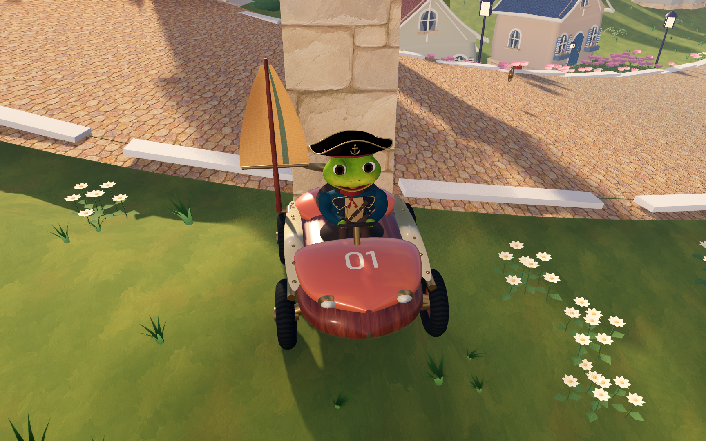

# Kolizje pojazdów i fizyczny teren

2026-11-17. Samochody korzystają z `RigidBody3D` i jawnie wybranego backendu Jolt. Jezdnia oraz pełna siatka wyspy mają fizyczne powierzchnie. Zjazd na trawę kończy się kontaktem z terenem, a wpadnięcie poniżej poziomu morza natychmiast przywraca auto przy ostatniej legalnej bramce.

## Publiczna implementacja

Wykorzystano działającą implementację [Jolt Physics](https://github.com/jrouwe/JoltPhysics) dostarczaną z Godot 4.7.2. [Opis autora](https://jrouwe.github.io/JoltPhysics/md__docs__architecture.html#the-simulation-step) wskazuje sekwencyjny solver impulsów z warm starting według prac Erina Catto. Publiczny [ContactConstraintManager.cpp](https://github.com/jrouwe/JoltPhysics/blob/master/Jolt/Physics/Constraints/ContactConstraintManager.cpp) zawiera obsługę ograniczeń kontaktu, tarcia i ich rozwiązywania. Integracja z projektem korzysta z [wbudowanego modułu Godot](https://docs.godotengine.org/en/stable/tutorials/physics/using_jolt_physics.html), bez kopiowania C++ do GDScript i bez osobnej zależności binarnej. Informacje licencyjne użytej binarki pozostają w [GODOT_NOTICES.json](../GODOT_NOTICES.json).

`scripts/vehicle_contacts.gd` konfiguruje rzeczywiste bryły, a `scripts/vehicle.gd` realizuje sterowanie arcade w bezpiecznym callbacku [`_integrate_forces`](https://docs.godotengine.org/en/stable/classes/class_rigidbody3d.html#class-rigidbody3d-private-method-integrate-forces). Grawitację, wykrywanie zderzeń i impulsy kontaktu wyznacza silnik. Usunięto produkcyjne rozpychanie obrysów i limit impulsu 6, który sztucznie osłabiał silniejsze uderzenia.

| Parametr | Wartość |
|---|---:|
| Krok fizyki | 60 Hz |
| Masa wózka żaglowego | 280 kg |
| Masa pojazdu z kołem zamachowym | 380 kg |
| Obrys bryły | 2,2 × 1,1 × 3,3 m |
| Tarcie materiału podwozia | 0,25 |
| Opór materiału jezdni i gruntu | 0,02 |
| Odbicie materiału podwozia | 0,08 |
| Zgłaszane punkty kontaktu | do 16 |

Ruch w pionie i obrót wokół pionowej osi pozostają fizyczne. Przechyły X/Z są zablokowane dla charakteru gry arcade. Opony mają własną przyczepność boczną, mniejszą w brodzie; sterowanie stopniowo koryguje prędkość obrotową, dzięki czemu impuls przy narożnym uderzeniu nie znika w kolejnej klatce. Krótka sonda o zasięgu 0,45 m pod autem utrzymuje sterowanie przy małych nierównościach, dodając docisk zamiast teleportowania nadwozia. Skok wyłącza ten docisk. Niski opór materiału podłoża pozwala skręcać bez tarcia całej skrzyni o asfalt; grip opon wyznacza kontroler. Napęd ogranicza przyspieszanie, a nie ucina prędkości otrzymanej w zderzeniu. Ciała nie zasypiają podczas oczekiwania na start. Wyłączenie gałęzi przetwarzania zamraża je także fizycznie w menu i podglądach.

## Naprawa spadania pod mapę

Wcześniej wyspa miała widoczną siatkę, ale nie miała collidera. Jedynie pas jezdni, wąskie pobocza i skrót zapewniały podparcie. `scripts/scenery_art.gd` tworzy teraz `IslandGround/IslandGroundCollision` z dokładnie tych samych **64 512 trójkątów** co renderowany teren. Collider obejmuje wzgórza, brzegi i wycięcia potoków; nie jest płaską niewidoczną płytą. Jego warstwa 1 jest uwzględniona przez maskę samochodów.

Zwykły zjazd na pobocze nadal daje dwie sekundy na powrót przed automatycznym odzyskaniem pojazdu. Dla upadku poniżej Y = −8 m nie ma już tego opóźnienia. Odzyskanie zachowuje kolejność bramek i stan okrążeń.



[Drugi typ samochodu](offroad_flywheel.png). To niezmienione obrazy natywnego renderera zapisane w pełnym ekranie. Podczas próby wyłączono kontroler i odzyskiwanie testowanego auta; podparcie pochodzi z realnego collidera.

## Przejazd AI

Skrót korzysta z własnych punktów trasy, a nie projekcji na główną drogę. AI wjeżdża do niego po zaliczeniu bramki wejściowej, zwalnia odpowiednio do krzywizny i prędkości obrotowej podwozia, a przy wyjeździe celuje przez legalną bramkę. Sterowanie ma mniejszy minimalny promień skrętu przy małej prędkości. Odzyskiwanie ominiętej bramki działa również po większym skoku najbliższego punktu trasy. Nie przyznaje pominiętych checkpointów.

## Kontrola

| Końcowa próba | Wynik |
|---|---|
| Fizyka podwozi i działający kontroler | 35 kontroli, PASS |
| Fizyczne podłoże i zjazdy z asfaltu | 1 461 kontroli i 576 promieni, PASS |
| Sesja i zamrożenie podwozi w podglądzie | 42 kontrole, PASS |
| Reguły i prowadzenie przez bramki | 139 kontroli, PASS |
| Integralność oprawy i kontaktów | PASS |
| Świat, skrót i wyposażenie | 23 kontrole, PASS |
| Pełny wyścig | Sześć aut, trzy legalne okrążenia; ostatnie auto: 101.02 s symulacji |
| Natywny renderer, pełny ekran | Oba typy pojazdów fizycznie podparte poza jezdnią, PASS |

Końcowe wyniki: [TEST_LOGS.json](TEST_LOGS.json), [fizyka pojazdów](physics_results.json), [teren](offroad_results.json), [natywne ujęcia](native_review.json). Test podłoża obejmuje 576 promieni po obu stronach całego okrążenia, porównanie trójkątów renderowania i fizyki, zrzucenie obu typów podwozi w sześciu odcinkach, rzeczywisty przejazd przez obie krawędzie jezdni oraz natychmiastowy powrót z wody. Żaden kontroler ani respawn nie ukrywa upadku w próbach podparcia.

Test zderzeń sprawdza pęd, energię liniową i obrotową, masę, uderzenia centralne i narożne, tarcie styczne, sześć aut w karambolu, brak fałszywych kontaktów na różnych wysokościach, ścianę, ruch przy pełnym dopalaczu oraz działający napęd i hamulce po otrzymaniu impulsu. Osobne testy obejmują sesję, reguły i pełny wyścig sześciu AI przez trzy uporządkowane okrążenia.

```powershell
godot --headless --path . --fixed-fps 60 --script tests/test_vehicle_physics.gd
godot --headless --path . --fixed-fps 60 --script tests/test_offroad_physics.gd
godot --headless --path . --fixed-fps 60 --script tests/test_session.gd
godot --headless --path . --script tests/test_rules.gd
godot --headless --path . --script tests/test_art.gd
godot --headless --path . --script tests/test_living.gd
godot --headless --path . --fixed-fps 60 -- --race-test
godot --path . --fullscreen --script tools/review_offroad.gd
```

Jolt oblicza fizykę na CPU; grafika, mimika, skórkowanie i cząsteczki zachowują dotychczasowe wykonanie GPU. To podwozie arcade, bez osobnego zawieszenia każdego koła i bez deformacji karoserii. CCD nie jest gwarancją dla dowolnej prędkości: badawcza próba dwóch aut jadących naprzeciw siebie po 500 m/s wykazała przenikanie w użytej integracji. Zachowano [surowy wynik tej próby](exploratory_results.json). Końcowe testy przeciwbieżnych aut obejmują trzy fazy zderzenia przy maksymalnym dopalaczu 49,92 m/s; statyczna cienka ściana jest testowana osobno przy 800 m/s. Własności i ograniczenia liniowego CCD opisuje [autor Jolt](https://jrouwe.github.io/JoltPhysics/md__docs__architecture.html#continuous-collision-detection). Nie wykonywano nowego pomiaru FPS; wcześniejsze raporty grafiki dotyczą wcześniejszej konfiguracji sceny.
