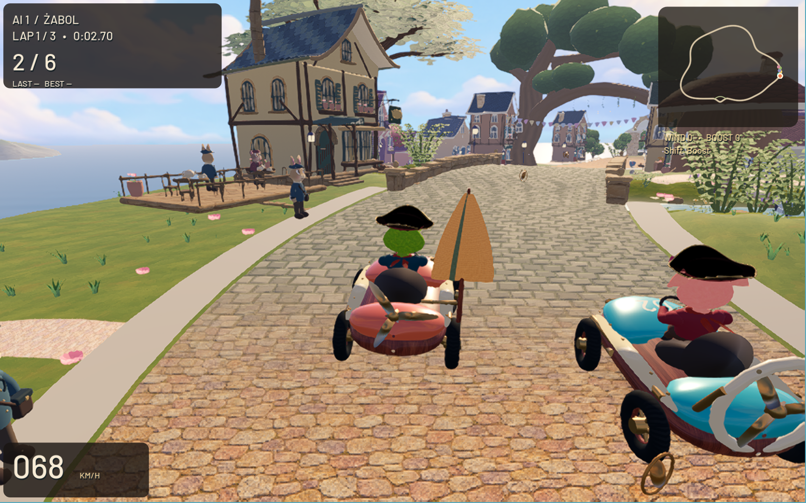
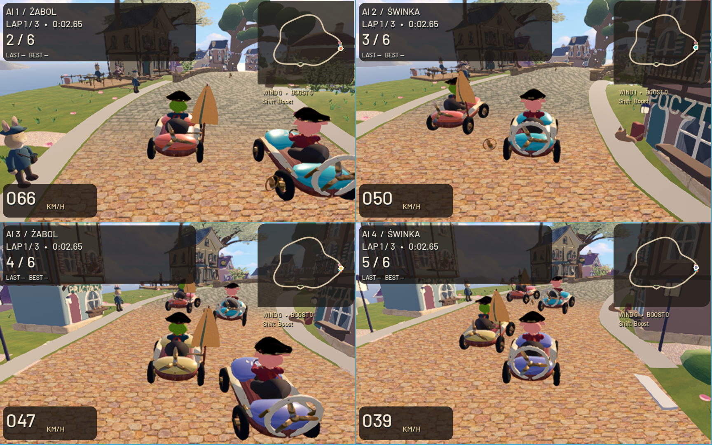
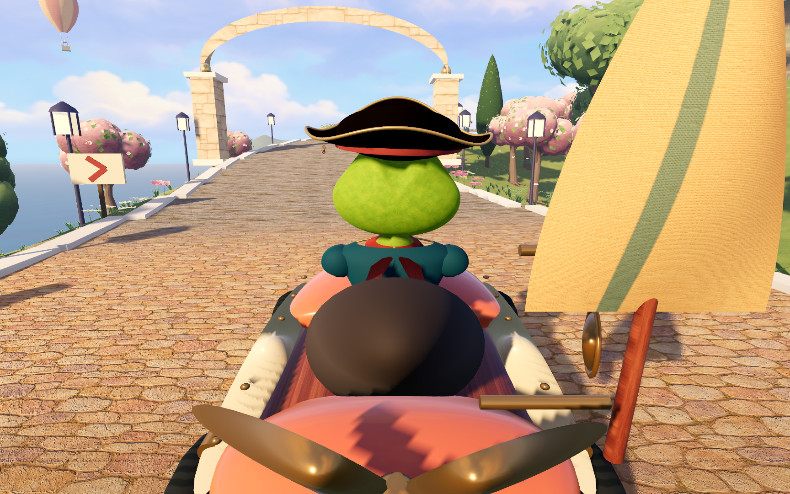
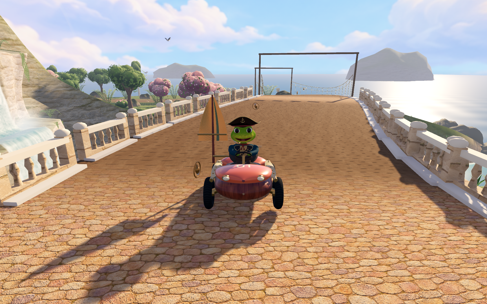
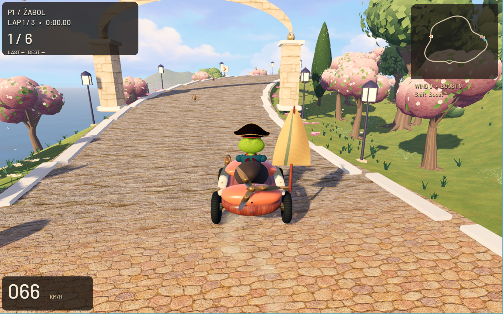
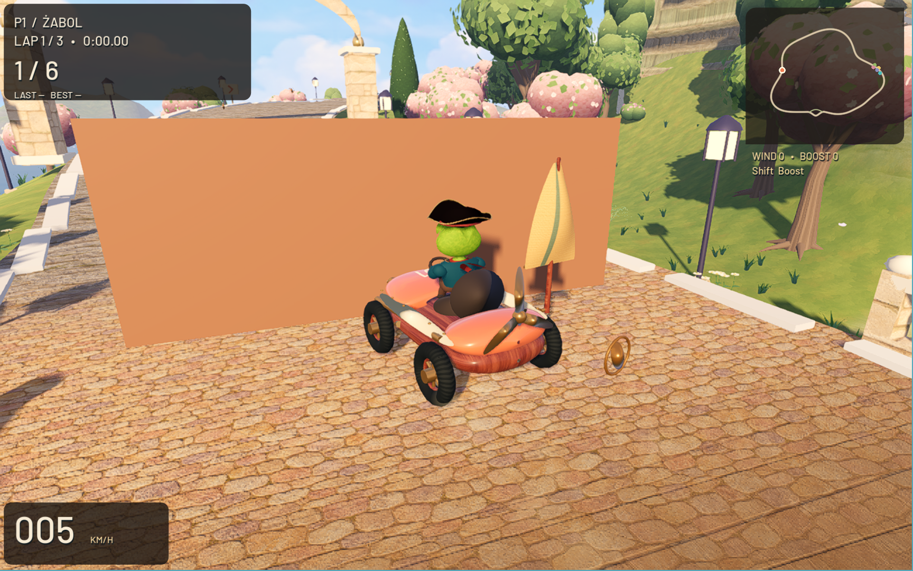
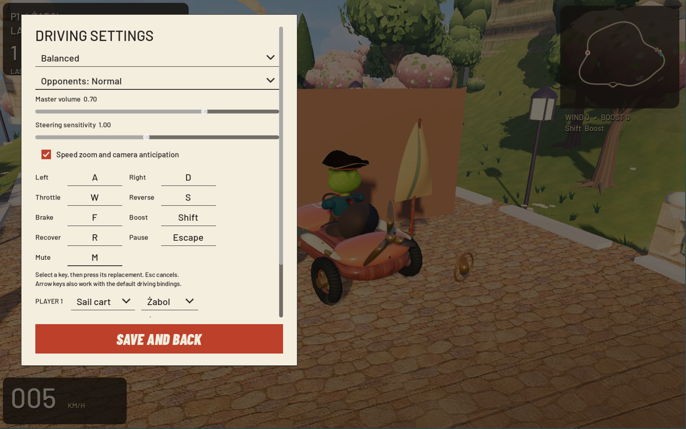
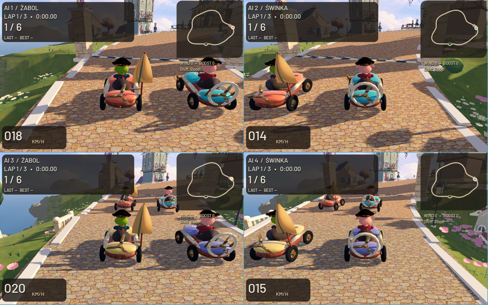
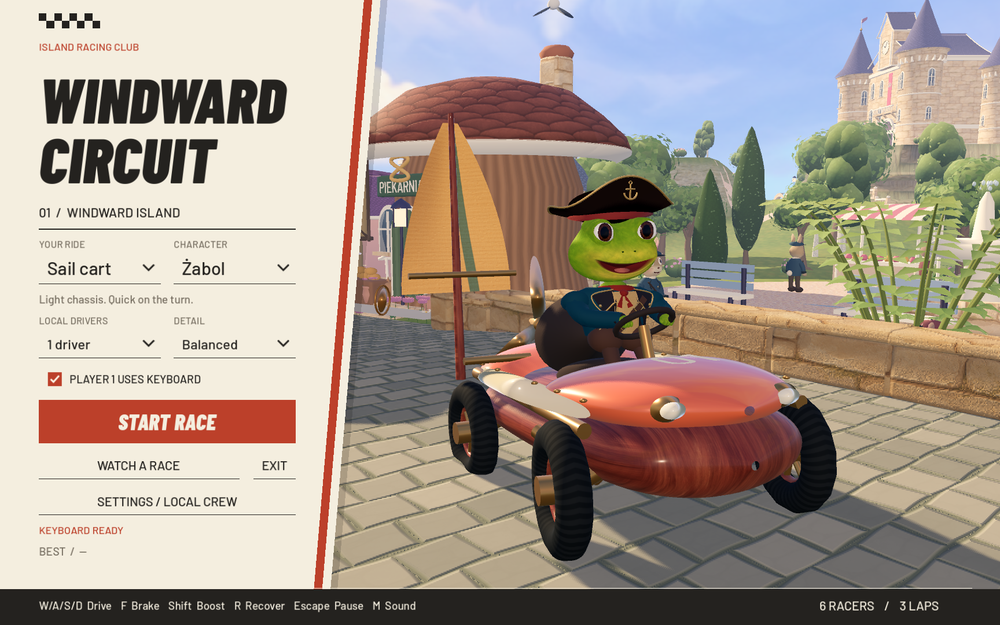

# Podstawy jazdy — 18 listopada 2026

Przyrost rozwija działający wyścig: prowadzenie, kamerę, dźwięk, ruch przeciwników i obsługę gracza. Pozostaje jeden tor i dwa pojazdy; pełny wcześniejszy zakres gry nadal wymaga produkcji.

## Prowadzenie i kontakt

Skręt z klawiatury narasta i centruje się stopniowo. Pad ma przeskalowaną martwą strefę i regulowaną czułość. Przy dużej prędkości skręt jest łagodniejszy, a w powietrzu ograniczony. Wciśnięcie przeciwnego kierunku najpierw hamuje auto, potem pozwala cofać. Przyspieszenie zmienia się wraz z prędkością. Silne uderzenie na krótko osłabia korekcję kierunku, zachowując obrót nadany przez Jolt.

Paving, dirt, wood, water, grass i sand mają osobne wartości przyczepności, oporu i napędu. Ciężki pojazd może ruszyć również na miękkim podłożu; opór narasta wraz z jego prędkością. Poza centralną sondą cztery sondy przy narożach pomagają utrzymać podparcie na spadkach. Podwozie pozostaje jedną bryłą arcade, bez osobnego fizycznego zawieszenia każdego koła. Grafika kół, kierowców, mimiki i cząsteczek zachowuje wykonanie GPU; fizyka Jolt działa na CPU.

Powrót sprawdza kilka pozycji przy ostatniej legalnej bramce i pomija miejsca zajęte przez auta oraz stałe przeszkody. Nie przyznaje punktów kontrolnych. Jeśli nie ma miejsca, próba czeka i jest ponawiana; kolejne ręczne użycie ma krótki cooldown.

## Kamera, rywalizacja i tor

Kamera sprawdza prześwit sferą o promieniu 0,32 m za pomocą [`cast_motion`](https://docs.godotengine.org/en/stable/classes/class_physicsdirectspacestate3d.html#class-physicsdirectspacestate3d-method-cast-motion). Kurczy ramię od razu przed przeszkodą i wydłuża je stopniowo po jej minięciu. Cofanie zmienia kierunek widoku, a odzyskanie pojazdu resetuje odległą kamerę. Zmienny kąt widzenia i wyprzedzenie można wyłączyć w ustawieniach.

AI co 0,15 s ocenia pasy, położenie innych aut i statyczną geometrię przed sobą. Wybiera miejsce mijania, dopasowuje prędkość do zajętego przejazdu i hamuje przy zablokowanych korytarzach. Przy grocie pozostaje na środku wąskiego przejazdu. Easy/Normal/Hard zmieniają docelowe tempo, zachowując osiągi podwozia.

Amplituda dodatkowego leśnego slalomu spadła z 3,5 do 1,8 m. Osiem znaków zapowiada kierunek zakrętów. Jezdnia przy ścianie groty zachowuje poprzednią bezpieczną szerokość; próba jej poszerzenia wykryła przecięcie ze skałą i została skorygowana. Teren i rozmieszczenie otoczenia powstają ponownie z aktualnej krzywej toru, więc zachowują zgodność z drogą.

## Audio i interfejs

Osiem oryginalnych WAV powstaje z `python tools/build_driving_audio.py`. Nie wykorzystują nagrań ani cudzych sampli. [`AudioStreamPlayer3D`](https://docs.godotengine.org/en/stable/classes/class_audiostreamplayer3d.html) obsługuje ograniczone przestrzennie głosy napędu, opon i toczenia oraz pojedyncze zdarzenia kontaktu, lądowania, dopalacza i nasiona. Pitch oraz głośność zależą od prędkości, gazu i uślizgu. Kontakt jest przekazywany z rzeczywistego impulsu fizyki. Wyłączenie auta w menu wycisza jego głosy.

HUD pokazuje ostatnie i najlepsze okrążenie, różnicę czasu na wspólnym punkcie kontrolnym, jazdę pod prąd, odliczanie powrotu i oczekiwanie na wolne miejsce. Meta otrzymała krótki komunikat FINISH, a wyniki podają postać i najlepsze okrążenie.

Panel ustawień ma przewijanie i stale dostępny przycisk powrotu. Obsługuje profil grafiki, poziom AI, głośność, czułość, efekty kamery, dziewięć akcji klawiatury i osobne wybory załogi czterech lokalnych graczy. Zajęty klawisz zamienia przypisania. Dane są walidowane i zapisywane osobno od rekordów. Przydział przycisków pada pozostaje standardowy; jego skręt korzysta z ustawionej czułości.

## Sprawdzanie

Próby fizyczne używają stałego kroku 1/60 s. Kontrola kamery stawia rzeczywistą ścianę w przestrzeni fizyki. Próba powrotu najpierw potwierdza, że miejsce jest naprawdę zajęte przez inne podwozie. Próby handlingu wyłączają odzyskiwanie i AI, aby nie mogły ukryć błędu. Test podłoża nadal sprawdza zgodność siatki i 576 promieni wokół całego okrążenia; dobiera fizycznie nieblokowane pobocze do przejazdu.

Natywna próba sprawdza żywe sterowanie i audio, cztery widoki, pauzę oraz zmianę fizycznego klawisza w panelu. Jej scenariusze są kontrolowane: zegar zawodów jest zatrzymany, auta i ściana testowa ustawiane w wybranych miejscach. To test komponentów z obrazem, odrębny od pełnego wyścigu i benchmarku. Obrazy są kopiowane bez edycji. Czterech rzeczywistych kontrolerów nie sprawdzano sprzętowo.

```powershell
godot --headless --path . --fixed-fps 60 --script tests/test_handling.gd
godot --headless --path . --fixed-fps 60 --script tests/test_driving_foundation.gd
godot --headless --path . --fixed-fps 60 -- --race-test
godot --path . --fullscreen --fixed-fps 60 --script tools/review_driving_foundation.gd
godot --path . --fullscreen --script tools/benchmark_art.gd
godot --path . --fullscreen --script tools/benchmark_art.gd -- --performance
```

Benchmark nie używa `--fixed-fps`. Pomija przygotowanie, pięć sekund rozgrzewki oraz odczyt i zapis PNG. Balanced używa skali 0,75 również dla jednego gracza, FXAA i przestrzennego FSR. Performance używa skali 0,50 i miękkiego cienia kontaktowego pod samochodem zamiast dynamicznych cieni całego otoczenia. High zachowuje pełną skalę, MSAA 4×, SSAO i SSIL. Skala profilu jest mnożona przez fizyczną skalę wyświetlania; rzeczywiste rozmiary, skale i filtry są zapisane w JSON. W Forward+ FSR jest włączane, gdy wynikowa skala jest mniejsza niż 1,0; pozostałe przypadki używają bilinear.

Performance wybiera też istniejące indeksy LOD dla instancji drzew, paproci i drobnych roślin przez [`ImporterMesh`](https://docs.godotengine.org/en/stable/classes/class_importermesh.html). Nie usuwa kolejnych instancji tej roślinności. Przykładowa powierzchnia dębu spada z 5 808 do 1 452 trójkątów, a jego liście z 9 600 do 2 400. Źródłowe siatki, materiały, High/Balanced i fizyczne kształty pozostają zachowane. Banki MultiMesh są wypełniane jawnymi transformacjami i kolorami; test sprawdza zgodność rozmieszczenia w obu rendererach użytych do kontroli.

### Wyniki kontroli

| Próba | Wynik |
|---|---|
| Prowadzenie z rzeczywistym podwoziem | 7/7; przyspieszenie do 19,55 m/s, narastanie skrętu, hamowanie i cofanie |
| Kamera, preferencje, LOD, ruch AI, odzyskiwanie i powierzchnie | 26/26 headless; 36/36 w natywnym Forward+ |
| Reguły zawodów i sesja | 139/139 oraz 42/42 |
| Żyjąca wyspa i otoczenie | 23/23 oraz 271/271, 57 modeli |
| Kontakt z otoczeniem i fizyka aut | 54/54 oraz 35/35 |
| Teren i pobocza | 1 463/1 463, w tym 576 promieni wokół toru |
| Zgodność póz animacji GPU | 143/143; maksymalny błąd kości 0,000036950 |
| Kontrola materiałów, terenu i rozmieszczenia | ART_TEST PASS |
| Pełny wyścig | Sześć aut, po trzy uporządkowane okrążenia; ostatni finisz po 114,75 s czasu symulacji |

W natywnej próbie pitch napędu wzrósł z 0,743 do 1,442 przy rozpędzeniu auta do 18,16 m/s. Rzeczywisty kontakt ze ścianą i uruchomienie dopalacza wyzwoliły swoje głosy. Zdarzenia lądowania i nasiona są podłączone, ale w tym kontrolowanym scenariuszu ich licznik wynosił zero. Sfera kamery zmniejszyła ramię z 8,50 do 2,98 m przed ścianą i ponownie je wydłużyła po jej usunięciu. Wszystkie końcowe logi mają znaczniki PASS bez błędów silnika lub skryptów.

[Pełne logi](TEST_LOGS.json), [kontrola headless](headless_results.json), [kontrola natywna](native_results.json), [podłoże](offroad_results.json), [fizyka](physics_results.json), [otoczenie](world_collision_results.json). [Manifest SHA-256](ASSET_MANIFEST.json) łączy wyniki, nieedytowane obrazy, źródła, modele i dźwięki.

### Płynność na tym komputerze

Intel Iris Xe, Vulkan/Forward+, pełny ekran, główny viewport 1920×1080. Krótkie przebiegi trwają 17 s, w tym pięć sekund rozgrzewki; pomiar pełnego okrążenia trwa 45 s. Obrazy są pobierane przed pomiarem. Wynik średni jest odwrotnością średniego czasu klatki; P99 oznacza czas, poniżej którego mieści się 99% zmierzonych klatek.

| Wersja / profil | Widoki | Średnio FPS | P99 klatki | Dane |
|---|---:|---:|---:|---|
| Punkt wyjścia `903c832`, Balanced | 1 | 9,92 | 139,59 ms | [JSON](baseline_balanced.json) |
| Poprawiony Balanced, próba krótka | 1 | 14,98 | 84,49 ms | [JSON](balanced_release.json) |
| Performance z LOD, próba krótka | 1 | 26,54 | 47,78 ms | [JSON](performance_lod.json) |
| Końcowy Performance, całe okrążenie | 1 | 26,76 | 53,56 ms | [JSON](performance_circuit.json) |
| Końcowy Performance, próba krótka | 4 | 10,15 | 109,60 ms | [JSON](four_performance.json) |

Starszy Balanced omijał obniżanie skali dla jednego gracza; dlatego porównanie obejmuje również poprawę ustawień jakości, a nie samą optymalizację równoważnego obrazu. W aktualnym pomiarze pojedynczy widok ma logiczne 1438×898 i skalę renderowania 0,60 w Performance albo 0,90 w Balanced po uwzględnieniu skali wyświetlania. Cztery widoki mają po 718×448 i skalę 0,60. Nie osiągnięto 60 FPS; cztery widoki pozostają zbyt wolne do komfortowej gry na tej karcie.

Końcowy długi przebieg przejechał legalne okrążenie przez wszystkie sześć dzielnic, z aktywnym audio, kamerą i animacją GPU. Nie odnotował klatki powyżej 100 ms; najwolniejsza trwała 60,43 ms. Nie dowodzi to stałych 30 FPS ani płynności całej sesji na każdym komputerze.

Próbny renderer Mobile był wolniejszy i zawiesił się przy zamykaniu; pozostał eksperymentem. Jego własna instancja została zamknięta, a następny pomiar z nakładającymi się procesami odrzucono. Końcowe natywne pomiary uruchomiono kolejno. Narzędzie benchmarku zwalnia teraz scenę i zasoby animacji GPU przed wyjściem. [Surowy wynik i uwagi o eksperymencie](EXPERIMENTS.json).

### Natywne ujęcia

Zrzuty są kopiami obrazu gry bez retuszu. Pierwsze dwa pochodzą z normalnego benchmarku wyścigu; pozostałe z opisanego wyżej scenariusza kontrolnego.


















