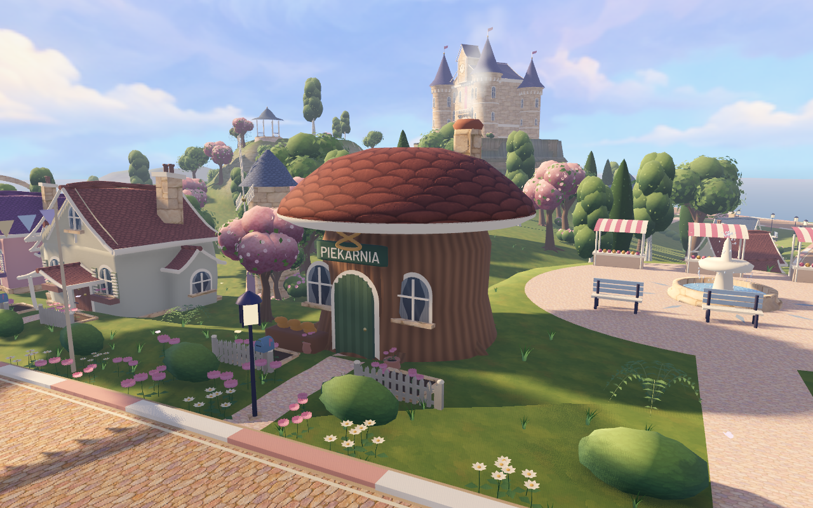
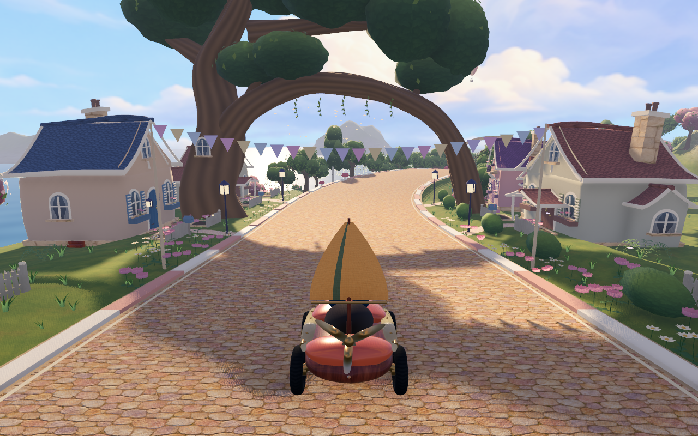

# Bajkowy kierunek — wdrożenie 2026-11-16

Wzorcowy odcinek przy wiosce ma teraz przejazd pod starym drzewem i piekarnię w pniu. Ciepłe światło, materiały, spokojniejsza łąka i skupiska roślin obowiązują na całej wyspie. Zamek otrzymał skalne tarasy, a przystań dom na palach. To wdrożenie kierunku stylizowanego 3D, nadal wymagające oceny artystycznej użytkownika.

## Formy i kompozycja

- Domki mają zaokrąglone ściany, lekko wybrzuszone bryły i asymetryczne, wygięte dachy. To deformacja zapisanych modeli wraz z oknami i obróbkami; fundament pozostaje stabilny.
- Stare drzewo wyrasta z pobocza, obejmuje drogę nierównym konarem i ma niższe gałęzie, korony, korzenie, pnącza i okienko. Test sprawdza ponad sześć metrów prześwitu nad całą szerokością korytarza jazdy.
- Piekarnia ma dach z czerwonych dachówek, tablicę „PIEKARNIA”, precel, ladę z pieczywem, donice, deskowe drzwi i komin z dymem.
- Zamek stoi na zamkniętej siatce skały z wystającymi warstwami, tarasami, zielonkawymi powierzchniami i bluszczem. Dom rybaka ma pale, drewniany pomost, schodki do wody i poręcze.
- Rabaty przy drodze tworzą nieregularne skupiska. Wyższe pobocza wioski i spokojniejsza tekstura trawy ograniczają efekt płaskiej planszy.
- Kamera jazdy ma FOV 58° i patrzy około 10 m przed pojazd, na wysokość 2 m. Osobny objazd pokazuje 11 miejsc, zaczynając od piekarni i przejazdu pod drzewem.

## Światło, materiały i woda

Światło słoneczne pada niżej i z boku, ma ciepłą barwę, a wypełnienie cieni jest chłodne, lawendowe. High ma SSAO, SSIL oraz miękkie cienie; lżejsze profile zachowują tę samą paletę bez SSIL. Ustawienia i wyniki pomiarów są w [raporcie walidacji](../GRAPHICS_VALIDATION.md).

Korony otrzymały szersze przejścia pigmentu zamiast dominującego drobnego wzoru tekstury. Kora ma filtrowane rowki, tynk delikatny gradient, a dachówki zachowują kolor malowania. Naprawiono też wyznaczanie metaliczności na granicach rodzin materiałów: drobny błąd interpolacji liczby całkowitej nie robi już z matowej powierzchni metalu.

Porównanie w natywnym rendererze wykazało, że widoczna kratka na morzu pochodziła głównie z odbierania cieni. Ocean ma teraz wyłączone odbieranie map cieni, wyższą nieprzezroczystość, kolory zależne od głębokości i pianę przy brzegu. Pod pięcioma łodziami są miękkie, analityczne przyciemnienia. Nie są pełnymi cieniami wszystkich obiektów na wodzie. Obliczenia kontaktów są ograniczone do przystani, a kaustyka do płycizn.

Motyle są mniejsze, mają zaokrąglone skrzydła i jasne spody. Dym z piekarni oraz płatki pod drzewem to GPUParticles3D. Nad kaskadą jest subtelny, półprzezroczysty łuk tęczy; jego widoczność zależy od kamery i przesłonięcia przez most.

## Nowa tekstura

[meadow_painted_v3.png](../../assets/textures/meadow_painted_v3.png) powstała we **wbudowanym image_gen**, wyłącznie z opisu tekstowego. To nieprzezroczyste RGB **1254×1254 px**, bez powiększania i bez modyfikowania pikseli po generowaniu. Oryginał generatora zachowano; plik w repozytorium jest identyczną kopią. Mipmapy są włączone.

[Dokładny prompt](PROMPTS.json), [rozmiar i SHA-256](ASSET_MANIFEST.json). Starsze tekstury oraz ich manifesty zachowano. Obrazy poniżej są zrzutami Godot, nie generowanymi wizualizacjami.

## Odbudowa i granice

`tools/enchanted_builder.gd` tworzy nowe modele i deformuje domki podczas autorskiej odbudowy zasobów. `tools/build_fairy_assets.gd` zapisuje 44 skompresowane siatki wraz z LOD. `tools/review_enchanted.gd` wykonuje dziewięć ujęć z kamery jazdy i cztery zbliżenia. Zwykłe uruchomienie gry ładuje zapisane modele.

Renderowanie i ruch dekoracji pozostają na GPU. Obliczenia póz, skinning i wspólny zegar GPU z poprzedniego etapu są zachowane. Tworzenie zasobów, budowa terenu i rozmieszczenie przy starcie, fizyka, AI, kamery oraz UI korzystają z CPU. Ten etap nie oznacza generowania całej gry bez udziału CPU.

Wygląd Żabola i Świnki pozostaje odrzuconym prototypem. Nie przebudowano ich w tym etapie. Zamek, rośliny i architektura nadal mają uproszczenia typowe dla tej wersji; zrzuty i pomiary dokumentują rzeczywisty rezultat bez deklaracji jakości finalnego wydania.
