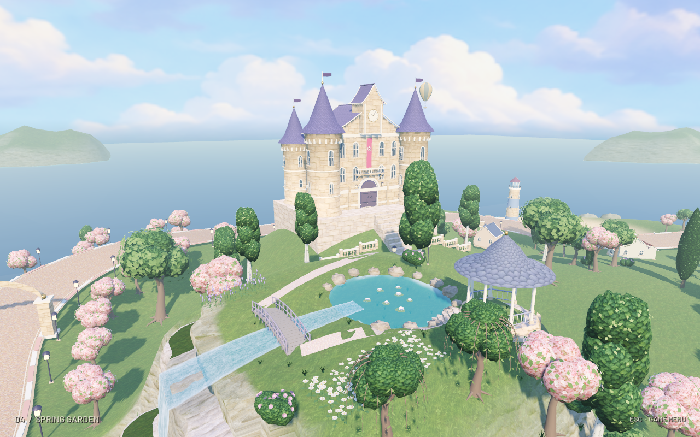
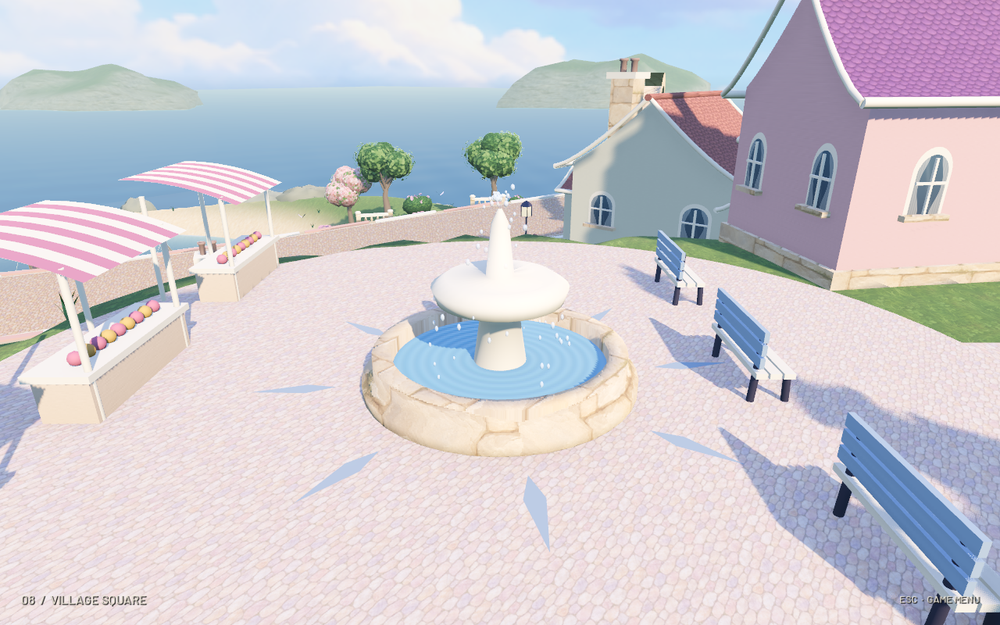

# Bajkowa wyspa — zasoby

Całe okrążenie otaczają wioska, gaj z glicynią, most przy wodospadzie, zamkowe wzgórze, ogrody i przystań. Nocny etap dopracował bryły, materiały, rośliny i rozmieszczenie dekoracji. Krzywa drogi, kolizja nawierzchni, bramki i reguły wyścigu pozostają dotychczasowe.

Najnowszy etap dodaje piekarnię w pniu, przejazd pod starym drzewem, tarasy pod zamkiem i dom rybaka. Domki są zaokrąglone i asymetryczne, rabaty mniej regularne, a światło cieplejsze. Aktywna tekstura terenu to teraz **meadow_painted_v3**, malarskie RGB 1254×1254 px z wbudowanego image_gen. [Opis, prompty i manifest nowego etapu](../enchanted-island/README.md). Poniższy zestaw v2 zachowuje swoje źródła i zastosowania w pozostałych materiałach oraz historię pochodzenia.

## Tekstury i pochodzenie

Sześć obrazów powstało we **wbudowanym image_gen**, wyłącznie z opisów tekstowych:

| Zasób | Natywny rozmiar | Zastosowanie |
|---|---:|---|
| meadow_albedo_v2 | 1254×1254 | Łąka, drobna trawa i mech |
| cliff_albedo_v2 | 1254×1254 | Naturalne warstwy wapienia |
| leaf_canopy_albedo_v2 | 1254×1254 | Liście koron |
| blossom_canopy_albedo_v2 | 1254×1254 | Kwiaty koron |
| shore_albedo_v2 | 1254×1254 | Piasek z drobnym ziarnem i muszelkami |
| storybook_sky_panorama_v2 | 1774×887 | Panorama nieba 2:1 |

Obrazy są nieprzezroczyste, zachowane w natywnej rozdzielczości i bez powiększania. Dokładne prompty są w [NIGHT_PROMPTS.json](NIGHT_PROMPTS.json), a rozmiary, tryb koloru, pliki źródłowe i SHA-256 w [NIGHT_ASSET_MANIFEST.json](NIGHT_ASSET_MANIFEST.json). Oryginały wyników generatora zachowano; do repozytorium skopiowano wybrane PNG.

`python tools/audit_night_assets.py` (Python z Pillow) porównuje aktualne obrazy i ustawienia mipmap z zapisanym manifestem. Nie modyfikuje obrazów. Przełącznik `--write` służy do jawnego odtworzenia manifestu po zaakceptowanej zmianie zasobów.

Pierwszy zestaw wyspy — bruk, mur, dachówki, glicynia i dwa spraye roślin — zachowuje własne [prompty](PROMPTS.json) i [manifest](ASSET_MANIFEST.json). Bieżące korony łączą nowe albedo z przestrzennymi liśćmi i kwiatami. Glicynia zachowuje rzeczywisty kanał alfa.

Wszystkie PNG w assets/textures są importowane z mipmapami. Naprawiono wyłączone mipmapy sześciu wcześniejszych tekstur, a domyślny import projektu włącza je także dla nowych obrazów. Materiały powierzchni filtrują anizotropowo. Niebo wybiera jawny poziom tekstury, aby skok długości geograficznej na szwie nie powodował pionowych linii.

## Modele i kompozycja

W assets/fairytale znajdują się **44 skompresowane siatki**. Większe modele mają zapisane LOD. [Manifest siatek](../../assets/fairytale/mesh_manifest.json) podaje powierzchnie, trójkąty i poziomy LOD.

- Trzy domki mają różne proporcje, lukarnę, balkon lub ganek z bocznym skrzydłem, wypełnione szczyty dachów, okiennice, zasłony, drewniane skrzynki kwiatowe, detale drzwi i kominy. Ogródki mają kamienne rabaty, płotki i skrzynki pocztowe.
- Dęby, drzewa kwitnące, wierzby, brzozy i cyprysy mają różne sylwetki. Róże są wielowarstwowe, lawenda ma kłoski, paprocie wygięte osie i osobne listki. Bluszcz zwisa ze skalnych progów.
- Zamek ma wieżę zegarową, bramę z deskami i okuciami, balkon, wsporniki, gzymsy i chorągwie. Rynek jest wyrównany, wybrukowany i wyposażony w fontannę, ławki oraz stragany.
- Źródło, strumień i trzy stopnie kaskady korzystają ze wspólnej definicji położenia. Ogród ma mostek i lilie wodne. Port ma trzy warianty otwartych łodzi, olinowanie, beczki, skrzynie, zwoje lin i latarnię z balkonem.

Rośliny omijają wejścia, ścieżki, rynek i miejsca odpoczynku. Podstawy altan, fontann i ławek uwzględniają teren. Wysokość roślin jest zgodna z rzeczywistymi trójkątami siatki. Gładsze normalne terenu zmieniają cieniowanie, bez zmiany wysokości.

Generatory: tools/fairy_asset_builder.gd, botanical_builder.gd, architecture_builder.gd, sky_asset_builder.gd i enchanted_builder.gd. Modele powstały w kodzie tego projektu; nie pochodzą z Cro-Mag Rally. Ilustracji Akademii Oli nie przesyłano do zewnętrznego modelowania.

## Renderowanie i ruch

Siatki współdzielą materiały z parametrami zapisanymi przy wierzchołkach. MultiMesh grupuje dekoracje według obszaru i komórek 48 m, co pozwala dokładniej ograniczać widoczność. Teren i bryły budynków mają konserwatywne przesłony; test sprawdza, że proxy terenu pozostaje pod jego powierzchnią, także przy wąskim strumieniu.

High zachowuje pełną gęstość. Balanced używa 75% drobnych kęp, Performance 50%, z krótszymi zasięgami i dalszymi LOD. Przełączenie banków zachowuje pozycje instancji. High/Balanced korzystają z atlasu cieni 2048 px, Performance 1024 px.

Przepływ kaskady, piana, wiatr w liściach i chorągwiach, skrzydła motyli, kołysanie łodzi i balonów działają w shaderach. Mgiełka, krople fontann i kurz są GPUParticles3D. Compute shader oblicza także pozy kości kierowców, koła, śmigła, przechył nadwozia i rotor wiatraka. Zegar GPU zatrzymuje ruch shaderów podczas pauzy. Wszystkie kamery korzystają z jednego bufora animacji; wymagana jest ścieżka Forward+/RenderingDevice.

Kopie modeli kierowców w render_optimized łączą siedem powierzchni w dwie, zachowując pozycje, trójkąty i wpływy kości. **Ich podobieństwo do Akademii Oli nadal pozostaje odrzucone.** Szczegóły: [CHARACTERS.md](../CHARACTERS.md).

## Podgląd i odbudowa

Run-tour.cmd uruchamia jedenaście płynnych ujęć rzeczywistego świata gry. Esc wraca do normalnego menu. To podgląd scenerii ze specjalnie prowadzoną kamerą.

W oficjalnym Godot 4.7.2:

```powershell
godot --headless --editor --single-threaded-scene --path . --import --quit
godot --headless --path . --script tools/build_fairy_assets.gd
godot --headless --path . --script tools/build_render_drivers.gd
godot --path . --script tools/review_world.gd
godot --path . --script tools/review_tour.gd
```

ImporterMesh służy do przygotowania zasobów. Zwykłe uruchomienie ładuje gotowe pliki .res i nie wymaga ich odbudowy.





Wyniki testów i pomiarów ruchomej gry: [GRAPHICS_VALIDATION.md](../GRAPHICS_VALIDATION.md).
