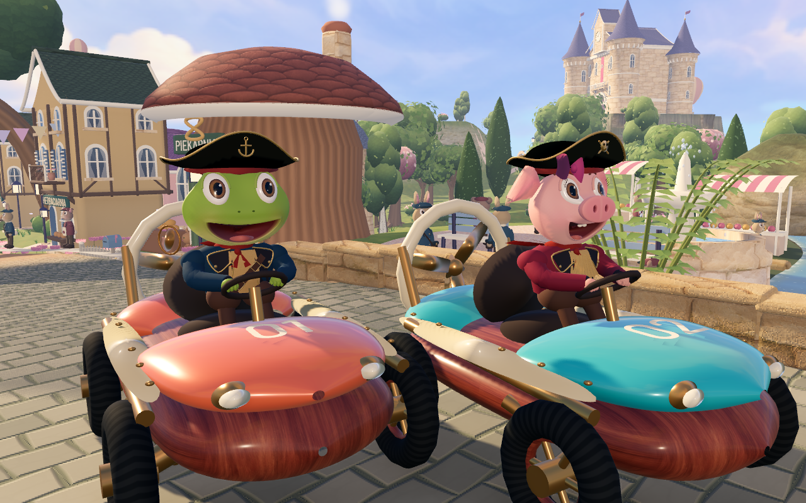
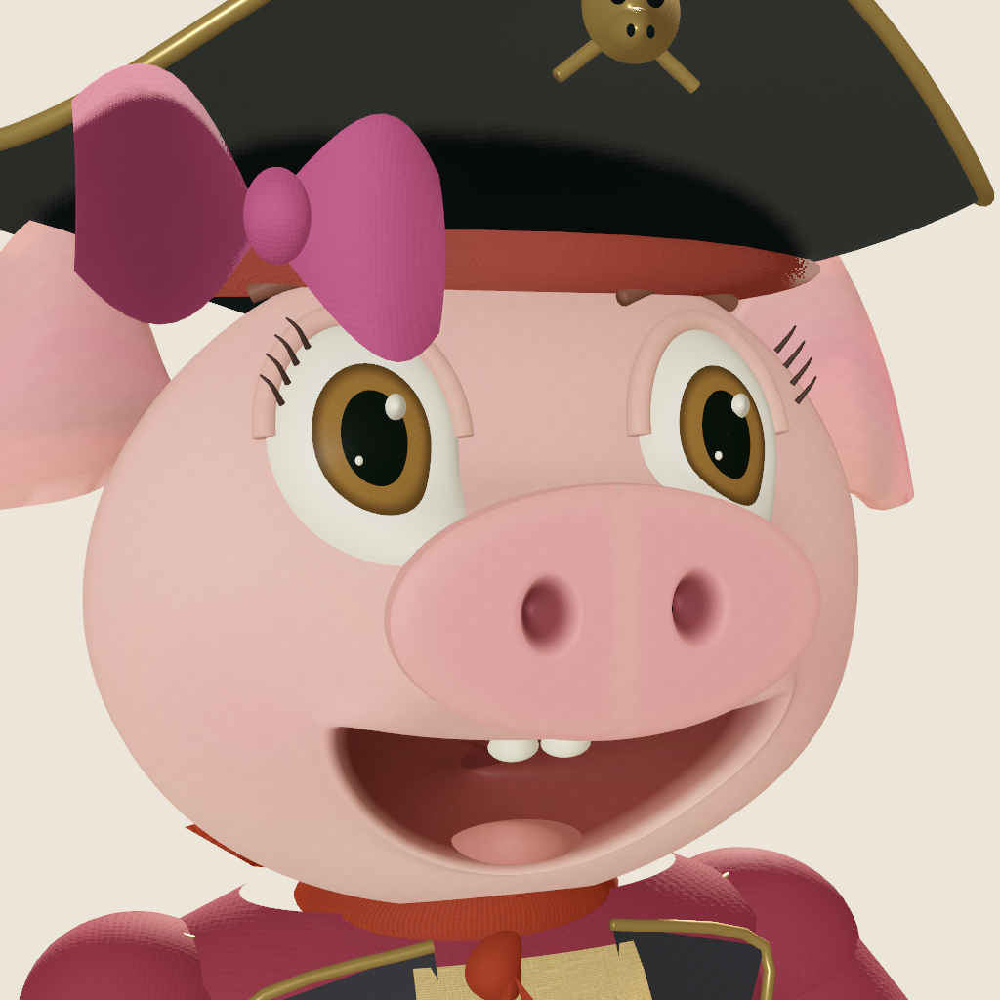
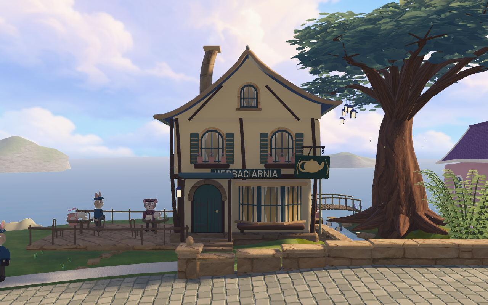

# Postacie — portrety 3D, etap v3

2026-11-17: przebudowane twarze i stroje Żabola oraz Świnki, a także królik i mysz z wioski. Obrazy poniżej pochodzą z natywnego renderera gry. Nie są ilustracjami koncepcyjnymi ani retuszowanymi wizualizacjami.

| Model | Poprzednia siatka | Nowa siatka |
|---|---|---|
| Żabol | [Przed](../screenshots/living_driver_zabol_threequarter.png) | [Teraz](screenshots/zabol_threequarter.png) |
| Świnka | [Przed](../screenshots/living_driver_swinka_threequarter.png) | [Teraz](screenshots/swinka_threequarter.png) |





## Zakres

Głowy mają jawne pierścienie geometrii wokół ust i ciągłe policzki. Zastąpiły wcześniejszą ekstrakcję powierzchni niejawnej, która dawała poszarpane wargi. Białka, brązowe tęczówki, źrenice i powieki przylegają do kształtu twarzy. Świnka ma osobny owalny ryjek z dwoma zagłębionymi nozdrzami, miękkie uszy o zamkniętej grubości i kokardę. Żabol zachowuje szeroką głowę, żuchwę i naturalne wyniosłości oczu.

Stroje mają dopasowane klapy, lamówki, guziki, mankiety i palce przy kierownicy. Żabol ma skórzany pas z otwartą złotą klamrą; Świnka kremowy żabot. Czarne filcowe kapelusze mają złote brzegi oraz kotwicę lub emblemat świnki. Żagiel przesunięto i zwężono, aby odsłonić kierowcę.

Królik i mysz dostały nowe ciągłe pyski, oczy i powieki, wąsy, ubrania, dłonie oraz buty. Królik nosi torbę listonosza, mysz fartuch. Zachowano rozmieszczenie mieszkańców i role. Koty, kaczki i mewy używają dotychczasowych modeli.



[Pełny opis modeli i liczby geometrii](../CHARACTERS.md). [Poprzednie modele](../CHARACTERS_BEFORE_PORTRAITS.md) i [referencje](../character-lookdev-v2/README.md) pozostają zachowane. Nowe modele wymagają oceny artystycznej użytkownika; testy nie potwierdzają idealnego podobieństwa do portretów.

## GPU

Sześć kości kierowcy: compute shader oblicza pozy, shader wierzchołków deformuje siatki. Żuchwa i oczy mają sztywną wagę głowy, więc nie zostają przy tułowiu podczas skrętu. Chusta ma dwa osobne przeguby. Mruganie i ruch powiek kierowców oraz nowych mieszkańców korzystają z zatrzymywanego zegara GPU. Tęczówki, drobna faktura skóry, filcu i tkanin są wyliczane w shaderze.

Nie ma aktualizacji twarzy przez CPU co klatkę, aktywnego Skeleton3D ani odczytu póz w grze. Modele i LOD powstają offline w narzędziach GDScript. Fizyka, AI, kamery i UI nadal działają na CPU. Mimika obejmuje stały uśmiech i mruganie; nie dodano animacji mowy.

## Sprawdzenie

- Nowy test modeli: 16 asercji PASS, w tym podążanie żuchwy za głową, zachowane części twarzy we wszystkich profilach, prawdziwe kieszenie nozdrzy i widoczność głowy za żaglem.
- Grafika PASS; otoczenie 271 PASS; żywa trasa 23 PASS; herbaciarnia 12 PASS; sesja 40 PASS.
- Sześć AI ukończyło trzy uporządkowane okrążenia przy kroku fizyki 1/60 s.
- GPU motion: 125 asercji PASS. GPU skin: sześć porównań obrazów PASS. GPU life: 11 asercji PASS, w tym widoczny ruch pięciu gatunków, mruganie, pauza i wznowienie.
- 12 natywnych ujęć modeli: przód, trzy czwarte, profil i twarz dwóch kierowców oraz dwie kamery królika i myszy. Dodatkowo pięć widoków z gry i siedem obrazów kontroli animacji.

Test GPU skin izoluje atlas póz i modele od całej sceny wyścigu. Zwalnianie ostatniego pomocniczego viewportu podczas klatki powodowało zawieszenie Iris Xe po poprawnych porównaniach. Zasoby zwalnia teraz zamknięcie SceneTree; powtórzony test zakończył się kodem 0. [Zachowane końcowe logi](TEST_LOGS.json), [SHA-256 źródeł, modeli i obrazów](ASSET_MANIFEST.json).

## Płynność

Windows, Godot 4.7.2, Vulkan / Forward+, Intel Iris Xe, 1280×800. Próby wykonywane kolejno, bez drugiej gry, bez VSync i limitu FPS. Przygotowanie grafiki, pierwsze dwie klatki oraz pięć sekund rozgrzewki są poza pomiarem; zapis PNG także. High mierzy około 40 s jazdy, pozostałe około 12 s. Krótszych prób i różnych profili nie należy traktować jako bezpośredniego porównania.

| Próba | Średnie FPS | p99, ms | Maksimum, ms |
|---|---:|---:|---:|
| High, pełne okrążenie, 1 widok | 24.90 | 52.60 | 58.55 |
| Balanced, krótka próba, 1 widok | 51.25 | 26.25 | 27.97 |
| Performance, 4 widoki | 36.75 | 34.49 | 37.03 |

Surowe JSON są w `docs/benchmarks/portraits_*.json`, wraz z liczbą próbek, rozdzielczością widoków i kompilacjami shaderów. Wyniki dotyczą tej Iris Xe i tych ustawień; nie potwierdzają stałych 60 FPS ani wydajności 1080p. [Pomiary poprzedniego etapu](../tea-bend/README.md) pozostają oddzielnie.

## Odtworzenie

```powershell
godot --headless --editor --single-threaded-scene --path . --import --quit
godot --headless --path . --script tools/portrait_character_builder.gd
godot --headless --path . --script tools/build_portrait_residents.gd
godot --headless --path . --script tests/test_portrait_assets.gd
godot --path . --script tools/review_portraits.gd
godot --path . --script tools/review_character_game.gd
godot --path . --script tests/test_gpu_skin.gd
godot --path . --script tests/test_gpu_life.gd
python tools/archive_portrait_review.py
```

Archiwizację należy wykonać po pełnym zestawie testów i trzech pomiarach z nazwami logów z narzędzia. Zwykła gra ładuje gotowe zasoby. Nie dodano nowych bitmap ani zewnętrznych modeli, nie wysyłano artworku do usług 3D. [Pochodzenie projektu](../PROVENANCE.md).
