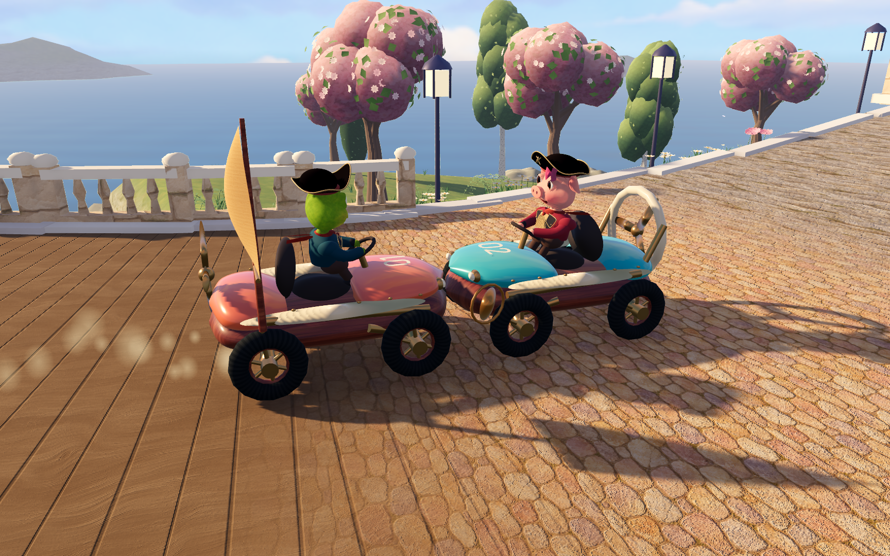
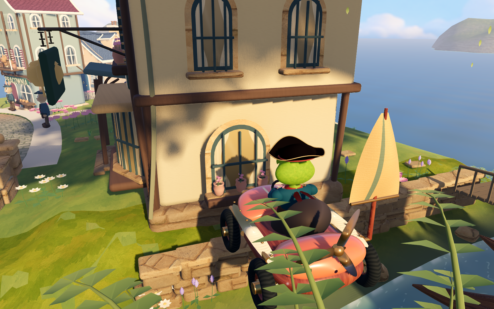

# Kolizje budynków, otoczenia i aut

2026-11-17. Wcześniejsze obrysy budynków służyły rozmieszczaniu roślin i zasłanianiu obrazu. Nie tworzyły fizycznych ścian. Ten przyrost dodaje **350 statycznych ciał**, korzystających z **39 współdzielonych siatek kolizji**. Istniejące dynamiczne podwozia Jolt zostały połączone z nową warstwą otoczenia. Nowy test sprawdza także zderzenie dwóch aut z aktywnym kontrolerem w rzeczywistej scenie wyścigu.

## Geometria

`IRWorldCollisions` wybiera stałe trójkąty istniejących modeli. Bryły powstają po ostatecznym filtrowaniu rozmieszczenia, przed przeliczeniem współrzędnych instancji renderowania. Herbaciarnia, wielki dąb, taras, mostek i brzegi strumienia korzystają z rzeczywistych transformacji obiektów sceny. Współdzielenie kształtów ogranicza powielanie danych między egzemplarzami tego samego modelu.

Fizyczne są domki, piekarnia, budynki miasteczka, przystań na palach, latarnia morska, zamek i wieże, wiatrak, dźwig, herbaciarnia, fundamenty, mury, płoty, bramy, grota, mostki, altany, fontanny, ławki, stragany, donice, latarnie, skrzynie, pnie drzew i większe skały. Liście, tkaniny, woda, poświaty oraz animowani mieszkańcy pozostają poza nową statyczną warstwą. Szyld i wirnik wiatraka zachowują animację GPU bez nieruchomej przeszkody w miejscu poruszającej się części.

Kształty zachowują otwory pod bramami, przejście groty i otwartą dolną kondygnację przystani. Użyto statycznych [`ConcavePolygonShape3D`](https://docs.godotengine.org/en/stable/classes/class_concavepolygonshape3d.html) z kolizjami obu stron trójkąta. Są to powierzchnie, nie wypełnione objętości całych budynków. Nie należy teleportować auta do wnętrza zamkniętej siatki i oczekiwać automatycznego wypchnięcia na zewnątrz.

| Element | Warstwa | Maska |
|---|---:|---:|
| Podwozie | 2 | 7: podłoże, auta, otoczenie |
| Nowe otoczenie | 4 | 2: auta |
| Sonda podparcia | — | 5: podłoże i otoczenie, bez aut |

Kontakt z górną powierzchnią skały, fundamentu lub mostku daje podparcie opon. Pionowa ściana ani dach innego auta nie daje przyczepności. Zmiana profilu grafiki i zasięgu renderowania nie usuwa fizycznych ciał. Jolt oblicza fizykę na CPU; dotychczasowe animacje, mimika, skórkowanie i cząsteczki pozostają na GPU.

## Sprawdzenie

Test `tests/test_world_collisions.gd` używa rzeczywistego świata gry. Obejmuje zgodność liczby budynków, 200 promieni wokół ich ścian, 576 sprawdzeń przestrzeni trzech pasów jezdni, 32 sprawdzenia środka skrótu, trzy profile grafiki, wspólny świat fizyki czterech kamer, zderzenie aut z aktywnym sterowaniem oraz uderzenie podwozia w ścianę herbaciarni. Promienie trafiają 186 ścian; pozostałe przechodzą przez rzeczywiste otwory. Każdy sprawdzany budynek musi dać co najmniej dwa trafienia ścian.

Próba aut odbywa się na jezdni, z kontrolerem napędu i przyczepności. Próba ściany używa rzeczywistego modelu herbaciarni; wyłącza grawitację i odzyskiwanie testowanego auta, aby oddzielić kontakt ze ścianą od podparcia przez teren. Żaden test nie rozpycha samochodów ręcznie.



[Przed zderzeniem](cars_before.png) · [Po odbiciu](cars_after.png)



[Podejście do ściany](building_before.png). To nieedytowane obrazy natywnego renderera Vulkan, zapisane w pełnym ekranie. Samochód w próbie budynku ma wyłączoną grawitację, zgodnie z opisem powyżej.

| Końcowa próba | Wynik |
|---|---|
| Ściany i aktywne auta, headless | 54 kontrole, PASS |
| Te same próby, natywny pełny ekran | 54 kontrole, PASS |
| Przestrzeń jezdni i skrótu | 608 sprawdzeń, zero zablokowanych pozycji |
| Rozstaw środków aut podczas zderzenia czołowego | minimum 3,226 m; brak przejazdu przez drugie auto |
| Największa względna prędkość odbicia aut | 3,521 m/s |
| Odległość środka podwozia od płaszczyzny ściany | minimum 1,600 m headless / 1,900 m natywnie |
| Fizyczny teren i pobocza | 1 461 kontroli, 576 promieni, PASS |
| Podwozia, pęd, tarcie i CCD | 35 kontroli, PASS |
| Sesja / reguły / świat | 42 / 139 / 23 kontrole, PASS |
| Integralność oprawy | PASS |
| Pełny wyścig | Sześć aut, trzy legalne okrążenia; ostatnie auto: 110,23 s symulacji |

Różnica położenia w próbie ściany wynika z dodatkowych klatek renderowania oraz wyboru wolnej strony podejścia. Obie wersje wymagają rzeczywistego kontaktu i dodatniego odstępu od ściany. [Wynik headless](headless_results.json), [wynik natywny](native_results.json), [podłoże](offroad_results.json), [podwozia](physics_results.json), [treści końcowych logów](TEST_LOGS.json), [SHA-256 źródeł, modeli i dowodów](ASSET_MANIFEST.json).

Pierwszy pełny wyścig wykrył klinowanie AI przy grocie. Kierowcy skracali ciasny łuk długim wektorem celowania. Obecnie śledzą bliższy punkt i ograniczają prędkość według krzywizny drogi oraz prędkości obrotowej podwozia. Nie wyłączono żadnej ściany ani zaliczania bramek. [Log próby przed poprawką](EXPLORATORY_LOGS.json) zachowuje wynik nieudanego przejazdu; końcowy test mieści się w niezmienionym limicie 240 s.

Test poboczy nadal porównuje fizyczną siatkę z widocznym terenem i wykonuje 576 promieni oraz 1 461 kontroli. Zrzucane auta muszą rzeczywiście dotknąć podłoża lub stałej przeszkody i pozostać nad terenem przez całą próbę. Kontakt jest rejestrowany w czasie próby, ponieważ samochód może następnie zsunąć się ze skały. Przejazd przez krawędzie odbywa się w lesie; pobliskie skały i pnie mają teraz rzeczywiste kolizje.

```powershell
godot --headless --path . --fixed-fps 60 --script tests/test_world_collisions.gd
godot --headless --path . --fixed-fps 60 --script tests/test_offroad_physics.gd
godot --headless --path . --fixed-fps 60 -- --race-test
godot --path . --fullscreen --fixed-fps 60 --script tools/review_world_collisions.gd
```

Ostatnie polecenie wykonuje te same próby fizyczne z obrazem natywnego renderera. `--fixed-fps 60` określa krok symulacji; nie jest wynikiem pomiaru wydajności. Nie wykonywano nowego benchmarku FPS. Wcześniejszy [raport podwozi i terenu](../collisions/README.md) dokumentuje poprzedni przyrost oraz ograniczenia CCD.
