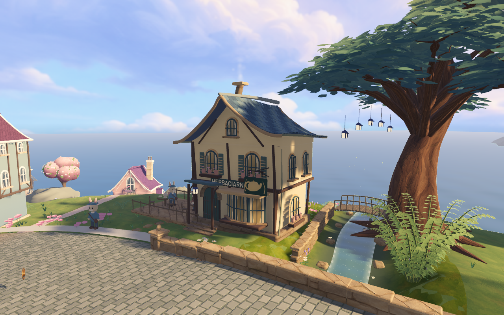
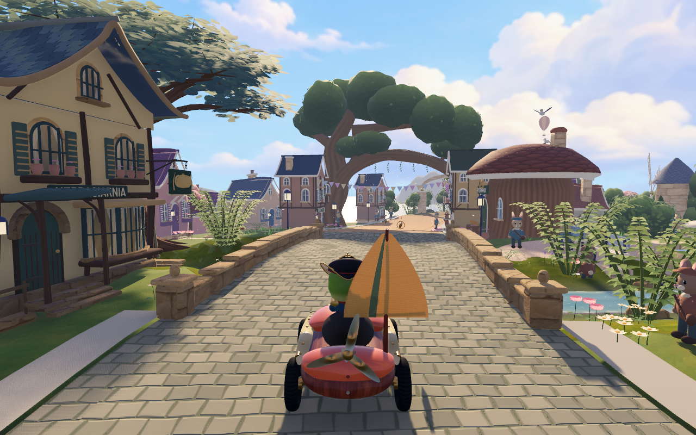
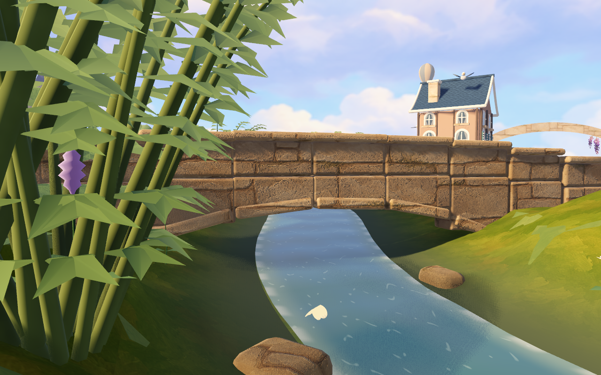

# Zakręt przy herbaciarni

Nowy fragment rzeczywistej trasy: herbaciarnia z giętym dachem i wykuszem, stary dąb, most drogowy, kładka, strumień oraz taras. **Run-teahouse.cmd** zapętla cztery ujęcia tego miejsca. **Esc** wraca do menu, **M** wycisza dźwięk. Zwykły objazd wyspy ma teraz 16 ujęć, a przygotowanie grafiki 20 widoków w trzech profilach.





## Geometria i materiały

Cztery osobne zapisane modele z LOD: herbaciarnia, dąb, taras i szyld. Herbaciarnia ma dachówki z grubością, zamknięte poddasze i podbicie dachu, trzyczęściowy wykusz, okna także od strumienia, okiennice, donice, drzwi z okuciami, gięty komin, rynny oraz szyld z dzbankiem na metalowym wsporniku. Taras ma stoliki, krzesła, dzbanki i filiżanki. [Liczby geometrii](../../assets/tea_bend/mesh_manifest.json).

Dąb ma wygięty pień, korzenie, 18 rozgałęzionych skupisk i 4 680 pojedynczych profilowanych liści. Kora używa nowego albedo 1254×1254 px z wbudowanego image_gen. Obraz zachowano w natywnym rozmiarze; nie jest oznaczany jako 2K/4K. [Dokładny prompt](BARK_PROMPT.txt), [plik tekstury](../../assets/textures/tea_ancient_bark_v1.png).

Droga zwęża się stopniowo do mostu. Dwa kamienne boki podążają za rzeczywistymi punktami i szerokością drogi; przęsło zostawia otwarty przepływ wody. Węższa drewniana kładka prowadzi w stronę drzewa. Strumień ma obniżone koryto w głównej siatce terenu i osobną, gęściej próbkowaną powierzchnię brzegów. Odpływ opada do morza; początek ukrywa skała źródła. Starsze domki, drzewa i ogrodzenia są wyłączone z rezerwowanego obszaru. Mieszkańcy stoją na tarasie i suchych brzegach; trzy kaczki przeniesiono do spokojnego odcinka potoku.



## GPU i pauza

Liście reagują na wiatr w shaderze wierzchołków. Szyld kołysze shader wokół punktu zawieszenia. Strumień ma przesuwający się nurt, pianę przy brzegach i drobne fale; normalne zachowują kierunek nachylonego odpływu. Ruch korzysta ze wspólnego zegara GPU, zatrzymywanego podczas pauzy. Para nad dzbankiem i kominem, spadające liście oraz drobne świetliki są GPUParticles3D.

Węzeł dzielnicy nie ma skryptu aktualizującego transformacje co klatkę. Fizyka samochodów, AI, kolizje, kamery, dźwięk i UI nadal działają na CPU. Geometria modeli i LOD powstaje offline; koryto terenu, instancje i statyczne elementy mostu są przygotowywane przy wczytaniu. Nie jest to generowanie wszystkich modeli przez GPU w czasie jazdy. Woda jest efektem dekoracyjnym, bez fizycznej symulacji płynu.

## Walidacja

- Reguły 133 PASS, otoczenie 271 PASS, grafika PASS, żywa trasa 23 PASS, nowy zakręt 12 PASS, sesja 40 PASS.
- Kontrola zakrętu: poprawne siatki i normalne, zwrot dachówek ku górze, brak przesuniętych części mostu, przejazd pod gałęziami, rozsądny spadek drogi, suche miejsca mieszkańców i minimum 1,185 m między środkiem strumienia a próbkowanym dnem.
- Pełny wyścig: sześć AI ukończyło po trzy legalne okrążenia, ostatni czas symulacji 105,50 s przy kroku 1/60 s.
- GPU motion 125 PASS; GPU skin sześć siatek PASS; GPU life 11 PASS, w tym siedem zapętlonych źródeł audio i jeden słuchacz.
- Nowy GPU test 9 PASS: widoczny ruch liści, szyldu i nurtu, dokładne zamrożenie ich obrazu, widoczna symulacja pary oraz produkcyjna pauza i wznowienie cząsteczek.
- 15 natywnych ujęć trasy i detali. Objazd całej wyspy: 16 ujęć; objazd herbaciarni: cztery; oba wracają Esc do aktywnego menu.

[Zachowane logi](TEST_LOGS.json) i [hashe plików](ASSET_MANIFEST.json). W teście GPU skin usunięto zbędne przywracanie ukrytego świata 3D na jedną klatkę przed zamknięciem. Wcześniej powodowało zawieszenie po poprawnym zakończeniu porównań; powtórzona próba zakończyła się kodem 0.

## Płynność

Windows, Godot 4.7.2, Vulkan / Forward+, Intel Iris Xe, okno 1280×800, bez VSync i limitu FPS. Wszystkie próby natywne wykonano kolejno, bez drugiej instancji gry. Odczyty obrazu i zapis PNG są poza pomiarem. Przygotowanie grafiki, pierwsze dwie klatki i pięć sekund rozgrzewki są wyłączone z pomiaru jazdy.

| Jazda | Średnie FPS | p99, ms | Maksimum, ms |
|---|---:|---:|---:|
| High, 1 widok, pełne okrążenie | 25.10 | 51.27 | 56.57 |
| Balanced, 1 widok, krótka próba | 54.46 | 24.84 | 26.87 |
| Balanced, 4 widoki | 26.51 | 49.62 | 51.88 |
| Performance, 4 widoki | 39.16 | 33.91 | 37.33 |

Pierwsza kontrola nowego objazdu wymagała 33,53 s przygotowania wariantów grafiki. Późniejsze próby jazdy z pamięcią podręczną: 2.76 s, 2.79 s, 3.06 s, 2.63 s. Liczniki kompilacji podczas pomiaru nadal są niezerowe; ich wartości zachowano w surowych JSON. To nie są próby całkowicie wolne od kompilacji w czasie jazdy.

Poniższa osobna próba izoluje koszt nowego miejsca: nieruchoma kamera, jeden nieruchomy widoczny pojazd w widoku drive, brak AI i fizyki pojazdów. To pomiar renderowania, nie FPS wyścigu. Każdy przypadek obejmuje dwie sekundy rozgrzewki i cztery sekundy pomiaru po przygotowaniu grafiki.

| Kamera | Profil | Średnie FPS | p99, ms |
|---|---|---:|---:|
| drive | high | 21.46 | 50.80 |
| drive | balanced | 49.19 | 24.26 |
| drive | performance | 80.49 | 15.87 |
| stream | high | 23.23 | 49.33 |
| stream | balanced | 60.95 | 20.22 |
| stream | performance | 90.99 | 14.86 |

[Surowe pomiary nieruchomych kamer](fixed_camera_benchmarks.json). Surowe próby jazdy są w docs/benchmarks z prefiksem tea_. Wyniki dotyczą tej Iris Xe i tych ustawień; nie potwierdzają stałych 60 FPS ani docelowej wydajności 1080p. Warstwa artystyczna i płynność pozostają do dalszej oceny.

## Odtworzenie

```powershell
godot --headless --editor --single-threaded-scene --path . --import --quit
godot --headless --path . --script tools/build_tea_assets.gd
godot --headless --path . --script tests/test_tea_bend.gd
godot --path . --script tests/test_tea_gpu.gd
godot --path . --script tools/review_tea_bend.gd
godot --path . --script tools/benchmark_tea_bend.gd
godot --path . -- --tea-tour
```

Gotowe modele i tekstura są w repozytorium. Zwykłe uruchomienie nie wykonuje budowania modeli offline. [Pochodzenie całej gry](../PROVENANCE.md), [poprzedni przyrost](../GRAPHICS_VALIDATION_LIVING.md).
